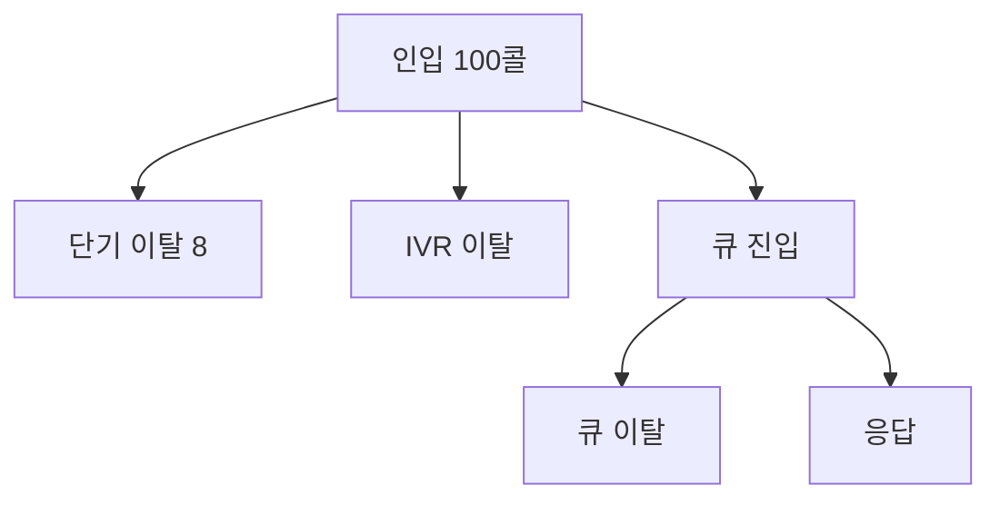
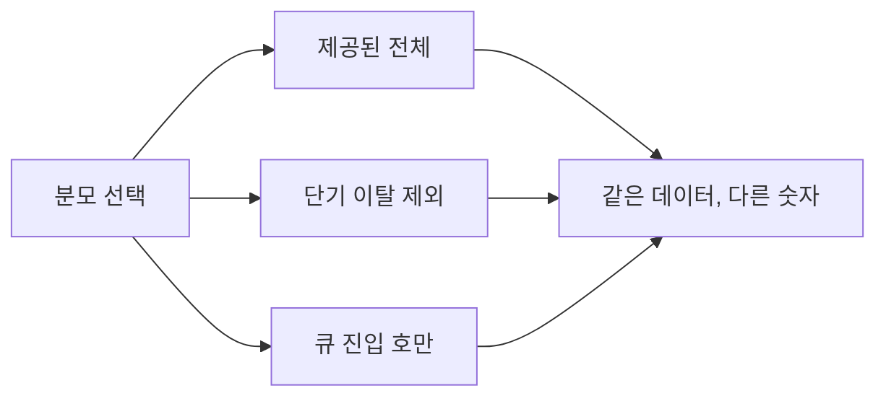

# 이탈률 분모

> 이탈률은 **무엇으로 나누느냐**(분모)에 따라 같은 데이터에서도 숫자가 크게 달라진다. 그래서 분모와 단기 이탈 기준을 항상 같이 적어야 한다.

## 쉽게 말하면
"합격률 30%"가 지원자 기준인지 응시자 기준인지에 따라 다르듯, 이탈률도 걸려 온 전화 전부로 나눌지, 실제 대기열에 들어간 호만으로 나눌지에 따라 달라진다.

## 자세히
(NICE 용어집과 Geckoboard KPI 문서를 직접 읽었다. 4.5%→9% 예는 지도의 [대기열 이탈률](#queue-abandonment) 글에서 가져온 계산이다.)
- **기본식(NICE)**: 이탈률 = 이탈 접촉 ÷ **제공된(offered) 전체 접촉** × 100. 문서는 다른 분모 선택은 다루지 않는다.
- **Geckoboard의 두 기본식**: ① 이탈 콜 ÷ 전체 인입 콜 ② (수신 − 응답) ÷ 수신. ②는 타임아웃 등 응답 안 된 호를 모두 세므로 보통 조금 더 높다. 예: 주 2,000콜 중 이탈 120 → **6%**.
- **단기 이탈 제외**: (이탈 − 단기 이탈) ÷ (인입 − 단기 이탈). NICE는 보통 5~10초 미만(오다이얼·셀프서비스로 곧장 끊음)을 제외한 값을 "조정 이탈률"이라 부르고, Geckoboard 예는 10초 기준. **제외하면 이탈률이 낮아진다.**
- **긴 이탈률(Geckoboard)**: 10초 이상 큐 이탈 ÷ (인입 − 단기 − IVR 이탈). 큐에서 기다린 사람만 보는 지표다.
- **벤치마크**: NICE는 음성에서 5~8% 초과를 서비스 수준 문제 신호로, 10% 초과를 심각으로 본다. Geckoboard는 약 5% 양호, 5~8% 일반, 10% 근접 높음. **측정 방식이 같을 때만 비교 가능.**
- **주의(Geckoboard)**: 이탈률이 낮아도 서비스가 좋다는 증거는 아니다. 기다리다 나중에 다시 건 고객은 지표에 안 잡히므로 FCR·CSAT와 함께 본다. 이탈 위치(IVR·큐·대기·음성사서함)를 나눠야 처방이 나온다.

## 그림으로 보기

## 예시
- 540 이탈: 12,000으로 나누면 4.5%, 6,000으로 나누면 9%([대기열 이탈률](#queue-abandonment)의 가상 계산).
- 보고서 문장: "이탈률 6.2% (분모: 인입 전체, 10초 미만 단기 이탈 제외)".

## 헷갈리는 것과 비교
| 지표 | 분모 | 용도 |
|---|---|---|
| 기본 이탈률 | 인입 전체 | 전체 손실 |
| 조정 이탈률 | 인입 − 단기 이탈 | 서비스로 인한 이탈 |
| 긴 이탈률 | 인입 − 단기 − IVR | 큐 대기 품질 |
| [콜백 옵션](#callback-option) | – | 이탈을 줄이는 수단 |

## 더 읽을거리
- [NICE — Abandonment rate](https://www.nice.com/glossary/abandonment-rate) — 기본식·조정 이탈률·벤치마크(직접 읽음).
- [Geckoboard — Call abandonment rate](https://www.geckoboard.com/best-practice/kpi-examples/call-abandonment-rate/) — 변형식·주의점(직접 읽음).
