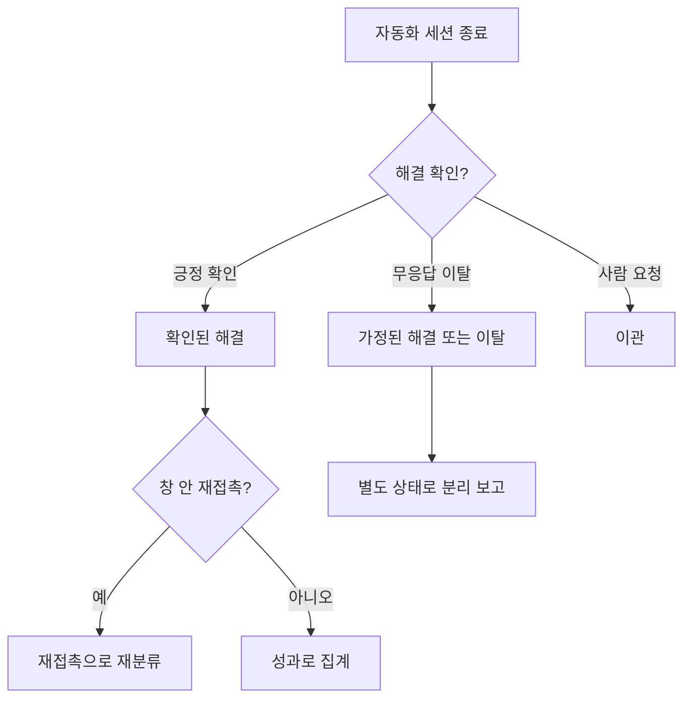

# 이탈과 해결의 구분

> 고객이 **문제가 풀려서 떠난 것(해결)**과 **포기하고 떠난 것(이탈)**을 같은 "성공"으로 세지 않는 원칙. 이관 없이 끝났다는 로그만으로는 둘을 구분할 수 없으므로 해결을 직접 확인하는 신호가 필요하다.

## 쉽게 말하면
식당에서 손님이 말없이 일어나 나갔다. 음식이 맛있었던 걸까, 너무 오래 걸려 화가 난 걸까? "나갔다"는 기록만으로는 알 수 없다. 만족을 확인하는 신호가 따로 있어야 한다.

## 자세히
출처: Cekura 블로그(컨테인먼트 글, 본문 확인), Metabase 지표 페이지(본문 확인), Intercom 해결 도움말(본문 확인), 2026-11-18. Cekura는 음성 AI 테스트 벤더이고 다수 수치가 인용 재인용이다.
- **문제**: 기본 컨테인먼트 정의에서는 포기하고 끊은 호출도 "사람에게 이관되지 않음"으로 성공이 된다. 포기한 사람, 틀린 답을 받아들인 사람, 완벽한 답을 받은 사람이 같은 로그 신호를 만든다([컨테인먼트율](#containment-rate)).
- **USPS 사례(Cekura 전달)**: 컨테인먼트 호출 다수가 고객이 끊은 것이었고, 감찰관실이 완결 호출과 이탈 호출을 분리 보고하라고 권고했다는 서술. 이는 글이 인용한 정부 감사 사례다(원 보고서 직접 확인 안 함).
- **네 가지 결말(Cekura 제안)**: 해결, 이관, 이탈, 재접촉으로 분류하고 해결만 성과로 센다. 이탈 판정 신호(제안): 답변 직후 무반응, 해결 확인 질문에 응답 없음, 같은 질문을 반복한 뒤 종료, 도중 종료.
- **해결 확인 신호(Metabase)**: 명시 신호("도움이 됐다", 봇 해결 확인)가 있고 같은 사용자가 72시간 안에 티켓을 만들지 않아야 해결로 인정. 조회나 단순 종료는 해결이 아니다([측정 창 72시간](#measurement-window)).
- **Intercom의 처리**: "고객이 확인"하면 확인된 해결, "더 요청 없이 이탈"하면 가정된 해결로 센다. 즉 이탈을 해결로 가정하는 구조이고 이 가정이 과금과 성과 수치를 부풀릴 수 있다는 비판이 있다([해결률](#resolution-rate)). 확인된 해결과 분리해 보고해야 한다.
- **재접촉 보정**: 해결로 센 뒤 같은 의도로 창(예: 24시간) 안에 다시 연락하면 재분류한다([재문의율](#reopened-as-ticket)).
- **운영 규칙(제안)**: ①이탈을 별도 상태로 기록 ②해결 확인 질문 설계("해결되셨나요?" 응답 수집) ③확인되지 않은 종료는 "가정된" 상태로 분리 ④원시 수치와 보정 수치를 병행 보고 ⑤의도별로 보고(집계가 큰 편차를 가림).
- **한계**: 확인 질문을 하면 응답률이 낮고 응답 편향이 생긴다. 이탈의 원인(불만 vs 단순 해결)은 로그만으로는 확정할 수 없다.

## 그림으로 보기

## 예시
- 세션 1,000건: 해결 확인 320, 이관 250, 무응답 종료 430(가상). 무응답 종료를 전부 성공으로 세면 컨테인먼트 75%, 확인된 해결만 보면 32%다. 둘을 나란히 보고한다.
- 교육 활용: 벤더 보고서에서 "이탈"이 어디에 포함되어 있는지 찾는 실습.

## 헷갈리는 것과 비교
| 개념 | 차이 |
|---|---|
| 이탈 | 포기하고 떠남 |
| 해결 | 문제가 풀렸고 확인됨 |
| [컨테인먼트율](#containment-rate) | 이관 없이 끝난 비율(이탈 포함 가능) |
| [재문의율](#reopened-as-ticket) | 해결 뒤 같은 주제로 다시 옴 |

## 더 읽을거리
- [Cekura: Containment rate](https://www.cekura.ai/blogs/containment-rate) — 이탈 문제와 네 결말 분류(벤더)
- [Metabase: Deflection rate](https://www.metabase.com/metrics/deflection-rate) — 명시 신호와 72시간 창
- [Intercom: Fin AI Agent resolutions](https://www.intercom.com/help/en/articles/8205718-fin-ai-agent-resolutions) — 확인된 해결과 가정된 해결
