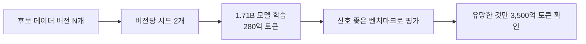
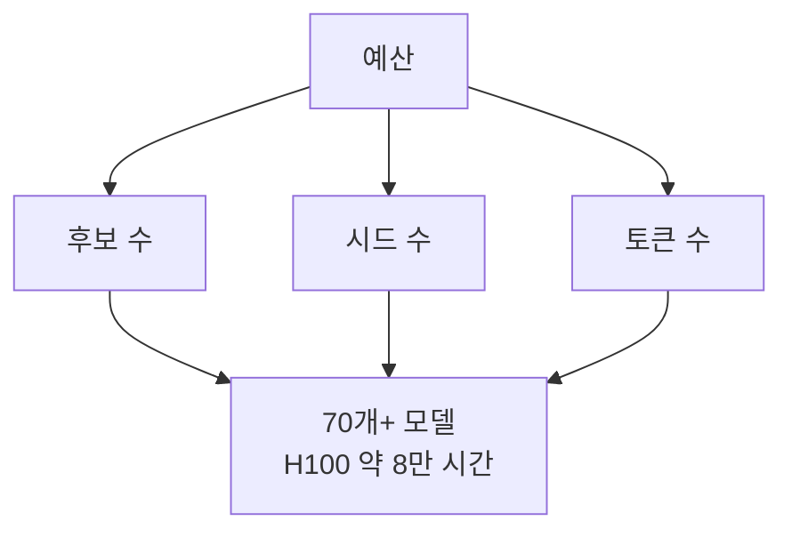

# ablation 연산 예산

> 데이터 파이프라인의 설계 선택을 비교하려고 **작은 모델을 여러 번 학습하는 데 드는 계산 비용**. FineWeb은 70개 넘는 모델에 H100 약 8만 GPU시간을 썼다.

## 쉽게 말하면
요리 대회 전에 레시피 후보 수십 개를 소량으로 시험 조리하는 비용이다. 본 요리(최종 대형 모델)보다 싸지만 후보가 많아지면 시험 조리만으로도 큰돈이 든다. 그래서 몇 가지 후보를, 몇 번씩, 얼마나 크게 시험할지 예산부터 정한다.

## 자세히
(FineWeb 논문, arXiv 2406.17557 PDF 본문 직접 읽음)
- **설정**: 비교할 데이터 버전마다 파라미터 수·구조·하이퍼파라미터가 같고 데이터만 다른 모델을 학습. 모두 **1.71B 파라미터** Llama 구조, 시퀀스 길이 2048, 글로벌 배치 약 200만 토큰, GPT2 토크나이저, nanotron 라이브러리.
- **데이터 크기**: 필터링 ablation은 **약 280억 토큰**(이 모델 크기의 Chinchilla 최적 크기쯤), 일부 중복 제거 ablation과 필터 단계별 누적 효과 확인은 **3,500억 토큰**.
- **총 예산**: 70개 넘는 모델, 추정 **H100 GPU시간 80,000**. 단순 평균으로 모델당 약 1,140GPU시간(280억·3,500억 토큰 실행이 섞인 평균이라 실제 개별 비용은 아님).
- **분류기 쪽 비용은 따로**: 교육 점수 분류기를 15조 토큰에 적용하는 데 H100 6,000시간(같은 논문).
- **예산을 아끼는 설계**: 같은 모델을 데이터 버전마다 두 시드로 학습해 평균([두 시드 평균](#two-seed-averaging)), 평가는 소규모에서도 신호가 잘 나오는 벤치마크로만 한정([벤치마크 선택](#benchmark-selection-small-scale)). 선택 기준은 ① 같은 데이터의 다른 무작위 표본으로 학습한 모델 간 점수 분산이 작을 것 ② 학습 중 점수가 (거의) 단조 증가할 것 ③ 이 크기 모델이 무작위 기준선을 넘길 것. 최종 8개 벤치마크는 CommonSenseQA, HellaSwag, OpenBookQA, PIQA, SIQA, WinoGrande, ARC, MMLU이고, 큰 벤치마크는 1,000문항으로 잘라 학습 도중 평가했다.
- 어림 계산(제안): 학습 FLOPs ≈ 6×파라미터×토큰으로 보면 280억 토큰 실행은 약 2.9×10²⁰, 3,500억 토큰은 약 3.6×10²¹ FLOPs로 약 12.5배 차이다. 큰 실행 하나가 작은 실행 12개 분량이므로, 어느 비교를 큰 규모로 확인할지가 예산의 대부분을 정한다.
- 교훈: 후보 수 × 시드 수 × 토큰 수가 예산이다. 분산이 큰 지표를 쓰면 시드를 더 늘려야 해서 비용이 커진다.

## 그림으로 보기

## 예시
| 항목 | 값(FineWeb 논문) |
|---|---|
| 모델 수 | 70개 이상 |
| 총 연산 | H100 약 80,000시간 |
| 모델 크기 | 1.71B 파라미터 |
| 필터링 실험 토큰 | 약 280억 |
| 중복 제거·누적 확인 | 3,500억 |
- 업무 장면: 자체 모델 파인튜닝 데이터 3종을 비교한다면 소규모 학습 3종×시드 2회로 시작해, 차이가 시드 흔들림보다 클 때만 큰 학습으로 확인한다.

## 헷갈리는 것과 비교
| 개념 | 차이 |
|---|---|
| ablation 연산 예산 | 작은 비교 실험 전체 비용 |
| 최종 모델 학습 비용 | 선택된 데이터로 큰 모델을 학습하는 비용. 별도 |
| [두 시드 평균](#two-seed-averaging) | 예산을 쓰는 방식 중 하나 |
| [시드 잡음 대 효과 크기](#seed-noise-vs-effect) | 얼마나 많이 돌려야 하는지의 근거 |

## 더 읽을거리
- [The FineWeb Datasets (arXiv 2406.17557)](https://arxiv.org/abs/2406.17557) — ablation 설정·8만 H100시간·벤치마크 선택 기준(PDF 본문 직접 읽음).
