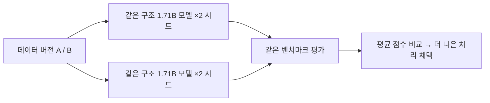
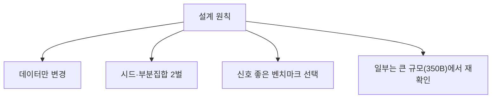

# 데이터 ablation 실험

> 모델 구조·학습 설정은 고정하고 **학습 데이터만** 바꿔 가며 작은 모델을 여러 개 학습해, 어떤 데이터 처리 단계(추출·필터·중복 제거)가 성능을 올리는지 비교하는 실험 방식이다.

## 쉽게 말하면
같은 레시피·같은 오븐으로 빵을 구우면서 밀가루만 바꿔 맛을 비교하는 것과 같다. 한 번에 하나만 바꿔야 어느 재료 덕분인지 알 수 있다. 작은 빵(작은 모델)으로 먼저 시험하고, 확실한 것만 큰 빵(대규모 학습)에 쓴다.

## 자세히
(FineWeb 논문 arXiv 2406.17557 PDF 본문 3.1절과 부록 E.2를 직접 내려받아 확인.)
- **설계(FineWeb)**: 데이터 버전만 다르고 **파라미터 수·구조·하이퍼파라미터·학습 토큰 수가 같은** 모델을 비교한다. 파이프라인 단계마다 이전 단계까지의 처리만 포함한 기준 모델을 둔다(반복적 데이터셋 구축).
- **모델 크기**: ablation 모델은 모두 **1.71B 파라미터**(임베딩 포함), Llama 구조, 시퀀스 길이 2048, 글로벌 배치 약 200만 토큰, GPT2 토크나이저. 학습은 nanotron, 평가는 lighteval.
- **토큰 수**: 필터링 ablation은 약 **280억 토큰**(이 모델 크기의 친칠라 최적 규모에 가까움), 일부 중복 제거 ablation과 누적 개선 확인은 **3,500억 토큰**. 총 **70개 이상 모델**, 추정 **H100 8만 GPU 시간**.
- **잡음 줄이기**: 데이터 버전마다 서로 다른 무작위 부분집합과 서로 다른 초기화 시드로 **모델 2개**를 학습해 평균 점수를 비교.
- **벤치마크 선택 기준**: 작은 규모에서도 신호가 좋도록 ① 같은 데이터의 다른 무작위 표본으로 학습해도 점수 변동이 작고 ② 학습 중 점수가 단조(거의 단조) 증가하며 ③ 이 크기 모델이 무작위 기준 이상인 벤치마크. 선택: CommonSense QA, HellaSwag, OpenBook QA, PIQA, SIQA, WinoGrande, ARC, MMLU(큰 벤치마크는 1,000문항으로 절삭).
- **함정(부록 E.2)**: 중복 제거의 효과는 280억 토큰 같은 작은 조각에서는 보이지 않을 수 있고, 스냅샷 간 재크롤된 URL 때문에 스냅샷 간 중복 제거에는 특수한 효과가 있다. 그래서 중복 제거 일부는 3,500억 토큰에서 확인했고, 결과가 작은 규모에서 큰 규모로 이어진다고 가정하지 않았다([스냅샷별 vs 전역 중복 제거](#per-snapshot-vs-global-dedup)).
- 결과는 코드(datatrove)와 ablation 모델을 공개해 재현 가능([datatrove](#datatrove)).
- 한계(제안): 1.7B 규모에서의 결과가 수백B 모델에도 그대로 간다는 보장은 없다. 벤치마크 자체의 오염·라벨 오류([벤치마크 라벨 노이즈](#label-noise-benchmarks))도 결론을 흔든다.

## 그림으로 보기

## 예시
- 사내 문서 코퍼스로 소형 모델을 파인튜닝할 때: 같은 모델·하이퍼파라미터로 "중복 제거 전/후", "필터 A/B"만 바꿔 학습하고 동일 질문 세트로 비교(제안, 규모는 훨씬 작게).
- 교육 활용: 실험 설계 교육의 "한 번에 하나만 바꾸기" 사례.

## 헷갈리는 것과 비교
| 개념 | 차이 |
|---|---|
| 데이터 ablation | 데이터 처리만 바꿔 비교 |
| 모델 ablation | 구조 요소를 하나씩 제거해 비교 |
| A/B 테스트 | 실제 사용자 대상 운영 실험 |
| [교육 품질 분류기](#educational-quality-classifier) | ablation으로 임계값 3을 고른 사례 |

## 더 읽을거리
- [The FineWeb Datasets (arXiv 2406.17557)](https://arxiv.org/abs/2406.17557) — 실험 설정·벤치마크 선택·부록 E.2(PDF 본문 확인).
