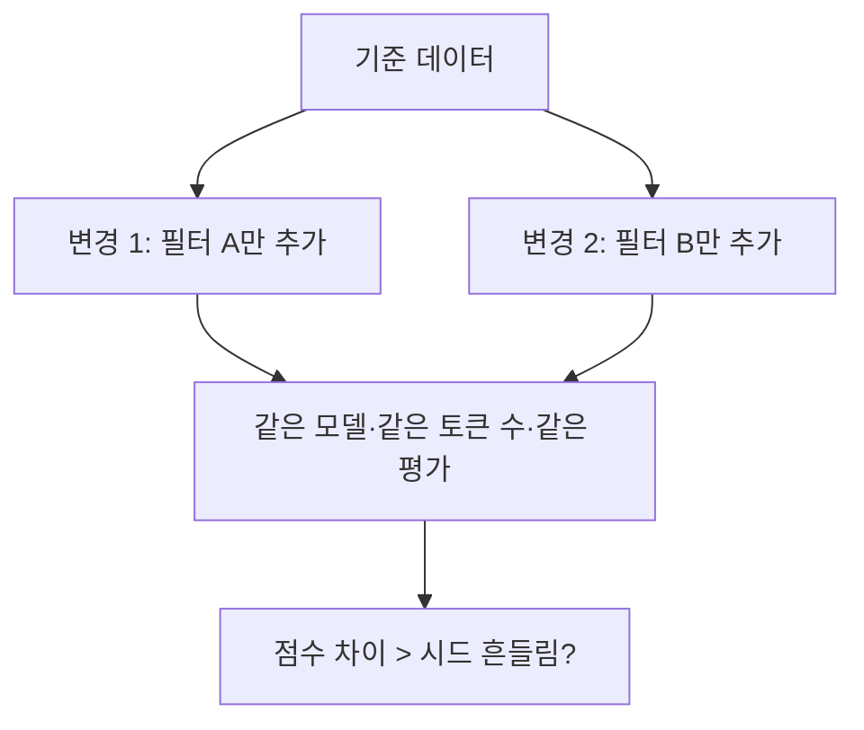

# ablation 실험 설계

> 데이터 처리 방식 하나의 효과를 알려면 **그것 하나만 바꾸고 나머지(모델·토큰 수·시드 처리·평가)는 모두 고정**해 비교한다. FineWeb의 실험 설계가 대표 사례다.

## 쉽게 말하면
케이크 레시피에서 설탕 양의 효과를 알고 싶다면 설탕만 바꾸고 오븐 온도·밀가루·굽는 시간은 똑같이 해야 한다. 두 가지를 동시에 바꾸면 맛이 달라진 이유를 모른다.

## 자세히
(FineWeb 논문 arXiv 2406.17557 3절을 PDF에서 직접 읽음)
- **통제 변수**: 비교할 모델은 "데이터만 다르고 파라미터 수·구조·하이퍼파라미터가 같으며, 각 데이터 버전에서 **같은 양의 무작위 토큰**으로 학습"한다. 같은 실험 안에서는 모든 모델이 같은 데이터양·같은 스텝 수로 학습한다.
- **구체 설정**: 1.71B 파라미터 Llama 구조, 시퀀스 길이 2048, 글로벌 배치 약 200만 토큰, GPT2 토크나이저, nanotron으로 학습. 필터링 실험 약 280억 토큰, 일부 중복 제거와 누적 효과 확인은 3,500억 토큰.
- **잡음 통제**: 버전마다 서로 다른 무작위 부분집합 + 서로 다른 시드로 모델 2개를 학습해 평균([두 시드 평균](#two-seed-averaging), [데이터 표본 잡음](#data-subset-noise)).
- **평가 고정**: lighteval로 같은 벤치마크 세트(CommonSenseQA, HellaSwag, OpenBookQA, PIQA, SIQA, WinoGrande, ARC, MMLU)를, 큰 벤치마크는 1,000문항으로 절단해 평가. 선택 기준은 무작위 표본 간 분산이 작고, 학습 중 점수가 단조에 가깝게 오르며, 무작위 기준선 위일 것([소규모 ablation 벤치마크 선택](#benchmark-selection-small-scale)).
- **한 번에 하나만 바꾸기의 예외**: FineWeb은 필터를 하나씩 추가하며 **누적 효과**를 따로 확인했다(3,500억 토큰). 이 경우 "단계별로 하나씩 추가"가 설계다.
- **체크리스트(제안)**: ① 바꾸는 변수 1개 명시 ② 고정 항목 목록(모델·토큰·시드 규칙·평가) ③ 반복 횟수와 잡음 추정 ④ 사전에 정한 채택 기준(차이 > 시드 흔들림) ⑤ 결과·설정 공개. FineWeb은 모든 ablation 모델을 공개했다고 밝힌다.
- 한계: 설계가 같아도 소규모 결과가 큰 규모로 이어지는지는 별개다([단계별 규모 검증](#staged-validation)).

## 그림으로 보기

## 예시
| 항목 | 고정/변경 |
|---|---|
| 모델·하이퍼파라미터 | 고정 |
| 학습 토큰 수 | 고정(280억) |
| 시드·데이터 표본 | 버전마다 2개씩 다르게 |
| 데이터 처리 방식 | 변경(실험 변수) |
- 업무 장면: 사내 문서 정제 방식을 비교한다면 같은 모델·같은 학습 스텝으로 정제 방식만 바꿔 세 번 반복하고, 사전에 정한 평가 문항으로 비교한다.

## 헷갈리는 것과 비교
| 개념 | 차이 |
|---|---|
| ablation | 요소 하나씩 바꿔 효과 측정 |
| [Chinchilla 최적 학습량 ablation](#chinchilla-optimal-ablation) | 학습량을 정하는 기준 |
| [ablation 연산 예산](#ablation-compute-budget) | 설계에 따른 총비용 |
| [lighteval 백엔드 선택](#lighteval-backends) | 평가 설정 고정 방법 |

## 더 읽을거리
- [The FineWeb Datasets (arXiv 2406.17557)](https://arxiv.org/abs/2406.17557) — ablation 설정(PDF 직접 읽음).
