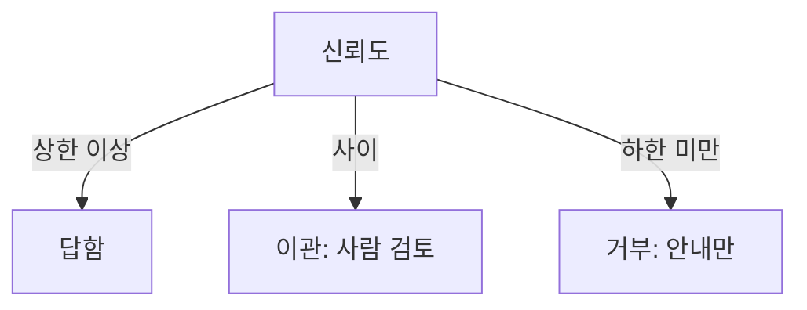

# 거부 vs 이관

> **거부(abstain)**는 모델 능력 밖이라 사람이 봐도 달라지지 않는 질의에서 답을 하지 않는 것이고, **이관(escalate)**은 아슬아슬한 경우에 사람의 짧은 검토로 맞는 답을 얻는 것이다.

## 쉽게 말하면
의사가 "이건 내 전문 밖이라 다른 병원에 가 보세요"(거부)와 "애매하니 선배 선생님께 같이 볼게요"(이관)는 다른 대응이다.

## 자세히
(Tian Pan의 "two-threshold problem" 블로그(2026-04-27)를 직접 읽었다. 개인 블로그이며 수치는 글의 예시다.)
- **세 구간(글)**: 상한 임계값 위에서는 모델이 직접 답하고, **두 임계값 사이**는 사람 검토, **하한 아래**에서는 모델이 답을 거절하고 안내한다.
- **거부(글)**: 모델 능력 밖이라 검토자 시간이 결과를 바꾸지 못하는 영역. 글은 이 영역에서 "침묵보다 가치 있는 답은 없다"고 쓴다.
- **이관(글)**: 짧은 사람 검토로 사용자가 가치 있게 여길 정답이 나오는 **근접 실패**. 예: 신뢰도 0.65인 질의를 단일 임계값 0.7은 0.4인 질의와 똑같이 취급.
- **측정 방식이 다름(글)**: 두 영역은 **escalation yield**(검토가 모델 초안보다 나은 비율)와 **recovery rate**로 서로 다르게 잰다.
- **주의(글)**: 말로 표현한 신뢰도는 90~100%에 몰린다(예: 표현 91%, 정확도 39%). 약 **5회 샘플의 일치도**가 더 믿을 만한 신호로 제안되지만 비용이 5배.
- **참고(해석)**: 거부 비율이 25%이면 "틀리는 신뢰 비용은 지면서 이득은 없다"는 글의 경고.

## 그림으로 보기

## 예시
- 챗봇: 0.9 이상 자동 답변, 0.5~0.9 상담원 이관, 0.5 미만 "처리할 수 없습니다 + 대안 안내"(제안).

## 헷갈리는 것과 비교
| 개념 | 차이 |
|---|---|
| 거부 | 답 안 함, 사람이 봐도 무의미한 경우 |
| 이관 | 사람 검토로 정답 회수 |
| [이중 임계값 정책](#double-threshold-policy) | 두 개념을 구간으로 나눈 설계 |

## 더 읽을거리
- [Tian Pan — The two-threshold problem](https://tianpan.co/blog/2026/04/27/two-threshold-problem-confidence-gated-ai) — 직접 읽음.
