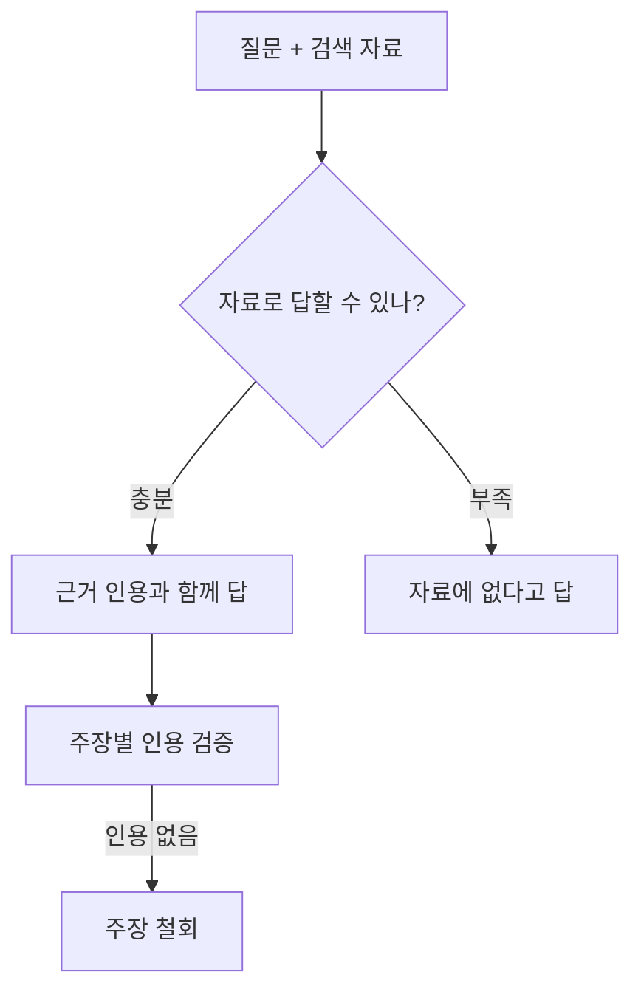
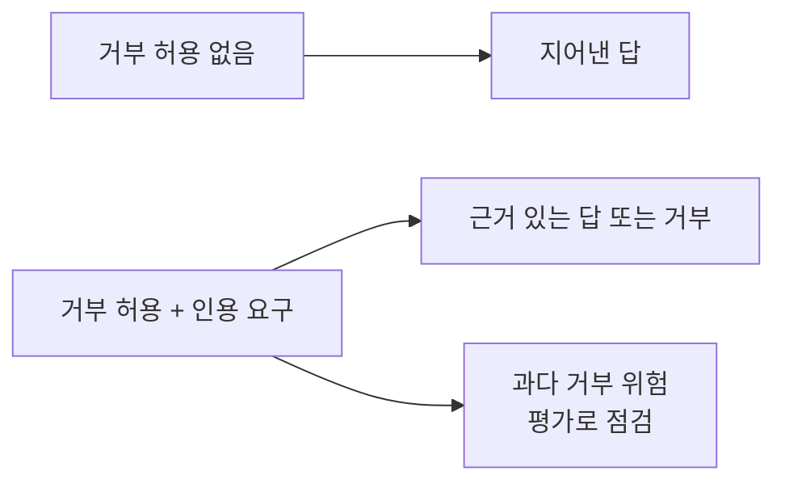

# 근거 없으면 거부

> 근거 없으면 거부는 검색해 온 자료에 답이 없을 때 지어내지 않고 "자료에 없어서 답할 수 없다"고 말하게 하는 설계다. 프롬프트로 허용·유도하고, 필요하면 근거 충분성 판정이나 재순위 점수로 보강한다.

## 쉽게 말하면
시험에서 "모르면 비워 두면 감점이 없다"고 하면 아는 것만 쓰지만, 비우면 0점이라고 하면 아무거나 쓴다. AI도 모른다고 말해도 되는 환경이 있어야 지어내지 않는다. 다만 너무 겁이 많아 아는 것까지 비우면 쓸모가 없다.

## 자세히
- **프롬프트 수준(Anthropic Reduce hallucinations 문서, 2026-11 열람)**: "모르겠다"고 말할 권한을 명시하면 허위 정보가 크게 줄 수 있다고 한다. 예: 보고서에 정보가 없으면 "확신 있게 평가할 만한 정보가 없습니다"라고 답하게 지시. 같은 문서는 긴 문서(2만 토큰 초과)에서 먼저 원문 인용을 뽑게 하고, 인용을 못 찾으면 "관련 인용 없음"으로 답하게 하며, 답한 뒤 각 주장마다 뒷받침 인용을 찾고 못 찾으면 주장을 철회하게 하는 방법을 소개한다. 제공 문서만 쓰고 일반 지식은 쓰지 말라고 명시하는 방법도 있다. 문서는 이 기법으로 크게 줄지만 없애지는 못한다고 경고한다.
- **왜 어려운가(Sufficient Context, arXiv 2411.06037, 초록 열람)**: Gemini 1.5 Pro·GPT-4o·Claude 3.5 같은 큰 모델은 문맥이 충분하면 잘하지만 충분하지 않을 때 거부하는 대신 틀린 답을 내는 경우가 많았다. 작은 모델(Mistral 3, Gemma 2)은 문맥이 충분해도 환각하거나 거부했다. 저자는 문맥 충분성 분류를 이용한 선택적 생성으로 응답 중 정답 비율을 Gemini·GPT·Gemma에서 2~10% 올렸다고 보고한다.
- **과다 거부**: 관련 없는 문서만 있을 때도 답할 수 있는 질문을 거부하는 경향을 다룬 연구와, 오해를 부르는 문맥에서 프롬프트 기반 거부가 무너진다는 통제 연구도 있다(검색 요약만 확인, 본문 미열람).
- **평가 함정**: 거부 평가는 정답 가능 여부 라벨이 부정확하면 왜곡된다는 지적이 있다(검색 요약).
- **조합**: [재순위](#reranking-for-rag) 점수가 모두 낮으면 거부 응답으로 가고, 답을 쓴 뒤 [근거 인용구 접지](#supporting-quote-grounding)로 검증하는 흐름이 실무 조합이다(해석).

## 그림으로 보기

## 예시
- 인사 규정 챗봇 프롬프트: "아래 규정에서 근거 문장을 먼저 인용하라. 찾지 못하면 '규정에서 확인되지 않습니다. 인사팀에 문의하세요'라고만 답하라."
- 평가: 답이 없는 질문 30개를 섞어 거부율과, 답이 있는 질문의 과다 거부율을 둘 다 잰다.

## 헷갈리는 것과 비교
| 개념 | 차이 |
| --- | --- |
| [방해 문서](#distractor-documents) | 거부가 필요한 상황을 만드는 원인 |
| [RAG 재순위](#reranking-for-rag) | 방해 문서를 걸러 거부 판단 신호도 제공 |
| 안전 거부(위험 요청 거절) | 정책상 거절. 여기는 근거가 없어서 모른다고 하는 것 |

## 더 읽을거리
- [Anthropic: Reduce hallucinations](https://platform.claude.com/docs/en/test-and-evaluate/strengthen-guardrails/reduce-hallucinations) — 모른다 허용·인용·철회 기법
- [Sufficient Context (arXiv 2411.06037)](https://arxiv.org/abs/2411.06037) — 충분 문맥과 선택적 생성
