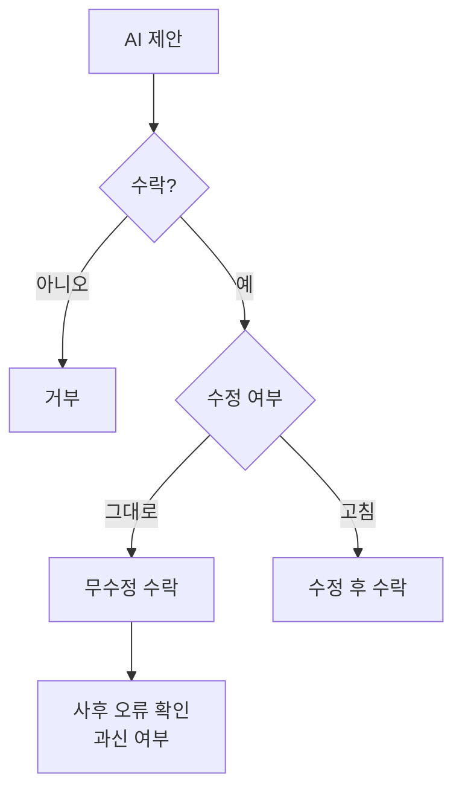

# 무수정 수락률

> AI 제안을 받아들인 건 중 사용자가 고치지 않고 그대로 쓴 비율. 지나치게 높으면 검토가 형식적이라는(과신) 신호일 수 있고, 낮으면 제안 품질 문제일 수 있어 해석이 필요하다.

## 쉽게 말하면
상사가 팀원 보고서를 읽지 않고 결재하는 비율을 세는 지표다. 100%에 가깝다면 정말 완벽해서일 수도, 안 읽어서일 수도 있다.

## 자세히
- **정의**: 무수정 수락률 = 수락한 제안 중 수정 없이 확정된 건수 / 수락한 건수. 수락 자체는 [제안 수락률](#suggestion-acceptance-rate)이 본다.
- **근거 연구(Ziegler 외, arXiv 2205.06537, 초록 확인)**: GitHub Copilot 사용자의 생산성 인식을 직접 측정 데이터와 비교한 결과, **제안이 수락되는 비율**이 생산성 인식을 가장 잘 설명했고, 완성 코드가 시간이 지나도 남는 정도(지속성) 같은 더 세부 지표는 그 역할을 하지 않았다. 수락률은 "느낌"을 반영하는 지표이고 품질을 직접 재는 것은 아니라는 뜻이다.
- **해석(일반 요령)**: ① 높음 + 사후 오류 많음 → 과신 ② 높음 + 오류 적음 → 제안 품질 양호 ③ 낮음 + 수정 큼 → 제안이 업무에 맞지 않음. 수치 단독 판단 금지, 사후 오류·재작업과 함께 본다.
- **함정**: 수정 없이 승인하는 습관이 생기면 [자동화 안주](#automation-complacency)가 된다. 오류 삽입 테스트로 검수 주의를 점검할 수 있다.
- **측정 주의**: 공백·표현 차이 같은 미세 수정을 수정으로 셀지 정해야 한다([편집 거리](#edit-distance-metric)).

## 그림으로 보기

## 예시
- 상담 요약 제안: 수락 80% 중 무수정 90%인데 월간 감사에서 누락 오류 12% → 검토가 형식적이라 판단하고 "원문 확인" 단계 추가.
- 코드 제안: 무수정 수락 코드의 7일 내 롤백·수정 비율을 함께 본다([수락 후 수정률](#post-acceptance-edit-rate)).

## 헷갈리는 것과 비교
| 개념 | 차이 |
|---|---|
| 수락률 | 제안을 받아들인 비율 |
| 무수정 수락률 | 수락 중 고치지 않은 비율 |
| 수락 후 수정률 | 수락 뒤 나중에 고친 비율 |

## 더 읽을거리
- [Productivity Assessment of Neural Code Completion](https://arxiv.org/abs/2205.06537) — 수락률과 생산성 인식(초록 확인)
