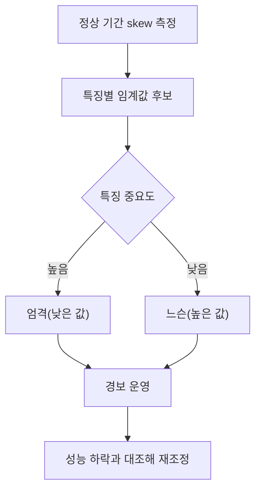
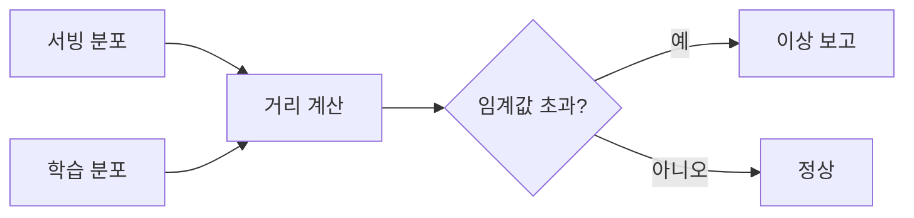

# 허용 편향 기준 정하기

> 학습 데이터와 서빙 데이터의 차이(skew)가 **얼마까지면 괜찮고 어디부터 경보인지** 정하는 임계값 설계다. 보편적인 정답은 없고, 특징의 중요도와 모델 성능이 견딜 수 있는 변동에 맞춰 직접 조정한다.

## 쉽게 말하면
체중계 오차가 100g이면 사람 몸무게를 재는 데는 문제없지만 약 조제에는 치명적이다. 같은 차이도 용도에 따라 허용치가 다르다. 중요한 특징은 촘촘하게, 영향이 작은 특징은 느슨하게 기준을 잡는다.

## 자세히
(TFDV 시작 가이드와 BigQuery ML 문서를 직접 열어 확인했다.)
- **TFDV 방식**: 스키마의 특징에 `skew_comparator`(학습 vs 서빙)나 `drift_comparator`(어제 학습 vs 오늘 학습)를 달고 임계값을 정한다. 문서 예: `payment_type`의 `infinity_norm.threshold = 0.01`로 두면 서빙에서 `Cash` 비율이 늘어 L-infinity 거리가 0.0435984가 됐을 때 "임계값 0.01 초과" 이상으로 보고된다. L-infinity는 **범주형만** 감지하고, 숫자·범주형 모두 보려면 `jensen_shannon_divergence` 임계값을 쓴다.
- **BigQuery ML `ML.TFDV_VALIDATE`**: 범주형·숫자형 기본 임계값이 모두 0.3(범위 [0,1)), 열별로 덮어쓸 수 있다. 0.3은 **제품 기본값이지 일반 기준이 아니다**.
- **임계값 선택(일반 원칙 + 커뮤니티 의견)**: 출발점은 기본값이지만, 정상으로 알려진 기간의 트래픽에서 skew를 먼저 재고 그 기준선으로 특징별 값을 정한다. 중요한 특징은 낮게(엄격), 영향이 작은 특징은 높게. 임계값을 "모델 성능이 견딜 수 있는 변동"과 연결한다. 이 조언은 deeplearning.ai 커뮤니티 글에서 왔고 공식 문서로 확인하지 못했다.
- **외부 관행(참고)**: 한 오픈소스 모니터링 라이브러리가 PSI 경고 0.1·심각 0.25, KS 0.1·0.2를 기본으로 쓴다는 정도의 제3자 기본값이 있다(검색 결과, 구글·TFDV 권고 아님).
- **알림 피로**: 너무 엄격하면 경보가 쏟아져 무시되고, 너무 느슨하면 놓친다. 경보 후 실제 성능 하락과의 상관을 기록해 임계값을 주기적으로 재조정한다.
- **서비스 위험 연결**: 의료·금융처럼 오류 비용이 큰 서비스는 낮게, 추천처럼 가벼운 서비스는 높게 두는 식으로 위험에 맞춘다.

## 그림으로 보기

## 예시
- `payment_type` 특징: 임계 0.01로 시작, 일주일 정상 트래픽에서 0.008~0.02가 관측되면 0.03으로 올려 오경보를 줄임(예시 수치).
- 교육 소재: "알람 기준을 너무 낮게 잡으면 어떻게 될까?"를 화재경보기 비유로.

## 헷갈리는 것과 비교
| 개념 | 차이 |
|---|---|
| 허용 편향 기준 | 경보 임계값을 정하는 일 |
| [학습-서빙 특징 일관성 점검](#feature-consistency-check) | 점검을 수행하는 방법 |
| [보류 vs 다음 날 비교](#holdout-vs-next-day) | 성능 격차로 skew를 보는 단계 |
| [skew 임계값 조정](#skew-threshold-tuning) | 같은 주제의 세부 조정 |

## 더 읽을거리
- [TFDV 시작하기: skew·drift 검사](https://www.tensorflow.org/tfx/data_validation/get_started) — skew_comparator·임계값 예제(직접 확인).
- [ML.TFDV_VALIDATE (BigQuery)](https://docs.cloud.google.com/bigquery/docs/reference/standard-sql/bigqueryml-syntax-tfdv-validate) — 기본 임계값 0.3과 지표.
- [임계값 설정 토론 (deeplearning.ai 커뮤니티)](https://community.deeplearning.ai/t/how-to-properly-set-jensen-shannon-divergence-infinity-norm-to-leverage-tfdv-drift-skew-check-features/118566) — 검색 요약만 확인, 본문 미확인.
