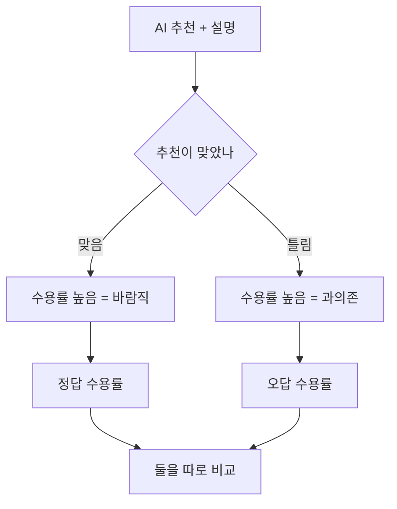
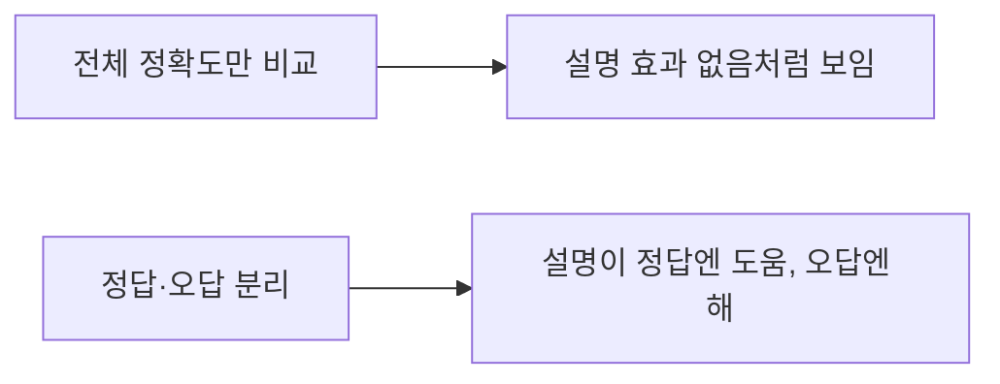

# 정답·오답별 수용률

> AI 추천을 사용자가 받아들인 비율을 "AI가 맞았을 때"와 "틀렸을 때"로 나눠 따로 재는 방법. 전체 평균 정확도만 보면 설명의 효과가 묻히거나 과장된다. 설명이 추천 수용을 늘려도 그 증가가 정답에서만 일어나는지 오답에서도 일어나는지가 핵심이다.

## 쉽게 말하면
"학생들이 선생님 말을 90% 믿는다"는 숫자만으로는 좋은지 나쁜지 모른다. 선생님이 맞을 때 믿는 것과 틀릴 때까지 믿는 것은 전혀 다르다. 그래서 수용률을 정답 사례와 오답 사례로 쪼개서 본다. 좋은 설계는 정답에서 높고 오답에서 낮아야 한다.

## 자세히
출처: Bansal 외 CHI 2021(arXiv 2006.14779) §5, 논의(본문 직접 읽음). 크라우드 워커 실험(조건당 약 100명)이며 현업 전문가에 그대로 적용할 수 없다.
- **왜 나눠야 하나**: 전체 정확도 비교에서는 신뢰도만 보여 준 조건(Team Conf)과 설명을 보여 준 조건(Explain-Top-1 등)이 유의한 차이가 없었다(Beer 0.89 vs 0.88). 그러나 **AI가 맞았는지 틀렸는지로 나누면** 효과가 갈린다(논문 Figure 4B).
- **Explain-Top-1**: 최상위 예측만 설명하면 AI가 맞았을 때 정확도가 더 높았고 **AI가 틀렸을 때는 더 낮았다**(Beer, LSAT). 논문은 사람의 설명이 듣는 사람을 설득해 설명이 틀려도 동의하게 만든다는 심리학 연구, 설명 때문에 데이터 과학자가 모델을 과신했다는 연구와 일치한다고 해석한다. 이 연구는 이를 주관적 신뢰 평가가 아닌 종단 간 의사결정 성과로 대규모 확인한 것이라고 주장한다.
- **Explain-Top-2**(상위 두 후보를 설명): 파일럿에서 AI가 틀릴 때 Top-1보다 유리, 맞을 때는 그렇지 않았다. 설명 효과가 정답 여부와 상관이 있다는 관찰이다.
- **적응형 설명**: 확신도가 임계값(Beer 89.2%, Amzbook 88.9%, 중앙값 기준) 미만일 때만 Top-2를 보여 주는 방식. 인간-AI **일치율(agreement)** 을 확신도 구간별로 보면 AI가 불확실할 때 사람의 맹목적 일치를 줄였다(Figure 5). 그러나 **최종 팀 정확도는 유의하게 오르지 않았다.** 이유(저자 추측): 확신이 높은데 틀리는 "모르는 오류(unknown unknowns)"를 찾아야 하고, AI가 불확실한 사례는 사람이 직접 풀어야 하기 때문.
- **측정 방법 제안(이 글의 정리)**: 평가 로그에서 (a) AI 정답 사례의 수용률 (b) AI 오답 사례의 수용률 (c) 확신도 구간별 수용률 (d) 사람 혼자 대비 이득을 따로 낸다. 오답 사례가 부족하면 일부러 섞은 검증 문항을 쓴다([함정 사례 포착률](#trap-case-kpi)).
- **저자의 우려**: 설명이 전문가를 달래서 AI에 더 순응하게 만들 수 있으면 의료처럼 사람의 확인이 필수인 영역에서 윤리적으로 우려된다고 논문이 말한다.

## 그림으로 보기

## 예시
- 심사 AI 로그: 정답 사례 수용률 92%, 오답 사례 수용률 85%라면 설명이 오답도 거의 걸러 내지 못한다는 신호(가상 수치).
- 설명 기능을 켠 그룹과 끈 그룹에서 오답 사례의 수용률이 어떻게 다른지 A/B 테스트(제안).

## 헷갈리는 것과 비교
| 개념 | 차이 |
|---|---|
| 정답 수용률 | AI가 맞을 때 따른 비율. 높을수록 좋음 |
| 오답 수용률 = 과의존 | AI가 틀릴 때 따른 비율. 낮을수록 좋음 |
| 일치율(agreement) | 사람 최종 결정과 AI 추천이 같은 비율 |
| [설명이 과신을 부르는 문제](#explanations-overreliance) | 이 측정으로 드러나는 현상 |

## 더 읽을거리
- [Does the Whole Exceed its Parts? (arXiv 2006.14779)](https://arxiv.org/abs/2006.14779) — §5 결과와 논의(본문 직접 읽음)
