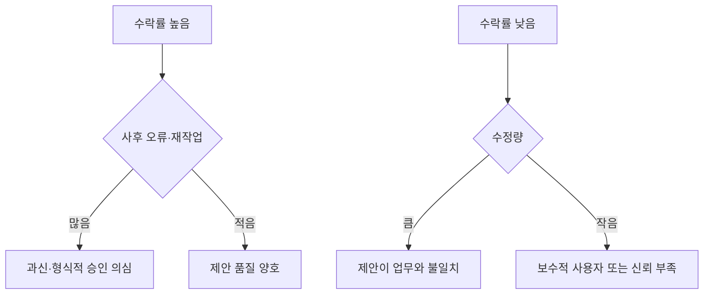

# 수락률과 품질의 관계

> AI 제안 **수락률이 높다고 제안의 품질이 좋은 것은 아니다.** 수락률은 사용자가 느끼는 유용함이나 신뢰를 반영하고, 품질은 사후 오류·재작업으로 따로 확인해야 한다는 점을 정리한 노드.

## 쉽게 말하면
결재 문서에 도장이 많이 찍혔다고 해서 문서가 좋다는 뜻은 아니다. 바빠서, 믿어서, 귀찮아서 찍었을 수도 있다. 품질은 나중에 문제가 생겼는지로 확인해야 한다.

## 자세히
출처: Ziegler 외 arXiv 2205.06537 초록(확인), JAMIA 리뷰가 서술한 Parasuraman·Manzey(2010) 요약(PMC3240751 본문 확인, 원 논문 초록은 열지 못함), 2026-11-18. 표본 수 같은 세부 수치는 열람한 부분에 없다.
- **수락률이 설명하는 것**: GitHub Copilot 사용자 연구에서 제안이 수락되는 비율이 개발자가 느끼는 생산성을 가장 잘 설명했고, 수락된 코드가 시간이 지나도 남는 정도(지속성)는 그렇지 않았다고 초록은 말한다. 수락률은 "느낌"의 지표로 읽힌다.
- **수락과 신뢰**: 자동화 편향 연구는 사람이 자동 제안에 주의를 덜 배분해 틀린 조언도 따르는 현상을 다룬다. 틀린 조언을 따르는 것은 작위 오류(commission error), 자동화가 알려 주지 않은 문제를 놓치는 것은 누락 오류(omission error)다([자동화 편향](#automation-bias)).
- **신뢰도 역설**: 자동화가 매우 높지만 완벽하지는 않은 신뢰도일 때 안주(complacency)가 커지고, 신뢰도가 낮으면 오히려 모니터링이 나아질 수 있다는 서술이 있다(리뷰 요약).
- **교육·설계**: 훈련은 안주 감소와는 비교적 뚜렷하게, 자동화 편향과는 덜 분명하게 연관된다는 서술. 자동화 신뢰도를 일정하게 두지 않는 적응형 업무 할당이 경계를 높였다는 보고. 제안의 두드러짐을 낮추는 설계가 자동화 편향 완화 근거로 언급된다.
- **품질을 재는 방법(제안)**: 수락 건의 사후 오류율, 재작업·되돌림 비율, 오류 삽입 테스트에서의 발견율([오류 삽입 테스트](#seeded-error-testing)), 전문가 표본 검수. 수락률과 이 지표를 같은 표에 둔다.
- **해석 틀(제안)**: 수락률↑·사후 오류↑ → 과신, 수락률↑·사후 오류↓ → 품질 양호, 수락률↓·수정↑ → 제안이 업무와 안 맞음.
- **한계**: 위 연구는 코드 제안(Copilot)과 일반 인간공학 문헌이며, 문서 작성·상담 요약 등 다른 업무에서 같은 크기로 성립한다는 근거는 이 조사에서 확인하지 못했다.

## 그림으로 보기

## 예시
- 상담 요약 도구 수락률 95%, 한 달 뒤 고객 재문의가 늘고 분쟁 건이 증가 → 수락률이 품질이 아니라 신뢰·습관을 반영했을 가능성. 오류 삽입 테스트로 검수 주의를 점검.
- 교육 활용: "AI 도입 성공 지표로 수락률만 보고하는 대시보드"의 문제점을 지적하는 실습.

## 헷갈리는 것과 비교
| 개념 | 차이 |
|---|---|
| 수락률 | 제안을 받아들인 비율(인식) |
| [무수정 수락률](#accept-without-edit-rate) | 수정 없이 확정한 비율 |
| 품질(사후 오류) | 결과가 실제로 맞았는지 |
| [자동화 편향](#automation-bias) | 틀린 제안을 따르게 만드는 심리적 요인 |

## 더 읽을거리
- [Ziegler 외 arXiv 2205.06537](https://arxiv.org/abs/2205.06537) — Copilot 수락률과 생산성 인식
- [JAMIA 리뷰(PMC3240751)](https://pmc.ncbi.nlm.nih.gov/articles/PMC3240751) — 자동화 편향·안주 정리(Parasuraman·Manzey 인용)
