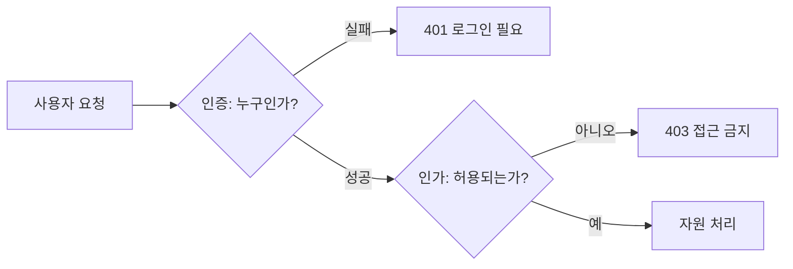
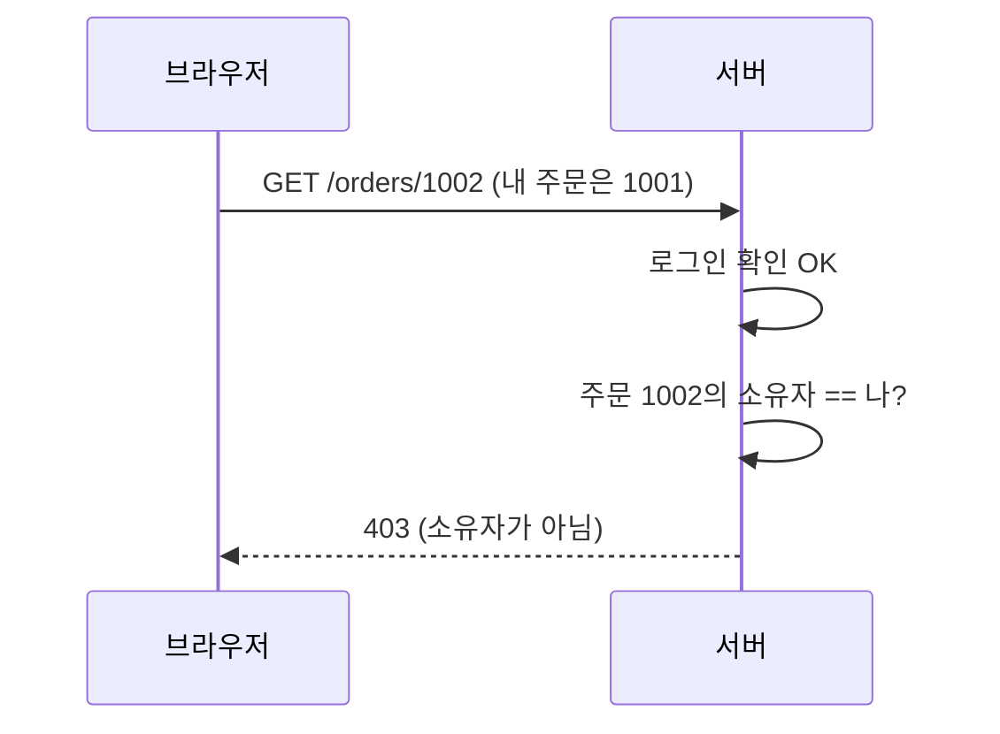

# 인증과 인가

> 인증(Authentication)은 "당신이 누구인지" 확인하는 것, 인가(Authorization)는 "그 사람이 이 일을 해도 되는지" 판단하는 것이다. 둘은 다른 단계이고, 둘 다 서버에서 검사해야 한다.

## 쉽게 말하면
호텔 체크인을 떠올리면 된다. 신분증을 보여 주고 본인임을 확인받는 게 인증, 받은 카드키가 내 객실 문만 열리는 게 인가다. 로그인했다고 해서 모든 방에 들어갈 수 있으면 안 된다. 바이브코딩으로 만든 앱에서 가장 흔한 사고가 "로그인은 있는데 권한 검사가 없는" 경우다.

## 자세히
- **인증 수단**(MDN 기준): 비밀번호, 일회용 코드(OTP), 외부 신원 제공자 로그인(구글 로그인 같은 federated identity), 패스키(기기가 서버의 질문에 개인키로 서명), 그리고 로그인 뒤 상태를 유지하는 세션 쿠키·JWT.
- **인가**: 인증된 사용자에게 역할(role)·소유권에 따라 허용 범위를 정하는 일. 예: 일반 사용자는 자기 글만 수정, 관리자는 전체 삭제.
- **OWASP Top 10:2021 1위가 Broken Access Control**이다. 대표 사례는 URL의 계정 번호만 바꿔 남의 정보를 보는 것(IDOR), 관리자 페이지 주소를 직접 입력하는 것(forced browsing), 인가 검사가 없는 POST/PUT/DELETE API 호출, 토큰 변조 등이다.
- **예방 원칙**: 공개 자원 외에는 기본 거부(deny by default), 검사는 신뢰할 수 있는 서버 코드에 한 번 만들어 재사용, 레코드 소유자 확인, 실패 로그와 경보, API 속도 제한, 로그아웃 시 서버 세션 무효화, JWT는 짧은 수명, 접근 제어 테스트 작성.
- 화면에서 버튼을 숨기는 것은 인가가 아니다. 요청 자체를 서버가 막아야 한다.

## 그림으로 보기

## 예시
- AI에게 코드를 시킬 때: "모든 API에서 로그인 확인과 별도로, 요청한 레코드의 소유자가 현재 사용자인지 검사해 줘. 기본은 거부로."
- 점검: 사용자 A로 로그인해 내 글 주소의 번호를 바꿔 B의 글에 접근해 본다. 열리면 인가 버그다.

## 헷갈리는 것과 비교
| 개념 | 차이 |
| --- | --- |
| 인증 | 누구인지 확인(로그인) |
| 인가 | 무엇을 해도 되는지(권한) |
| 401 vs 403 | 401은 인증 안 됨, 403은 인증됐지만 권한 없음 |
| [바이브코딩 안전](#vibecoding-safety) | 인가 누락이 AI 생성 앱의 대표 허점 |

## 더 읽을거리
- [MDN: Authentication](https://developer.mozilla.org/en-US/docs/Web/Security/Authentication) — 인증 수단 정리
- [OWASP Top 10:2021 A01 Broken Access Control](https://top10.owasp.org/2021/A01_2021-Broken_Access_Control) — 사례와 예방
