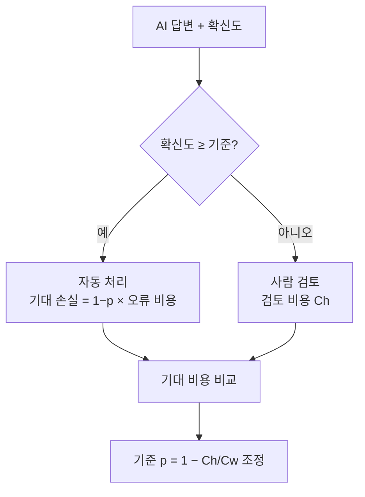
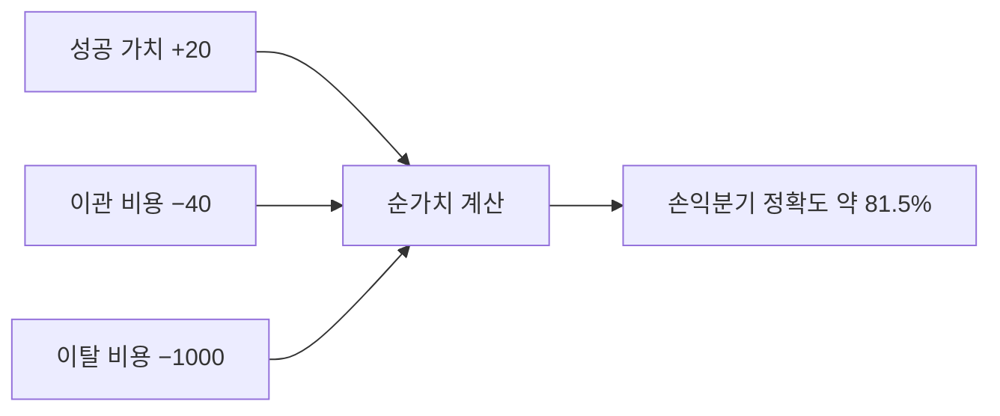

# 목표 정확도의 경제성

> "정확도 몇 %면 충분한가"를 감이 아니라 성공의 가치와 실패 비용을 곱해 손익분기점으로 정하는 방법.

## 쉽게 말하면
배달 앱 챗봇이 100번 중 몇 번을 맞혀야 도입할 만할까? 맞히면 상담원 비용 20달러가 절약되지만, 틀려서 고객이 떠나면 1,000달러를 잃는다. 이득과 손실을 저울에 올려 균형이 맞는 지점이 최소 목표 정확도다. 그 지점은 모델 점수가 아니라 **업무의 돈 계산**에서 나온다.

## 자세히
- **OpenAI 가이드의 고객 서비스 예(날짜 미표기)**: 성공 +$20, 불필요한 사람 이관 −$40, 실패 후 이탈 −$1,000(실패의 5%). 1,000건 중 815건 성공(81.5%)이면 순이익이 약 +$20으로 손익분기다.
- **사람 검토로 넘길지 판단**: 모델이 맞을 확률 p, 틀린 자동 처리 비용 Cw, 사람 검토 비용 Ch라면 `(1−p)×Cw < Ch`, 즉 `p > 1 − Ch/Cw`일 때 자동화가 싸다. 검토 1, 오류 5이면 기준은 p > 0.80(한 블로그의 가상 수치).
- 전제: 확률이 **보정(calibration)**돼 있고, 검토하면 항상 정답이 된다고 가정한다. 비용 추정이 조금만 바뀌어도 결론이 뒤집히는지 민감도를 확인한다.
- 정확도 하나가 아니라 **확신도 구간별 라우팅**이 실무 해법: 확신 높으면 자동, 낮으면 되묻기·재시도·사람 이관.
- 주의: 위 수치는 설명용 예시이고 실제 비용(재작업·평판·규제)은 추정이 어렵다.

## 그림으로 보기

## 예시
- 송장 처리: 검토 20달러, 오류 500달러면 오류율을 4% 아래로 두어야 검토 없이 자동 처리해도 손해가 없다(블로그 사례, 설명용).
- 챗봇 도입 보고: "정확도 90%"가 아니라 "건당 순가치 +x원, 정확도 하락 시 손익분기 y%"로 보고한다.

## 헷갈리는 것과 비교
| 개념 | 차이 |
| --- | --- |
| 벤치마크 점수 | 모델 일반 능력, 내 업무의 돈과 무관 |
| [자체 구축 vs 구매](#build-vs-buy-ai) | 이 노드는 그 선택에 필요한 목표치를 계산 |
| 신뢰도 보정 | 확률이 실제와 맞는지, 이 노드의 전제 조건 |

## 더 읽을거리
- [OpenAI: Optimizing LLM Accuracy](https://developers.openai.com/api/docs/guides/optimizing-llm-accuracy) — 81.5% 손익분기 예시
- [Digital Applied: When Human Review Costs Less Than a Wrong AI Decision](https://www.digitalapplied.com/blog/ai-triage-human-review-cost) — p > 1−Ch/Cw 공식
- [Scale AI: Which work is worth routing to a human?](https://scale.com/blog/hitl-routing) — 정확도만으로 사람 개입 기준을 못 정한다는 논지(검색 결과 요약만 확인)
