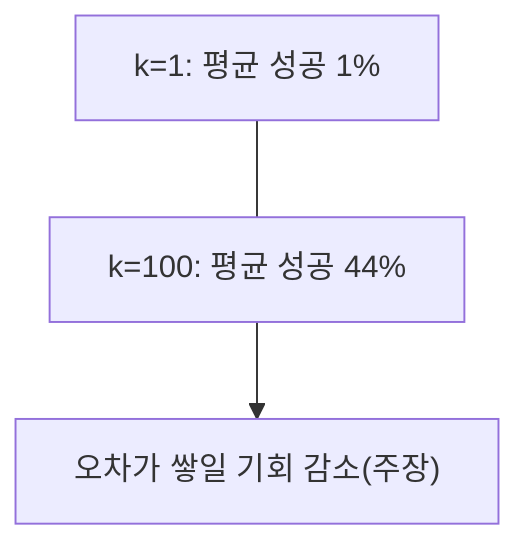

# 행동 묶음 예측

> 정책이 한 스텝의 행동이 아니라 **앞으로 여러 스텝의 행동을 한꺼번에(chunk)** 예측하게 하는 방식. 판단 횟수를 줄여 유효 시야(horizon)를 짧게 하고 [오차 누적](#compounding-error)을 줄이려는 시도다.

## 쉽게 말하면
길을 한 걸음마다 다시 판단하는 대신 "다음 90걸음은 이 경로"라고 한 번에 계획하는 것이다. 판단 횟수가 줄면 판단 실수가 쌓이는 기회도 줄어든다.

## 자세히
(ALOHA 프로젝트 페이지 열람 기준, [ALOHA와 ACT](#aloha-act)와 같은 출처.)
- ACT는 표준 행동 복제처럼 한 번에 한 행동을 예측하지 않고 **행동 시퀀스(chunk)**를 예측한다. 저자들은 이것이 **유효 시야를 줄여 오차 누적을 줄인다**고 말한다(저자 주장).
- 설정: 50Hz 관절 위치 출력, 에피소드 600~1,000스텝. chunk 크기는 프로젝트 페이지 요약에서는 90, 논문 PDF 하이퍼파라미터 표(직접 확인)에는 **100**. 100스텝 묶음이면 에피소드당 묶음 교체가 약 6~10번(내 계산: 600/100=6, 1,000/100=10).
- **논문 ablation(본문 직접 읽음)**: 4개 설정 평균 성공률이 chunk 크기 k=1(묶음 없음)에서 **1%**, **k=100에서 44%**, 이후 k=200·400(거의 개방 루프)에서는 약간 하락한다. 논문은 묶음이 많고 유효 시야가 낮을수록 대체로 성능이 좋다고 해석하고, 너무 긴 k의 하락은 반응성 부족과 긴 시퀀스 모델링의 어려움 때문이라 설명한다.
- 이론 배경: 행동 복제의 오차 상한 T²ε에서 **T가 실효적으로 줄면** 상한이 줄어든다는 해석이 가능하다(내 해석, Ross 논문의 정리를 묶음 예측에 적용해 증명한 것은 아님).
- 부드러움 문제: 묶음 경계에서 움직임이 끊길 수 있어 겹치는 예측을 가중 평균하는 [시간 앙상블](#temporal-ensembling)이 쓰인다(ACT 논문 본문 확인).
- 한계: 묶음 안에서는 새 관찰에 반응하지 못한다(일반 논평). 환경이 급변하면 불리할 수 있다.

## 그림으로 보기

## 예시
- 50Hz로 100스텝은 2초 분량의 팔 궤적을 한 번에 출력.
- 교육: 매 스텝 재판단과 묶음 실행의 차이를 걷기 예시로 설명.

## 헷갈리는 것과 비교
| 개념 | 차이 |
|---|---|
| 행동 묶음 예측 | 여러 스텝을 한 번에 |
| 단일 스텝 정책 | 매 스텝 판단 |
| [DAgger](#dagger-algorithm) | 데이터를 보강해 분포 불일치를 줄임 |

## 더 읽을거리
- [ALOHA 프로젝트 페이지](https://tonyzhaozh.github.io/aloha/) — ACT 설정(읽음).
- [DAgger 논문](https://arxiv.org/abs/1011.0686) — 오차 상한(본문 읽음).
