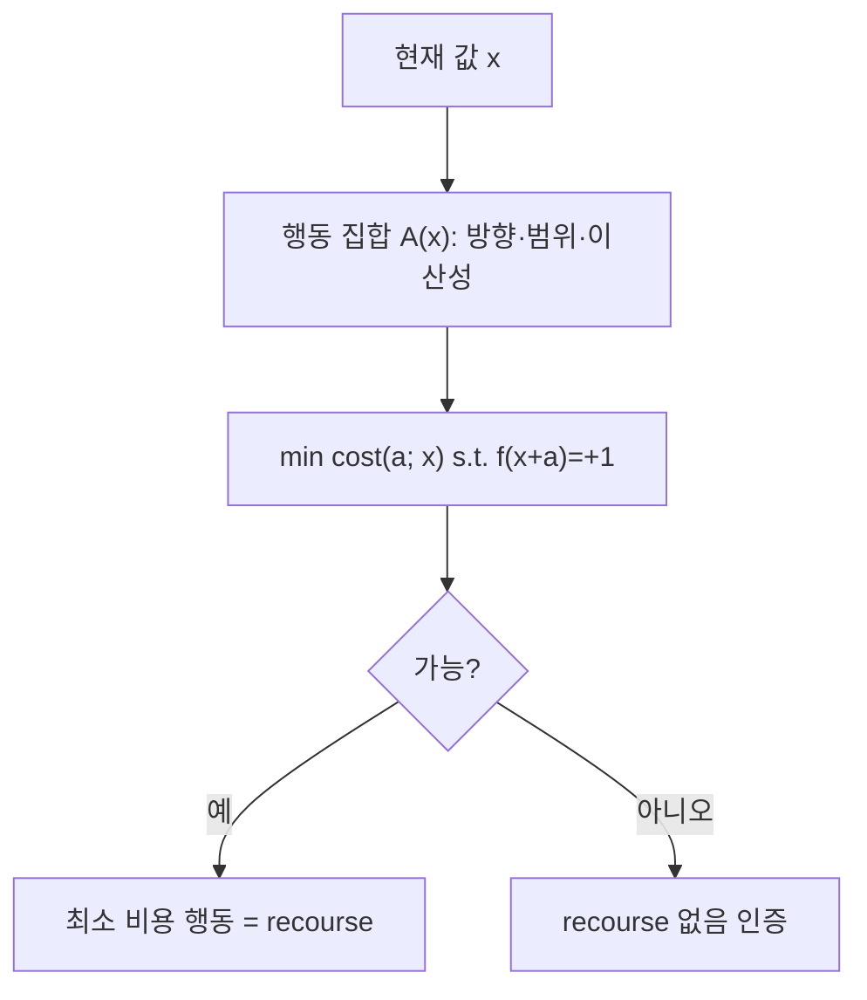

# 행동 집합 정의

> recourse를 계산할 때 **한 사람이 현재 값에서 실제로 취할 수 있는 변화(행동)의 집합**을 특징별로 형식화한 것이다. 이 집합을 정확히 정의해야 "승인되려면 이렇게 바꾸세요"라는 안내가 실행 가능해진다.

## 쉽게 말하면
여행 경로 앱이 "이 도로로 가면 가장 빠릅니다"라고 말하려면, 그 사람이 갈 수 있는 도로(차량 통행 가능, 통행금지 아님)가 먼저 지도에 정의돼 있어야 한다. 행동 집합은 recourse 계산의 "갈 수 있는 도로 지도"다.

## 자세히
(Ustun·Spangher·Liu의 「Actionable Recourse in Linear Classification」(arXiv 1809.06514)의 문제 정식화 절을 PDF로 직접 읽어 확인.)
- **형식화(논문)**: 사람 x에게 **recourse**를 찾는 문제는 `min cost(a; x)` 를 `f(x + a) = +1`(원하는 결정)과 `a ∈ A(x)` 조건 아래 푸는 것이다. 여기서
  - **A(x)**는 x에서 가능한 **행동의 집합**이다. 행동 a는 각 특징 j마다 변화량 a_j를 갖는 벡터이고, a_j는 `A_j(x_j) ⊆ {a_j ∈ ℝ | a_j + x_j ∈ X_j}`, 즉 변경 후 값이 그 특징의 **허용 값 집합 X_j 안에** 있어야 한다.
  - 특징 j가 **immutable**이면 `A_j(x) = {0}`(변화 없음), **conditionally immutable**이면 어떤 x에서 `A_j(x) = {0}`이다. 예를 들어 이미 박사 학위가 있는 사람은 그 특징의 행동 집합이 {0}이다([조건부 immutable 특징](#conditionally-immutable-features)).
  - **비용 함수 cost(·; x)**는 가능한 행동 중 선택하거나 감사에서 쓰는 양을 재며 두 가지 성질을 가정한다: (i) `cost(0; x)=0`(행동 안 하면 비용 없음) (ii) 행동이 커지면 비용이 같거나 커진다(단조).
- **계산 결과가 말해 주는 것(논문)**: 문제가 **가능(feasible)**하면 최적해가 결정을 뒤집는 **최소 비용 행동**이다. **불가능(infeasible)**하면 어떤 행동으로도 원하는 결정을 얻을 수 없다는 **인증**이다(행동 집합 정의에 의존하므로 [recourse 가능성과 값의 범위](#recourse-feasibility-bounds) 참고).
- **행동 집합을 정할 때의 선택(제안)**
  | 항목 | 예 |
  |---|---|
  | 방향 | 증가만(경력), 감소만(대출 개수), 양방향(소득) |
  | 범위 | 현실적 상한·하한, 느슨한 상한 |
  | 이산성 | 정수(카드 수), 범주(직종), 이진(학위) |
  | 상호 의존 | 학위 취득 시 나이·경력도 같이 변함 |
  | 시간 | 변경에 걸리는 시간(수개월~수년) |
  | 개인별 차이 | 사람마다 다른 한계(자산·건강) |
  A(x)가 너무 넓으면 비현실적 조언이 나오고, 너무 좁으면 "대안 없음"으로 잘못 판정된다.
- **합의 필요(제안)**: 행동 집합과 비용은 **이해관계자(법무·도메인 전문가·영향받는 사람 대표)**와 정하고 문서화한다. 모델 개발 단계가 아니라 **모델이 개인에게 미치는 영향**을 보는 감사 관점이라는 점이 논문의 문제의식이다.
- **한계**: 논문의 정식화는 선형 분류기에 대한 것이다. 인과적 의존(한 특징을 바꾸면 다른 특징이 변함)은 이 단순 정식화에 직접 들어 있지 않다.

## 그림으로 보기

## 예시
- 대출 모델의 행동 집합: 소득 +0~300만원(50만원 단위), 대출 개수 감소만, 학위는 FALSE→TRUE만(이미 TRUE면 변화 없음), 나이 불변. 이를 `A(x)`로 정의하고 최소 비용 변경을 계산.
- 교육 소재: "AI가 권하는 조언은 누가 실행 가능하다고 정했을까" — 행동 집합을 팀이 직접 정해 보는 활동.

## 헷갈리는 것과 비교
| 개념 | 차이 |
|---|---|
| 행동 집합 정의 | 가능한 변화 범위를 형식화 |
| [행동 가능한 특징](#actionable-features) | 바꿀 수 있는 특징의 분류 |
| [조건부 immutable 특징](#conditionally-immutable-features) | 방향·상태 의존 제약 |
| [recourse 가능성과 값의 범위](#recourse-feasibility-bounds) | 범위 설정이 가능성 판정에 미치는 영향 |

## 더 읽을거리
- [Actionable Recourse in Linear Classification (arXiv 1809.06514)](https://arxiv.org/abs/1809.06514) — 행동 집합 A(x), 비용 함수, 가능·불가능 인증(PDF 직접 확인).
