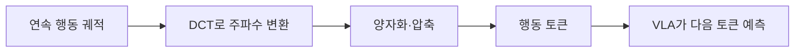
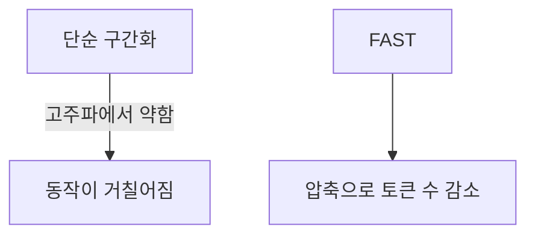

# 행동 토큰화

> **행동 토큰화**는 로봇의 연속적인 행동(관절 각도·속도 등)을 언어 모델이 다룰 수 있는 이산 토큰으로 바꾸는 방법이다.

## 쉽게 말하면
악보가 소리를 기호로 적어 연주를 전달하듯, 팔의 움직임을 기호열로 적어 두면 언어 모델이 "다음 음표"를 예측하듯 다음 동작을 예측할 수 있다. 문제는 기호를 너무 거칠게 적으면 섬세한 동작이 뭉개진다는 점이다.

## 자세히
(FAST, arXiv 2501.09747 초록 확인)
- **기본 방식**: 차원·시점별로 구간(bin)에 나눠 번호를 매기는 단순 이산화. 고주파·고숙련 작업에서는 잘 안 된다고 지적한다.
- **FAST(Frequency-space Action Sequence Tokenization)**: **이산 코사인 변환(DCT)** 기반 압축으로 행동 시퀀스를 주파수 영역에서 토큰화한다.
- 자기회귀 VLA가 고주파·고숙련 과제를 처리할 수 있게 한다고 보고한다.
- **FAST+**: 실제 로봇 행동 궤적 100만 개로 학습한 범용 토크나이저로, 다양한 행동 공간·제어 주파수에 블랙박스로 쓸 수 있다.
- pi0 VLA와 결합해 로봇 데이터 1만 시간까지 확장되고, 확산 VLA와 성능이 비슷하며 학습 시간은 최대 5배 줄었다고 보고.
- RT-2의 구간화 방식은 이 글에서 직접 확인하지 않았다(일반 지식).

## 그림으로 보기

## 예시
- 50Hz로 7축 행동 1초를 단순 구간화하면 350개 토큰이지만, 주파수 압축으로 훨씬 짧게 표현할 수 있다는 것이 아이디어(수치는 예시일 뿐 논문 값이 아님).

## 헷갈리는 것과 비교
| 개념 | 차이 |
|---|---|
| 행동 토큰화 | 연속 행동 → 이산 토큰 |
| [플로 매칭](#flow-matching) | 이산화 없이 연속 행동을 생성 |
| [OpenVLA](#openvla) | 행동을 토큰으로 출력하는 VLA |
| [텍스트 토큰화](#tokenization) | 글을 토큰으로, 원리는 비슷 |

## 더 읽을거리
- [FAST: Efficient Action Tokenization for Vision-Language-Action Models](https://arxiv.org/abs/2501.09747) — 논문 초록.
