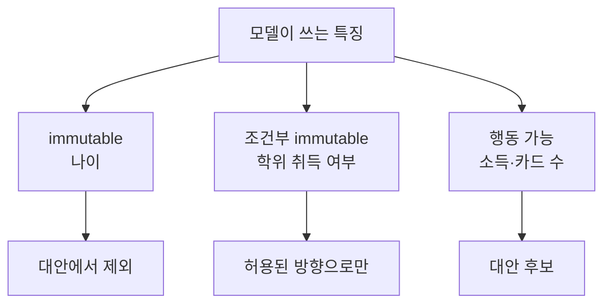

# 실행 가능한 특징

> 알고리즘적 대안 제시(recourse)에서 **사람이 실제로 바꿀 수 있는 입력 변수**(소득, 신용카드 수)와 바꿀 수 없는 변수(나이), 조건부로만 바뀌는 변수(학위 취득 여부)를 구분하는 일이다. 이 구분 없이 "나이를 줄이세요"를 대안이라고 내놓으면 의미가 없다.

## 쉽게 말하면
시험 불합격 통지에 "키가 10cm 더 컸으면 합격"이라고 적혀 있으면 소용없다. "오답 노트 20개 정리"처럼 내가 할 수 있는 행동으로 적혀야 쓸모가 있다. 변수 하나하나를 "내가 바꿀 수 있나?"로 먼저 분류하는 작업이다.

## 자세히
(Ustun·Spangher·Liu, "Actionable Recourse in Linear Classification", FAT* 2019 확장판 arXiv 1809.06514의 PDF 본문을 직접 열어 확인)
- **세 범주**: 논문은 모델이 쓰는 특징을 ① **immutable**(예: age ≥ 50) ② **conditionally immutable**(예: has_phd, FALSE → TRUE로만 바뀜) ③ 행동 대상으로 간주하면 안 되는 것(예: married)으로 예를 든다. 형식적으로는 각 특징 j에 대해 가능한 변화 집합 A_j(x)를 두고, A_j(x) = {0}이면 immutable, 일부 x에서만 {0}이면 conditionally immutable로 정의한다.
- **왜 구분하나**: 대안 탐색은 "immutable 특징을 바꾸지 않고, 가변 특징을 불가능한 방식으로 바꾸지 않는" 변화만 허용해야 한다(예: n_credit_cards 5 → 0.5, has_phd TRUE → FALSE는 불가). 이를 정수 계획 문제로 풀어 선형 분류기에서 결정이 뒤집히는 변화를 찾는다. 저자들은 구현을 github.com/ustunb/actionable-recourse에 공개한다고 밝힌다(저장소는 열지 않음).
- **모델 설계에 주는 의미(Remark 1)**: 선형 분류기가 **행동 가능한 특징만** 쓰고 그 특징이 제한이 없으면 모두에게 recourse를 줄 수 있다. 반대로 immutable 특징만 쓰거나 한 클래스만 예측하면 줄 수 없다. 특징이 유한한 범위라면 immutable 특징이 하나만 있어도 일부 사람에게 recourse가 없을 수 있다(Remark 3).
- **배포 시 위험**: 모델이 쓰는 특징이 배포 집단에서 누락되었거나 immutable이거나 분포가 달라지면 recourse가 달라질 수 있다(같은 논문, "Out-of-Sample Deployment" 항목).
- **한계(해석)**: 어떤 특징이 "행동 가능"한지는 사람·맥락마다 다르고(예: 이직 가능성), 분류 자체가 정책적 판단이다. 이 논문은 선형 분류기 중심이라 신경망 등에는 그대로 적용되지 않는다.

## 그림으로 보기

## 예시
- 대출 모델의 특징 표: 연체 횟수(조건부: 줄일 수 없고 시간이 지나야 의미), 카드 사용률(행동 가능), 나이(불가)로 분류해 대안 안내문에 쓸 항목만 남김.
- 교육 소재: 특징 10개를 주고 세 범주로 분류한 뒤 "대안 통지서"를 써 보는 실습.

## 헷갈리는 것과 비교
| 개념 | 차이 |
|---|---|
| 실행 가능한 특징 | 내가 바꿀 수 있는 입력 |
| immutable 특징 | 바꿀 수 없음(나이) |
| conditionally immutable | 한 방향으로만 변경 |
| [알고리즘적 대안 제시](#algorithmic-recourse) | 이 구분을 쓰는 상위 개념 |
| [대안의 비용·시간](#recourse-cost-and-time) | 바꾸는 데 드는 노력 |

## 더 읽을거리
- [Actionable Recourse in Linear Classification (arXiv 1809.06514)](https://arxiv.org/abs/1809.06514) — 초록과 PDF 본문 직접 확인(정의·Remark·정수 계획 설명).
