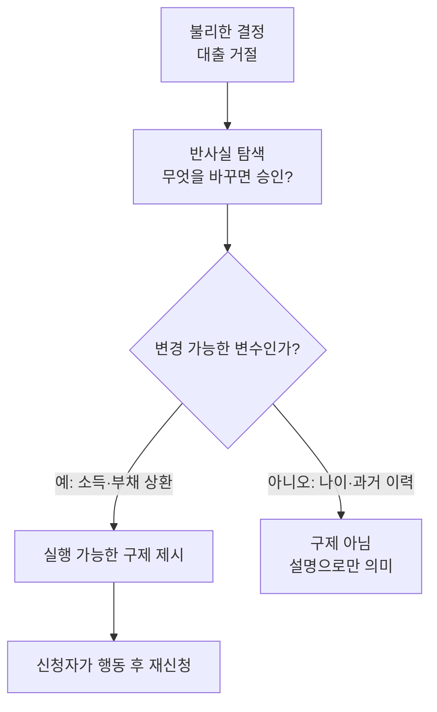

# 실행 가능한 구제(recourse)

> 불리한 AI 결정(대출 거절, 채용 탈락)을 받은 사람이 **실제로 바꿀 수 있는 변수**를 바꿔서 결정을 뒤집을 수 있는 능력. "나이를 5살 줄이면 승인"처럼 바꿀 수 없는 조건을 알려 주는 설명은 구제가 되지 못한다.

## 쉽게 말하면
시험에서 떨어진 학생에게 "키가 10cm 더 컸다면 합격"이라고 하면 소용이 없다. "이 과목을 20점 더 받으면 합격"처럼 학생이 실제로 할 수 있는 행동으로 말해야 구제가 된다.

## 자세히
출처: Ustun·Spangher·Liu, "Actionable Recourse in Linear Classification"(arXiv 1809.06514, 2018 최초 제출, 2019-11 개정, FAT* 2019 확장판, 초록 열어서 읽음), Molnar "Interpretable ML" 반사실 설명 장(열어서 읽음).
- **정의(논문)**: 영향받는 개인이 소득처럼 **바꿀 수 있는** 입력 변수를 바꿔 불리한 결정을 뒤집을 수 있는 능력을 recourse라 부른다. 나이처럼 고정된 속성은 해당하지 않는다.
- **기여(초록)**: 선형 분류기에서 구제 가능성을 **검사하고 보장하는 정수 계획(integer programming) 도구**를 제시하며, 모델 개발 방식을 바꾸지 않고 적용할 수 있다. 신용 평가 실험에서 흔한 모델 개발 관행이 구제 가능성에 크게 영향을 줄 수 있음을 보이고, 실무에서 구제 가능성을 평가해야 한다고 주장한다.
- **반사실 설명과의 관계(Molnar)**: 반사실 설명은 예측을 바꾸는 최소 변경을 찾는다. 하지만 변경 불가한 특성이 들어가면 실행 불가능하다. 책의 예: 임대료 예측에서 15㎡ 더 큰 집을 제시받는 것은 Anna에게 실행 불가능하고, 반려동물 허용·단열 개선처럼 바꿀 수 있는 특성을 봐야 한다.
- **설계 원칙(일반 정리)**: ① 변경 가능한 특성만 허용, ② 특성 간 현실적 제약(예: 나이는 줄지 않고 늘어난다), ③ 변경에 드는 비용을 고려, ④ 제안이 바뀐 뒤에도 유효한지(모델 갱신 후) 확인. 이 원칙은 논문·책의 직접 서술이 아니라 두 자료에서 이 지도가 정리한 것이다.
- **법·정책 연결**: 불리한 조치 통지에서 구체적 이유를 요구하는 제도와 함께 논의된다([GDPR 설명받을 권리](#explanation-right-gdpr)).

## 그림으로 보기

## 예시
- 좋은 설명: "카드 한도 사용률을 40% 아래로 낮추면 승인 확률이 기준을 넘는다."
- 나쁜 설명: "나이가 35세였다면 승인"(바꿀 수 없음).
- 점검: 모델이 거절 대상 중 구제 가능한 사람의 비율은? 변경 불가 변수만으로 거절되는 집단이 있는가?

## 헷갈리는 것과 비교
| 개념 | 차이 |
|---|---|
| 실행 가능한 구제 | 바꿀 수 있는 행동으로 결과를 뒤집을 수 있음 |
| [반사실 설명](#counterfactual-explanation) | 결과를 바꾸는 최소 변경, 실행 가능성은 별도 조건 |
| [반사실의 다양성](#counterfactual-diversity) | 여러 대안 경로를 주는 이유 |
| [전역 vs 지역 설명](#global-vs-local-explanation) | 구제는 지역(개인별) 설명의 용도 |

## 더 읽을거리
- [Actionable Recourse in Linear Classification (arXiv 1809.06514)](https://arxiv.org/abs/1809.06514) — recourse 정의와 검사 도구(초록 확인)
- [Counterfactual Explanations (Molnar)](https://christophm.github.io/interpretable-ml-book/counterfactual.html) — 반사실 설명의 성질과 실행 불가능 사례(열어서 확인)
