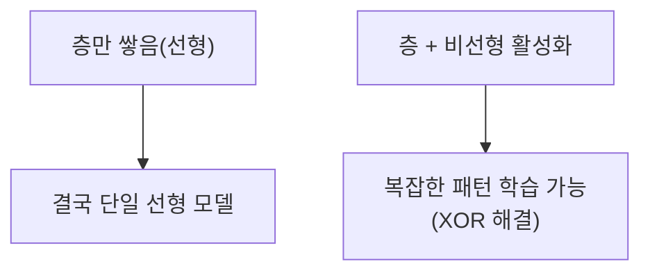

# 활성화 함수

> 신경망의 각 뉴런이 **계산 결과를 다음 층으로 넘기기 전에 통과시키는 비선형 함수**. 이 비선형성이 없으면 층을 아무리 쌓아도 **한 층짜리 선형 모델과 같아져서** 복잡한 패턴을 배우지 못한다. 대표로 sigmoid, tanh, ReLU, GELU가 있다.

## 쉽게 말하면
수도관 여러 개를 직선으로 이어 붙이면 그냥 긴 관 하나일 뿐이다. 중간에 "꺾이는 밸브"(비선형 함수)를 달아야 물길을 복잡하게 바꿀 수 있다. 활성화 함수가 그 꺾이는 밸브다.

## 자세히
(Wikipedia "Activation function" 요약 + 직접 실행)
- **왜 필요한가**: 활성화가 항등(그대로 통과)이면 "전체 네트워크가 단일 층 모델과 같다". 비선형 활성화가 있으면 작은 네트워크도 비자명한 문제를 풀 수 있고, 비선형 활성화를 가진 2층 네트워크는 어떤 함수든 근사할 수 있다(보편 근사 정리).
- **대표 함수**:

| 함수 | 식·범위 | 특징 |
|---|---|---|
| sigmoid | 출력 0~1, 미분 g(1−g) | 확률처럼 해석, 양끝에서 기울기 거의 0(포화) |
| tanh | 출력 −1~1, 미분 1−g² | 0 중심, 역시 포화 |
| ReLU | max(0, x), 0~∞ | 계산 단순, 양수 구간에서 기울기 1 |
| GELU | x·Φ(x)(Φ=가우시안 누적분포) | ReLU의 매끄러운 버전, BERT에서 사용 |

- **직접 계산**(x = −5, −2, −1, 0, 1, 2, 5):
  - sigmoid: 0.007, 0.119, 0.269, 0.5, 0.731, 0.881, 0.993 / 미분은 최대 **0.25**(x=0)이고 양끝에서 0.007.
  - ReLU: 0, 0, 0, 0, 1, 2, 5. GELU: −0.0, −0.045, −0.159, 0, 0.841, 1.955, 5.
  - **기울기 소실 감각**: sigmoid의 최대 기울기 0.25를 **10층** 곱하면 약 **9.5×10⁻⁷**, ReLU의 양수 구간 기울기 1은 10층을 곱해도 1. 문서 정의상 sigmoid·tanh는 **포화(기울기가 0으로 수렴)** 하며, ReLU 같은 비포화 함수는 기울기 소실 문제를 덜 겪는다.
- **직접 실행 — XOR 문제**(scikit-learn 1.9.1, 은닉층 8개, 10개 시드):

| 활성화 | XOR 정확도 평균 | 100% 정확도 시드 수 |
|---|---|---|
| 항등(선형) | 0.53 | 0/10 |
| ReLU | 1.00 | 10/10 |
| tanh | 1.00 | 10/10 |

  XOR는 선형으로 나눌 수 없는 문제라, **은닉층이 있어도 활성화가 선형이면 풀지 못하고** 비선형 활성화를 쓰면 풀었다.
- **선택 감각**: 은닉층 기본은 ReLU 계열, 트랜스포머 계열은 GELU 등 매끄러운 변형이 널리 쓰인다. 출력층은 목적별(확률 이진=sigmoid, 다중 분류=softmax). 위 위키 문서는 ReLU가 완전히 매끄럽지 않아 최적화에 문제가 있을 수 있다고만 언급하며, "죽은 ReLU" 같은 세부는 이 글에서 확인하지 않았다.
- 한계: 층 수·초기화·정규화 등 다른 요소도 기울기 흐름에 영향을 준다. 위 수치는 단순 곱셈 직관이다.

## 그림으로 보기



## 예시
```python
import numpy as np
relu = lambda x: np.maximum(0, x)
sigmoid = lambda x: 1 / (1 + np.exp(-x))
from sklearn.neural_network import MLPClassifier
MLPClassifier((8,), activation="relu").fit(X, y)   # activation="identity"로 바꿔 XOR 비교
```
- 교육 포인트: "AI가 왜 단순 선형 계산이 아니라 복잡한 것을 배우나?" → 비선형 활성화 때문.

## 헷갈리는 것과 비교
| 개념 | 차이 |
|---|---|
| 활성화 함수 | 뉴런 출력에 적용하는 비선형 함수 |
| 손실 함수 | 예측이 틀린 정도를 재는 함수(학습 목표) |
| softmax | 여러 클래스 점수를 확률로 바꾸는 출력층 함수 |
| [학습과 추론](#training-inference) | 활성화는 학습·추론 모두에서 쓰임 |

## 더 읽을거리
- [Wikipedia: Activation function](https://en.wikipedia.org/wiki/Activation_function) — 함수 목록과 포화·기울기 소실.
- [scikit-learn: MLPClassifier](https://scikit-learn.org/stable/modules/generated/sklearn.neural_network.MLPClassifier.html) — activation 옵션.
