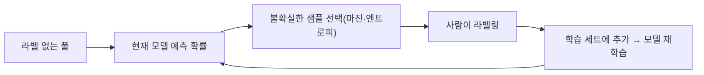
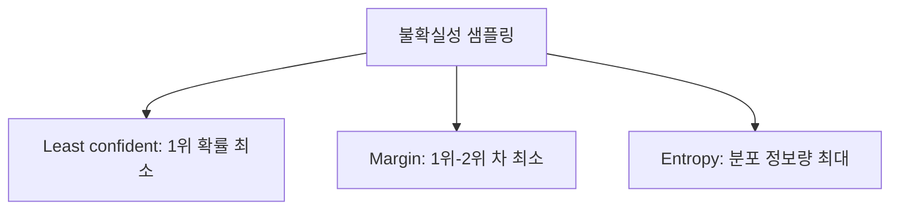

# 능동 학습 라벨링

> 라벨 없는 데이터 중 모델이 가장 헷갈려 하는(정보가 큰) 샘플부터 골라 사람에게 라벨링을 시키는 방법이다. 같은 라벨 수로 더 높은 정확도에 도달하는 것이 목표다.

## 쉽게 말하면
학생이 이미 잘 아는 문제를 100개 더 풀게 하기보다, 자주 틀리는 문제 유형을 골라 집중적으로 가르치는 것이 효율적이다. 능동 학습은 모델이 "이 문제는 잘 모르겠어요"라고 손을 든 샘플만 사람에게 물어본다.

## 자세히
(Settles의 「Active Learning Literature Survey」(2010, PDF 본문)를 직접 열어 확인하고, 직접 실험을 실행.)
- **핵심 아이디어(서베이 초록)**: 학습 알고리즘이 **학습할 데이터를 스스로 고르면 더 적은 라벨로 더 높은 정확도**를 낼 수 있다. 질의는 보통 라벨 없는 샘플을 사람(오라클)에게 라벨링시키는 형태. 라벨 없는 데이터는 풍부하지만 라벨은 어렵고 오래 걸리고 비쌀 때 의미가 크다.
- **시나리오**: 멤버십 질의 합성, 스트림 기반 선택적 샘플링, **풀 기반 샘플링**(라벨 없는 큰 풀에서 고름 — 라벨링 현장에서 가장 흔함).
- **질의 전략 틀**: 불확실성 샘플링, 위원회 질의(query-by-committee), 기대 모델 변화, 기대 오류 감소, 분산 감소, 밀도 가중 방법.
- **불확실성 샘플링 세 가지(본문 확인)**: ① **가장 자신 없는(least confident)** 샘플: 최상위 클래스 확률이 가장 낮은 것. 최상위 라벨 정보만 쓰고 나머지 분포 정보는 버린다. ② **마진 샘플링**(Scheffer 등 2001): 1위와 2위 확률의 차가 가장 작은 샘플. 앞 방식의 단점을 보완. ③ **엔트로피**: 전체 클래스 분포의 정보량 기준. 이진 분류에서는 세 방식이 동등하다.
- **직접 실험(digits 손글씨, 로지스틱 회귀, 초기 20개 + 20개씩 추가, 5회 평균, 시험 정확도)**: 라벨 수 60개에서 무작위 0.837 vs **마진 0.885**, 100개에서 0.884 vs **0.921**, 200개에서 0.924 vs **0.956**, 300개에서 0.936 vs **0.959**. 같은 라벨 수로 마진 샘플링이 일관되게 앞섰다(초기 20개는 동일). 장난감 데이터 결과이며 일반화하지 말 것.
- **Label Studio에서**: 자동 능동 학습 루프는 Enterprise 기능이고, Community는 작업을 수동 정렬하고 예측을 가져오는 식으로 흉내 낸다([Label Studio ML 백엔드](#label-studio-ml-backend)).
- **주의(제안)**: ① 모델 편향이 선택 편향을 만든다(불확실한 샘플만 보게 되어 분포가 치우침) ② 이상치·라벨 오류가 "불확실"로 보여 반복 선택될 수 있다([Confident Learning](#confident-learning)) ③ 시험 세트는 능동 선택과 무관하게 무작위로 따로 둔다 ④ 라벨러 피로·비용이 샘플마다 다를 수 있다.

## 그림으로 보기



## 예시
```python
import numpy as np
p = model.predict_proba(X_pool)
s = np.sort(p, axis=1)
margin = s[:, -1] - s[:, -2]          # 작을수록 헷갈림
to_label = np.argsort(margin)[:20]    # 다음에 라벨링할 20개
```
- 사내 문의 분류: 초기 200건 라벨 → 모델이 헷갈리는 100건씩 담당자에게 배정 → 5회 반복.

## 헷갈리는 것과 비교
| 개념 | 차이 |
|---|---|
| 능동 학습 | 모델이 라벨링할 샘플을 고름 |
| 무작위 샘플링 | 아무거나 골라 라벨링 |
| [라벨 오류 탐지](#label-error-detection) | 이미 있는 라벨의 오류 찾기 |
| [약한 지도](#weak-supervision) | 불완전한 출처로 라벨 생성 |

## 더 읽을거리
- [Active Learning Literature Survey (Settles, 2010)](https://burrsettles.com/pub/settles.activelearning.pdf) — 정의·시나리오·불확실성 샘플링(PDF 본문 확인).
- [Label Studio ML 통합 가이드](https://labelstud.io/guide/ml) — 능동 학습 설명(열어 확인).
