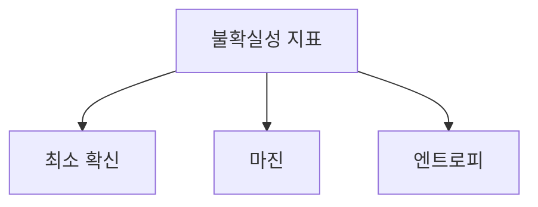

# 능동 학습형 검토

> 사람이 검토·라벨링할 건을 아무거나가 아니라, 모델이 가장 배울 게 많은 건(가장 불확실한 건 등)부터 골라 보내고, 그 결과를 다시 학습에 반영하는 방식. 같은 사람 노력으로 더 빨리 모델을 개선한다.

## 쉽게 말하면
학생이 이미 아는 문제 100개를 더 풀리는 대신, 헷갈려 하는 문제만 골라 선생님이 봐 주는 것이다. 같은 수업 시간에 실력이 더 빨리 는다.

## 자세히
출처: NLP 능동 학습 서베이(Zhang·Strubell·Hovy, arXiv 2210.10109, 열람)와 MetricGate 블로그(열람, 비공식).
- **질의 전략(서베이)**
  - 정보성: 불확실성 샘플링(엔트로피·최소 확신·마진), 위원회 불일치, 기울기 기반, 성능 예측.
  - 대표성: 풀을 대표하거나 이미 라벨된 것과 다른 건을 선호해 이상치를 피함.
  - 배치 다양성: 탐욕적 선택이나 군집으로 다양한 묶음 선택.
  - 하이브리드: 가중합, 다단계 필터, 동적 전환(초기엔 대표성, 후기엔 불확실성).
- **불확실성 세 가지(블로그)**: 최소 확신은 최고 확률 클래스의 확률이 가장 낮은 건(저렴, 이진에 적합, 다중 분류에선 나머지 분포를 무시). 마진은 상위 두 클래스 확률 차가 작은 건(3~10 클래스 다중 분류의 무난한 기본값이라 주장). 엔트로피는 전체 분포를 쓰며 약 20개 이상 클래스에 선호된다고 주장. 구체 기준 수치는 경험칙이다.
- **비용(서베이)**: 모든 건의 비용이 같다는 가정은 부정확한 경우가 많고, 실제 라벨링 시간이 가장 좋은 비용 지표다. 수익률(ROI)처럼 정보성과 비용을 저울질하는 전략, 사전 주석·상호작용 수정으로 수작업을 줄이는 방법이 있다.
- **실무 함정(블로그)**: 불확실성 샘플링은 이상치·라벨 잡음에 끌린다(밀도 항 추가나 사전 필터). 딥러닝 소프트맥스는 보정이 안 된 경우가 많아 온도 스케일링 등을 먼저 한다. 라벨 집합이 i.i.d.가 아니므로 처음부터 무작위 라벨 평가 세트를 따로 둔다. 상위 불확실 건은 서로 비슷해 배치를 다양화하지 않으면 유효 배치 크기가 줄어든다.
- **시작·종료(서베이)**: 초기(cold start)에는 무작위나 군집 중심으로 시드를 뽑는다. 종료 기준은 고정 임계값보다 반복 간 예측이 안정되는지 추적하는 편이 견고하다.
- 검토 큐에 적용할 때는 [검토 큐 설계](#review-queue-design)의 우선순위와 이 선택 기준을 합쳐 쓴다(해석).

## 그림으로 보기

## 예시
- 문의 분류 모델이 "환불/교환" 확률이 0.51/0.49인 건을 담당자에게 우선 보냄 → 라벨을 학습에 추가.
- 교육 실습: 예측 확률 표에서 최소 확신·마진·엔트로피 순위를 각각 계산해 서로 다른 건이 뽑히는지 비교.

## 헷갈리는 것과 비교
| 개념 | 차이 |
|---|---|
| 능동 학습 | 어떤 건을 라벨링할지 모델이 고름 |
| [검토 큐 설계](#review-queue-design) | 큐 운영과 우선순위 |
| [이중 임계값 정책](#double-threshold-policy) | 확신 구간으로 자동/검토 분할 |
| [위임 학습](#learning-to-defer) | 모델이 사람에게 넘길 시점 학습 |

## 더 읽을거리
- [A Survey of Active Learning for NLP (arXiv 2210.10109)](https://ar5iv.labs.arxiv.org/html/2210.10109) — 전략·비용·실무 과제(앞부분 열람)
- [MetricGate: Active Learning Query Strategies](https://metricgate.com/blogs/active-learning-query-strategies/) — 불확실성 지표와 함정(블로그)
