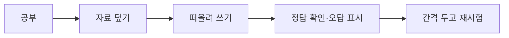
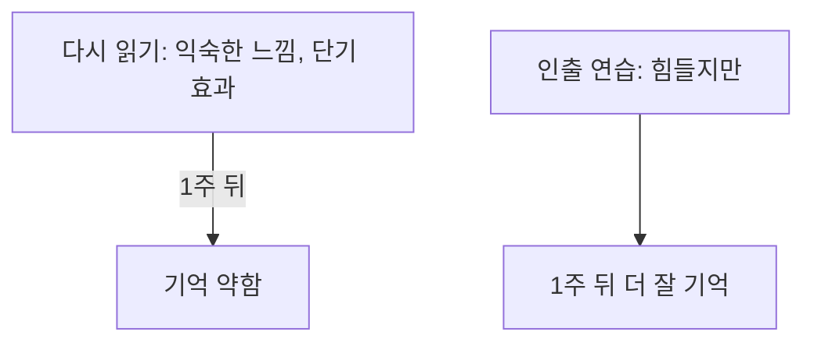

# 능동적 인출

> **능동적 인출(active recall, 시험 효과)** 은 자료를 다시 읽는 대신 **떠올려 보는 시험**을 치르며 공부하는 방법이다. 장기 기억에 더 오래 남는다는 것이 가장 탄탄한 학습 연구 결과 중 하나다.

## 쉽게 말하면
지도를 계속 쳐다보는 것보다, 지도를 덮고 길을 그려 보는 쪽이 길을 더 잘 기억한다. 헷갈리고 막히는 순간이 기억을 단단하게 만드는 순간이다.

## 자세히
- **Roediger & Karpicke(2006)**: 학생들이 글을 읽은 뒤 **자유 회상 시험**을 보거나 **같은 횟수만큼 다시 공부**했고, 5분·2일·1주 뒤 최종 시험을 봤다. **5분 뒤**에는 다시 공부한 쪽이 낫지만 **1주 뒤**에는 시험을 본 쪽이 훨씬 잘 기억했다. 다시 공부한 학생이 **더 자신감**이 있었는데도 그랬다(검색 요약 기준). 워싱턴대 보도자료는 반복 시험 조건 61% 대 공부만 40%를 소개하지만 논문 원문으로 확인하지 못한 수치다.
- **Dunlosky 외(2013)** 학습 기법 10종 평가: **연습 시험(practice testing)** 과 분산 학습이 **가장 높은 효용**, 형광펜과 다시 읽기는 **낮은 효용**(PSPI 14(1), 검색 요약 기준).
- **실천**: ① 읽은 뒤 책을 덮고 핵심을 적기 ② 질문 카드 만들기 ③ 틀린 것을 표시해 다시 시험 ④ 간격을 두고 반복([간격 반복](#spaced-repetition)).
- **AI 활용**(권고): AI에게 "내가 방금 공부한 내용으로 단답 문제 5개를 내고, 내 답을 채점해 줘"라고 시키기. 답을 먼저 보여 달라고 하지 않기.

## 그림으로 보기



## 예시
```
[프롬프트] 아래 노트를 바탕으로 서술형 질문 3개를 내줘. 내가 답하면 빠진 개념을 알려 줘.
(정답은 내 답변을 받은 뒤에 공개)
```
- 교육 활용: 사내 교육 마지막 10분에 "책 덮고 오늘 배운 3가지 적기".

## 헷갈리는 것과 비교
| 개념 | 차이 |
|---|---|
| 능동적 인출 | 떠올려 답하기 |
| 다시 읽기 | 익숙함만 높이기 쉬움 |
| [간격 반복](#spaced-repetition) | 복습 간격을 늘리는 일정 |
| [파인만 기법](#feynman-technique) | 설명하며 빈틈 찾기 |

## 더 읽을거리
- [Roediger & Karpicke 2006 (PubMed)](https://pubmed.ncbi.nlm.nih.gov/16507066/)
- [Dunlosky 외 2013 (PSPI)](https://www.psychologicalscience.org/publications/journals/pspi/learning-techniques.html)
- [WashU 보도자료](https://source.washu.edu/2006/03/repeated-testtaking-better-for-retention-than-repeated-studying-research-shows/)
