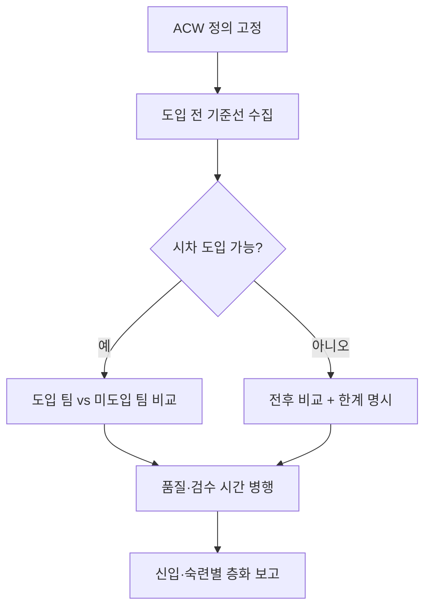

# ACW 측정법

> AI 통화 요약 도입이 후처리 시간(ACW)을 **정말 줄였는지** 믿을 만하게 재는 설계: 정의 고정, 도입 전후 비교, 가능하면 시차 도입(staggered rollout)을 이용한 대조군 비교, 품질 지표 병행.

## 쉽게 말하면
다이어트 효과를 볼 때 "시작 전보다 빠졌다"만으로는 부족하다. 계절이 바뀌었거나 식단이 같이 바뀐 탓일 수 있어서다. 같은 시기에 도구를 안 쓴 사람과 비교해야 도구의 효과를 분리할 수 있다.

## 자세히
출처: Brynjolfsson·Li·Raymond, "Generative AI at Work"(arXiv 2304.11771 v2 초록, 2026-11-18 확인), TechTarget·Call Centre Helper의 AHT 정의([평균 처리 시간](#average-handle-time)). 설계 단계 제안은 일반적 실험 설계 상식이며 단일 출처의 규칙은 아니다.
- **연구 사례**: 고객지원 상담사 5,172명에게 생성형 AI 보조 도구를 **시차를 두고 도입**해 효과를 비교했다. 시간당 해결 건수가 평균 약 15% 늘었고, 경력이 낮은 상담사는 속도·품질이 모두 개선, 가장 숙련된 상담사는 속도 소폭 상승·품질 소폭 하락이었다고 초록이 전한다. 이 수치는 ACW 단축이 아니라 해결 건수 지표다.
- **1단계 정의 고정**: ACW 시작·끝 기준(통화 종료 시점~다음 대기 상태 전환), 요약 검수와 수정, CRM 입력을 어디까지 포함하는지 확정. 정의가 바뀌면 전후 비교가 무의미하다.
- **2단계 기준선**: 도입 전 최소 수 주, 요일·시즌 효과를 고려. ACW 분포가 긴 꼬리이므로 평균과 함께 중앙값·상위 분위수를 본다(AHT 분포가 소수의 긴 건을 가진다는 Call Centre Helper 서술).
- **3단계 비교 설계**: 시차 도입이면 팀별 도입 시점을 활용해 "도입한 팀 vs 아직 안 한 팀" 비교(이중차분 계열 설계, 일반 지식). 전부 동시에 도입했다면 단순 전후 비교임을 명시하고 한계를 적는다.
- **4단계 품질·부작용**: 요약 정확도 오류 비율, 재문의율·FCR, 상담사 검수 시간을 함께 기록. ACW가 줄었어도 검수가 늘면 순효과가 작다.
- **5단계 층화**: 신입·숙련, 통화 유형별로 나눈다. 연구 결과처럼 집단별 효과가 다를 수 있다.
- **보고 형식(제안)**: 평균·중앙값·p90 ACW, 건수, 기간, 정의, 비교 방식, 한계를 한 장에.

## 그림으로 보기

## 예시
- ACW 평균 198초가 도입 후 160초로 줄었다면 −38초(약 −19%). 검수 시간이 건당 +15초였다면 순 −23초. 숫자는 설명용 가상값이다.
- 교육 활용: 컨택센터 관리자 교육에서 "효과 주장에 대조군이 있는가"를 묻는 체크리스트로 쓴다.

## 헷갈리는 것과 비교
| 개념 | 차이 |
|---|---|
| ACW 측정법 | 줄었는지 재는 설계 |
| [후처리 시간 ACW](#after-call-work) | 측정 대상 |
| [평균 처리 시간](#average-handle-time) | ACW를 포함한 상위 지표 |
| [요약 검수 시간](#summary-review-time) | 측정에서 빠지기 쉬운 숨은 시간 |

## 더 읽을거리
- [Generative AI at Work (arXiv)](https://arxiv.org/abs/2304.11771) — 시차 도입 설계로 AI 도구 효과를 측정한 사례
- [Call Centre Helper: AHT 측정법](https://www.callcentrehelper.com/how-to-measure-average-handling-time-52403.htm) — 구성 요소와 측정 실수
