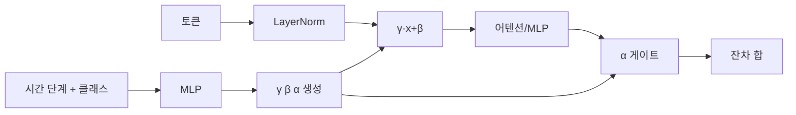
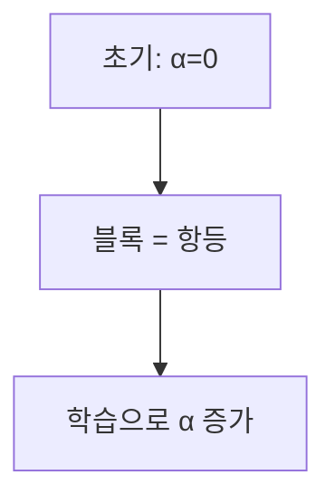

# AdaLN-Zero

> AdaLN-Zero는 DiT에서 시간 단계·클래스 같은 조건을 정규화 층의 스케일·시프트로 주입하고, 각 블록 출력 게이트를 0으로 초기화해 학습 시작 시 블록이 "항등 함수"처럼 동작하게 하는 조건 주입 방식이다.

## 쉽게 말하면
라디오(트랜스포머 블록)에 "지금 몇 단계인지, 무슨 종류 그림인지"를 알려 주는 볼륨·음색 다이얼(스케일·시프트)이 달려 있다. 처음엔 모든 다이얼의 출력 게이트를 0으로 닫아 두어 신호가 그대로 통과하고, 학습하면서 필요한 만큼 천천히 열어 안정적으로 훈련한다.

## 자세히
- DiT 논문(arXiv 2212.09748)은 잠재 패치에 작동하는 트랜스포머로 U-Net을 대체했고, 가장 큰 DiT-XL/2가 클래스 조건 ImageNet 256×256에서 FID 2.27을 기록했다고 초록에 적었다. Gflops를 키울수록 FID가 일관되게 낮아졌다.
- 이번에 확인한 문서에서 AdaLN-Zero 세부 설계(감마·베타·알파 회귀, 0 초기화)는 초록에 없었다. 아래는 일반적으로 알려진 설명이며 본문은 미확인이다(*주장*): 시간 임베딩+클래스 임베딩을 MLP에 넣어 정규화의 γ·β와 잔차 연결 앞 게이트 α를 만들고, α를 0으로 초기화한다.
- 같은 모델 설정(HF diffusers v0.42.1 `DiTTransformer2DModel`)은 `ada_norm_zero` 정규화를 기본으로 쓰며, 시간 단계와 클래스 라벨이 정규화 층 임베딩으로 들어간다([DiT](#dit-diffusion-transformer) 글 참고).
- [MMDiT](#mmdit)는 텍스트 조건을 토큰 시퀀스로 넣고, 시간·요약 벡터는 비슷하게 조절(modulation) 방식으로 주입한다.

## 그림으로 보기



## 예시
```python
from diffusers import DiTTransformer2DModel
m = DiTTransformer2DModel(norm_type="ada_norm_zero", num_embeds_ada_norm=1000)
```
(일반적 사용 예, 실행 확인 안 함.) 조건을 어떻게 모델에 넣는지(토큰으로 이을지, 정규화로 조절할지) 비교할 때의 기준점이다.

## 헷갈리는 것과 비교
| 개념 | 차이 |
|---|---|
| AdaLN-Zero | 정규화 스케일·시프트 + 0 초기화 게이트로 조건 주입 |
| [교차 어텐션](#cross-attention-diffusion) | 조건을 키·값으로 넣어 어텐션 |
| 일반 LayerNorm | 조건과 무관한 고정 학습 파라미터 |
| [MMDiT](#mmdit) | 텍스트는 토큰으로 이어 붙이고 시간은 조절 방식 |

## 더 읽을거리
- [DiT 논문 (arXiv 2212.09748)](https://arxiv.org/abs/2212.09748) — 초록: 구조·FID.
- [HF DiTTransformer2DModel](https://huggingface.co/docs/diffusers/api/models/dit_transformer2d) — `ada_norm_zero` 설정.
