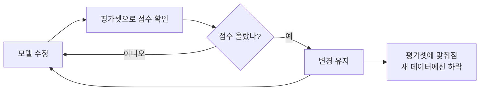

# 적응적 과적합

> 같은 평가셋(홀드아웃)의 결과를 보고 모델·설정을 **계속 고쳐 가면**, 모델이 평가셋의 우연한 모양에 맞춰져 점수는 오르는데 새 데이터 성능은 오르지 않는다. 평가셋을 "보는 횟수" 자체가 학습이 되는 셈이다.

## 쉽게 말하면
모의고사 정답지를 보며 문제집을 고쳐 푸는 일을 반복하면 그 모의고사 점수는 오르지만, 처음 보는 시험에선 그만큼 오르지 않는다. 시험지가 "연습장"이 되어 버린 것이다.

## 자세히
- **직접 실행**(numpy: 정답이 완전한 무작위인 라벨 500개, 무작위 예측기 K개 중 홀드아웃 정확도 50% 초과인 것만 남겨 다수결 앙상블):

| 시도한 예측기 K | 남은 수 | 홀드아웃 정확도 |
|---|---|---|
| 10 | 3 | 0.522 |
| 100 | 51 | 0.626 |
| 1,000 | 474 | 0.818 |
| 5,000 | 2,354 | 0.968 |

  진짜 신호가 0인데도 평가셋을 반복해 보면 점수가 0.97까지 오른다. 새 데이터에서는 당연히 0.5다. 이 구조는 Blum & Hardt의 "Ladder" 연구가 리더보드에서 보인 공격과 같은 계열이다.
- **반론도 있다**: Roelofs et al.(NeurIPS 2019)은 Kaggle 대회 100여 개를 분석해, 공개 리더보드와 최종 순위의 순서가 대체로 유지돼 **실제 대회에서는 적응적 과적합 증거가 약했다**고 보고한다. 이론상 위험과 실무 관측은 다르다는 뜻이다. 다만 시도 횟수·평가셋 크기에 따라 달라지므로 안전하다는 결론은 아니다.
- **대응**: 최종 테스트셋을 따로 두고 마지막에 한 번만 사용, 평가 횟수 제한·기록, 평가셋 주기적 교체, 점수 공개 시 반올림·임계 보고(Ladder 방식), 교차검증으로 선택하고 테스트는 보고용으로만.

## 그림으로 보기

## 예시
- LLM 프롬프트를 평가 질문 100개로 수십 번 고치며 점수를 올렸다면, 마지막에 처음 보는 질문 100개로 한 번만 확인한다.
- 벤치마크가 공개된 지 오래되면 모델이 문제 유형에 맞춰져 점수가 포화된다(오염과 함께 의심).

## 헷갈리는 것과 비교
| 개념 | 차이 |
|---|---|
| 적응적 과적합 | 평가 결과를 보며 반복 수정 → 점수가 서서히 부풀음 |
| [승자의 저주](#winners-curse) | 한 번의 선택에서 최고점의 과대평가 |
| [머신러닝의 다중 비교](#multiple-comparisons-in-ml) | 시도 수에 따른 우연한 유의 확률 |
| [시드 골라 쓰기](#seed-cherry-picking) | 시드를 바꿔 좋은 결과만 보고 |

## 더 읽을거리
- [Roelofs et al., A Meta-Analysis of Overfitting in Machine Learning (NeurIPS 2019)](https://papers.nips.cc/paper/2019/hash/ee39e503b6bedf0c98c388b7e8589aca-Abstract.html) — Kaggle 대회로 본 홀드아웃 재사용의 실제 영향.
- [Blum & Hardt, The Ladder (arXiv 1502.04585)](https://arxiv.org/abs/1502.04585) — 리더보드 과적합 문제와 방어 기법.
