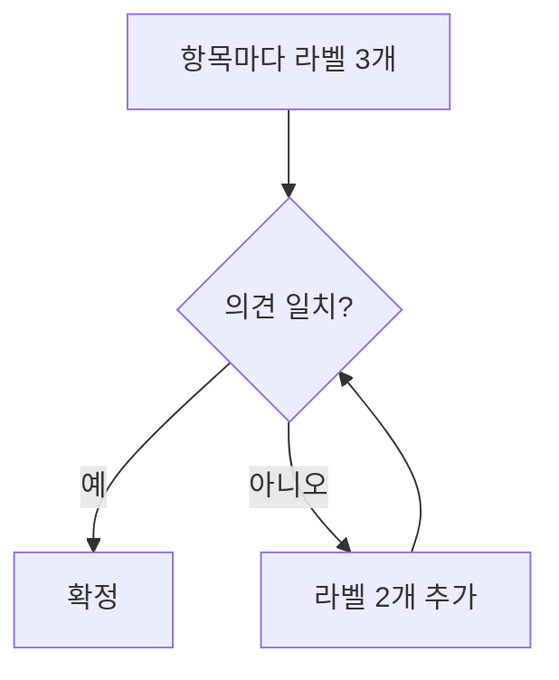
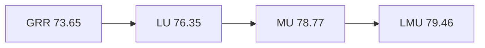

# 적응형 중복 라벨링

> 모든 항목에 똑같이 여러 번 라벨을 받는 대신, 라벨러들의 의견이 갈리는(불확실한) 항목에만 라벨을 더 받아 같은 예산으로 품질을 높이는 전략이다.

## 쉽게 말하면
심사위원 세 명이 만장일치인 작품은 거기서 끝내고, 의견이 갈린 작품에만 심사위원을 더 부르는 것이다. 심사료를 어려운 작품에 몰아 쓴다.

## 자세히
(Sheng, Provost, Ipeirotis, "Get Another Label? Improving Data Quality and Data Mining Using Multiple, Noisy Labelers", KDD 2008 PDF를 직접 읽고 확인.)
- **초록 주장**: 반복 라벨링은 라벨·모델 품질을 높일 수 있지만 항상은 아니다. 라벨이 노이즈 많으면 비용이 싸지 않아도 단일 라벨보다 낫고, **신중히 고른 점에만 반복 라벨링**하는 쪽이 대체로 낫다.
- **실험 설정**: 12개 데이터셋, J48(C4.5), 30% 테스트, 10회 반복, 라벨러 정확도 p를 시뮬레이션(주 설정 p=0.6).
- **전략**: GRR(일반화 라운드 로빈: 라벨이 가장 적은 항목에 다음 라벨), **LU**(라벨 불확실성), **MU**(모델 불확실성), **LMU**(둘의 기하평균). 각 예시는 라벨 3개로 시작해 2개씩 추가.
- **라벨 불확실성**: 진짜 클래스 확률을 Beta(L₊+1, L₋+1) 사후로 보고 S_LU = min{I₀.₅(L₊,L₋), 1 − I₀.₅(L₊,L₋)}. 엔트로피·순도로 재는 것은 좋지 않다(예: 양성 600·음성 400은 불순해 보여도 클래스는 확실).
- **결과(p=0.6, 평균 모델 정확도)**: GRR **73.65%**, LU **76.35%**, MU **78.77%**, LMU **79.46%**.
- **주의**: 라벨러가 고품질(p=0.8)이고 예시가 적으면 단일 라벨이 이길 수 있다. 시뮬레이션 라벨러 기준이며 실제 크라우드 상관은 반영하지 않는다(제안).
- 다른 적응형 크라우드소싱 논문(POMDP 계열 등)은 이번에 확인하지 않았다.

## 그림으로 보기

## 예시
- 라벨러 3명 만장일치 항목은 종료, 2:1 항목에만 2명을 추가하면 평균 라벨 수가 줄어든다.
- 교육 활용: "예산은 어려운 문제에 쓴다"는 자원 배분 원칙으로 설명.

## 헷갈리는 것과 비교
| 개념 | 차이 |
|---|---|
| 적응형 중복 | 불일치 항목에 추가 라벨 |
| 균등 중복(GRR) | 모든 항목에 같은 수 |
| [다수결 정확도 곡선](#majority-vote-accuracy-curve) | 인원 수별 이론 정확도 |

## 더 읽을거리
- [Get Another Label? (NYU 아카이브 PDF)](https://archive.nyu.edu/bitstream/2451/27818/2/CPP-02-08.pdf) — 전략 비교·표 2.
