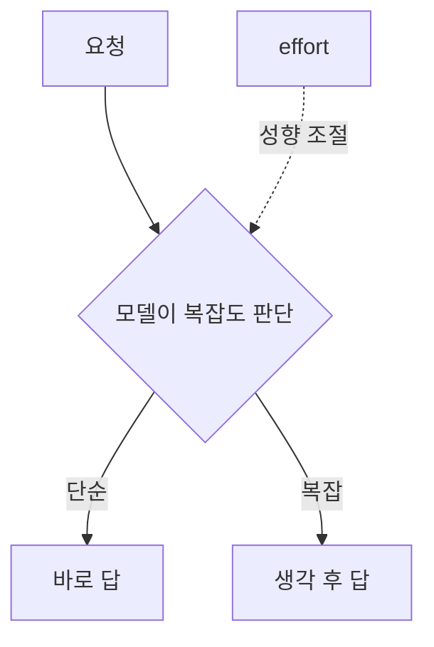

# 적응형 생각(adaptive thinking)

> 요청마다 **생각할지, 얼마나 오래 생각할지를 모델이 스스로 정하는** 방식. 고정된 생각 토큰 예산을 주는 옛 방식과 달리 의도와 effort만 정해 준다. (공식 문서 열람 2026-11-28)

## 쉽게 말하면
계산기를 두드릴지 암산할지 문제를 보고 즉석에서 고르는 사람과 같다. "오늘 며칠?"에는 바로 답하고, 복잡한 증명 앞에서는 종이를 꺼낸다.

## 자세히
- 문서 설명: Claude는 각 요청의 복잡도를 보고 깊은 추론이 도움이 될지 판단한다. 단순한 질문은 **생각 블록 없이** 바로 답할 수 있어, 같은 대화에 생각 있는 턴과 없는 턴이 섞인다. **모든 어시스턴트 턴이 생각 블록으로 시작한다고 가정하는 코드를 짜지 말라**고 경고한다.
- 제어: 주 수단은 [effort 파라미터](#effort-parameter). 생각을 줄이려면 프롬프트보다 **effort를 먼저 낮춘다**. Sonnet 5.5·Haiku 5.5·Fable 5.2는 "생각하지 마"라는 프롬프트 지시가 안정적으로 듣지 않았다고 문서가 밝힌다.
- 도구 사용과 결합: 도구 호출 사이에 생각하는 **인터리브 생각**이 자동. 도구 결과만 처리하는 후속 요청은 `xhigh`·`max`에서도 생각을 건너뛸 수 있다. 대화가 길수록 요청당 생각이 줄어드는 경향.
- 비용: 생각 토큰은 **출력 토큰으로 과금**되고 `max_tokens`에 포함된다. 요약 표시(summarized)여도 실제 생각 전체가 과금되며, `usage.output_tokens_details.thinking_tokens`로 확인한다. 이전 턴의 생각 블록도 입력 토큰으로 과금될 수 있다.
- 모델 제약: Opus 5.5는 적응형 생각이 항상 켜져 있고 `thinking: {"type":"disabled"}`는 400 오류. Sonnet 5.5는 생각 없이 응답하려면 `"between_tools"`(xhigh·max에서는 오류). Haiku 5.5는 `high` 이하에서 `disabled` 가능.
- 캐시: 같은 생각 설정·effort를 유지하면 프롬프트 캐시가 보존된다.

## 그림으로 보기



## 예시
```python
client.messages.create(
    model="claude-opus-5-5", max_tokens=16000,
    thinking={"type": "adaptive"},
    output_config={"effort": "medium"},
    messages=[{"role":"user","content":"이 버그 원인을 찾아 줘"}],
)
```
- 교육: 쉬운 질문에 매번 깊이 생각하는 AI가 왜 비싸고 느린지 설명하는 사례.

## 헷갈리는 것과 비교
| 개념 | 차이 |
|---|---|
| 적응형 생각 | 모델이 생각 여부·분량 결정 |
| 고정 예산 생각(budget_tokens) | 생각 토큰 상한을 직접 지정(구형 방식) |
| [effort 파라미터](#effort-parameter) | 적응형 생각의 성향을 조절하는 다이얼 |

## 더 읽을거리
- [Steering thinking](https://platform.claude.com/docs/en/build-with-claude/thinking-steering-and-cost) — 적응형 생각·비용(읽음).
- [Effort](https://platform.claude.com/docs/en/build-with-claude/effort) — 모델별 제약(읽음).
