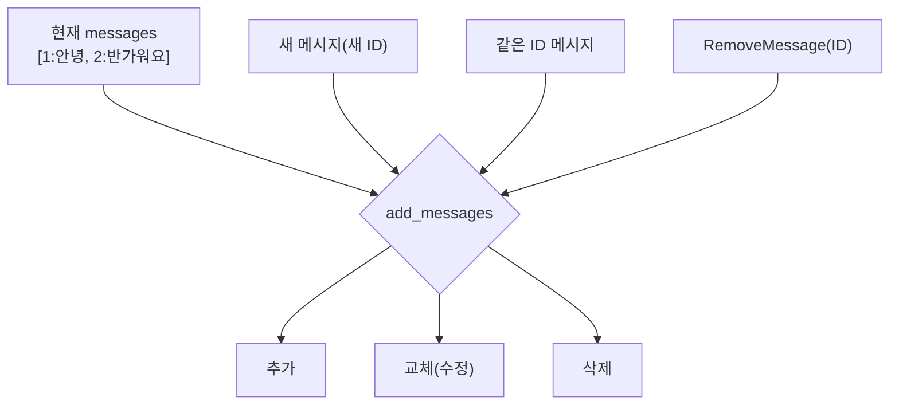
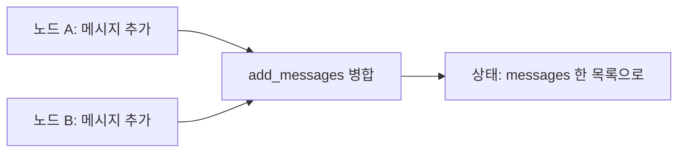

# add_messages 리듀서

> LangGraph에서 대화 메시지 목록을 합치는 전용 병합 규칙. 새 메시지는 뒤에 붙이고, 같은 ID가 있으면 덮어써서 수정하며, `RemoveMessage`로 삭제도 할 수 있다.

## 쉽게 말하면
회의록 공유 문서와 같다. 새 발언은 맨 아래에 이어 적고, 이미 있는 발언을 고치면 같은 번호의 줄이 바뀐다. 단순히 "맨 뒤에 추가"만 되는 메모장(`operator.add`)이었다면 오타 수정이나 삭제를 할 수 없다.

## 자세히
**리듀서란**(LangGraph 문서): 상태의 각 키에는 리듀서를 달 수 있다. 리듀서가 없으면 노드의 업데이트가 이전 값을 덮어쓴다. 리듀서는 현재 값(left)과 노드의 업데이트(right)를 받아 합친 값을 돌려준다. `Annotated`로 키에 붙인다.
```python
class State(TypedDict):
    foo: int                                   # 덮어쓰기
    bar: Annotated[list[str], operator.add]    # 이어 붙이기
```
**add_messages의 동작**(문서 + 직접 실행해 확인, langgraph 1.2.22):
1. 새 메시지를 목록 뒤에 **추가**한다.
2. **같은 `id`**의 메시지가 있으면 **교체**한다(수정).
3. `RemoveMessage(id=...)`를 주면 해당 메시지를 **삭제**한다.
4. `{"type": "human", "content": "..."}` 같은 딕셔너리 형식도 받아 메시지 객체로 바꾸고 ID를 부여한다.
직접 실행 결과: `[1:안녕, 2:반가워요]`에 id="1"인 "안녕하세요(수정)"를 보내면 `[1:안녕하세요(수정), 2:반가워요]`, `RemoveMessage(id="1")`를 보내면 `[2:반가워요]`만 남았다.

**왜 필요한가**: 에이전트 루프에서 사용자·AI·도구 메시지가 계속 쌓이는데, 사람 검토 단계에서 메시지를 고치거나(HITL), 길어진 대화를 정리(오래된 메시지 삭제)해야 한다. `operator.add`는 이어 붙이기만 가능하다.

**편의 기능**: `MessagesState`는 `messages` 키에 `add_messages`가 이미 달려 있는 미리 만든 상태다. 값을 아예 덮어쓰거나 비우려면 `Overwrite`로 리듀서를 우회한다.

**병렬 노드와 함께**: 한 슈퍼스텝에서 여러 노드가 같은 `messages` 키를 업데이트해도 리듀서가 합쳐 주기 때문에 충돌하지 않는다. 리듀서가 없는 키에 병렬로 쓰면 오류가 난다([잘못된 업데이트 오류](#invalid-update-error)).

## 그림으로 보기




## 예시
```python
from langgraph.graph.message import add_messages
from langchain_core.messages import HumanMessage, AIMessage, RemoveMessage

a = [HumanMessage(content="안녕", id="1")]
b = [AIMessage(content="반가워요", id="2")]
msgs = add_messages(a, b)                                   # 추가
msgs = add_messages(msgs, [HumanMessage(content="안녕하세요", id="1")])  # 수정
msgs = add_messages(msgs, [RemoveMessage(id="1")])          # 삭제
```
업무 예: 상담 에이전트가 긴 대화에서 오래된 메시지를 `RemoveMessage`로 정리해 컨텍스트 비용을 줄인다.

## 헷갈리는 것과 비교
| 개념 | 차이 |
|---|---|
| 리듀서 없음 | 새 값이 이전 값을 덮어씀 |
| `operator.add` | 목록을 이어 붙이기만 함(수정·삭제 불가) |
| `add_messages` | 추가 + ID 기준 교체 + RemoveMessage 삭제 |
| [상태](#langgraph-state) | 그래프가 공유하는 데이터. 리듀서는 키별 병합 규칙 |

## 더 읽을거리
- [LangGraph Graph API (공식 문서)](https://docs.langchain.com/oss/python/langgraph/graph-api) — 리듀서, MessagesState, 슈퍼스텝
