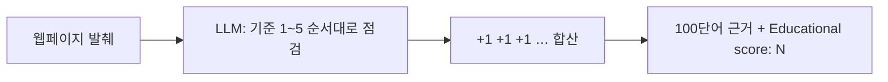
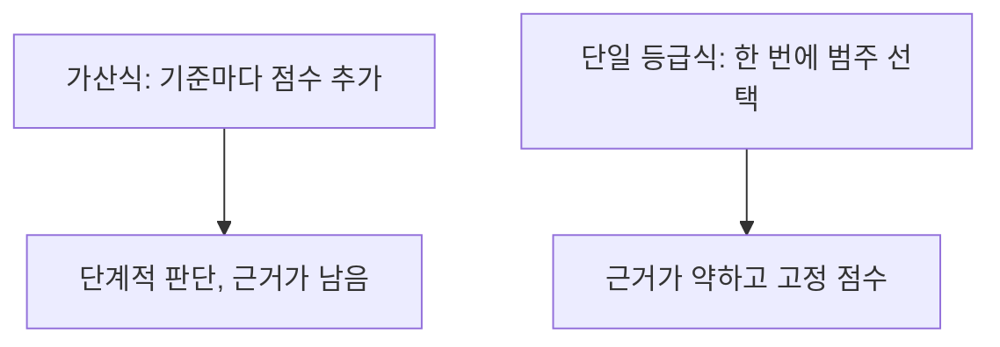

# 가산식 점수 프롬프트

> LLM에게 문서를 평가시킬 때 **"기준 하나를 만족할 때마다 1점씩 더해 총점을 내라"**고 하는 프롬프트 설계다. 단일 등급을 한 번에 고르게 하는 방식보다 판단 과정이 단계적이라 FineWeb-Edu에서 더 잘 작동했다고 보고됐다.

## 쉽게 말하면
채점표에 "기본 정보가 있으면 +1, 교육 요소가 있으면 +1, 교과 개념을 소개하면 +1 …"처럼 항목을 하나씩 확인해 점수를 더하는 방식이다. "이 글은 몇 점?"이라고 묻는 것보다 근거를 짚으며 매기게 된다.

## 자세히
(FineWeb 논문, arXiv 2406.17557 PDF 본문과 부록 F.1 프롬프트를 직접 읽음)
- 용도: FineWeb-Edu의 교육적 가치 분류기를 위한 **합성 라벨**을 만들 때 Llama-3-70B-Instruct가 웹페이지 **460,000개**(FineWeb CC-MAIN-2024-10 표본)를 0~5점으로 채점했다.
- 논문의 비교 결론: 여러 프롬프트를 시험해 **Yuan 외의 가산 척도(additive scale)**가 가장 잘 작동했다. LLM이 기준을 하나씩 평가하며 점수를 쌓을 수 있는 반면, 단일 등급 척도는 미리 정한 범주에 고정 점수를 준다고 설명한다.
- 프롬프트 구조(부록): "초등~중학교 수준 교육 맥락에서 유용한가"를 묻고 5개 가산 기준을 둔다.
  1. **+1** 교육 주제와 관련된 기본 정보가 있다(광고가 섞여도 됨)
  2. **+1** 교육 요소가 있으나 교육 기준과 맞지 않고 산만하다
  3. **+1** 교육용으로 적절하고 교과 핵심 개념을 소개하며 일관적이다(교과서 도입부·기초 튜토리얼 수준)
  4. **+1** 초등·중등 수준에 매우 관련 있고 명확·일관된 글, 연습·해설 포함
  5. **+1** 탁월한 교육적 가치, 상세한 추론과 쉬운 서술
  - 응답 형식: 총점을 **100단어 이내로 정당화**한 뒤 `Educational score: <총점>`으로 끝맺게 한다.
- 설계 의도: 점수를 정수로 받기 쉽고, 문서가 어느 기준까지 충족했는지 근거가 남으며, **"초등·중학교 수준에 집중하라"**는 지시로 arXiv 초록 같은 고도로 기술적인 페이지를 LLM이 과대평가하지 않게 했다(논문 서술).
- 한계(제안): LLM 채점은 프롬프트에 민감하고 일관성이 완벽하지 않으므로 소량의 사람 라벨로 보정·점검한다.

## 그림으로 보기



## 예시
```
Add 1 point if ... Add another point if ...
After examining the extract:
- Briefly justify your total score, up to 100 words.
- Conclude with the score using the format: "Educational score: <total points>"
```
- 사내 문서 품질 점수화에 적용할 때 5개 기준을 업무 맥락에 맞게 바꿔 쓴다.
- 교육: 루브릭(평가 기준표)을 LLM 프롬프트로 옮기는 방법.

## 헷갈리는 것과 비교
| 개념 | 차이 |
|---|---|
| 가산식 | 기준 충족마다 가점, 합산 |
| 단일 등급식 | 미리 정한 범주 중 하나 선택 |
| [교육적 품질 분류기](#educational-quality-classifier) | 이 점수로 학습된 대규모 적용 모델 |

## 더 읽을거리
- [The FineWeb Datasets (arXiv 2406.17557)](https://arxiv.org/abs/2406.17557) — 합성 주석 방식과 부록 F.1 프롬프트(PDF 본문 읽음).
