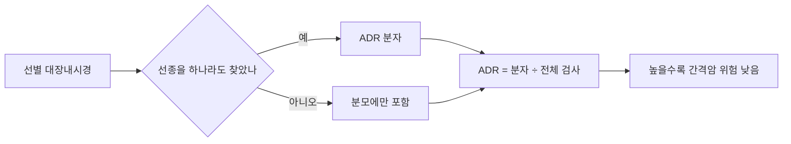
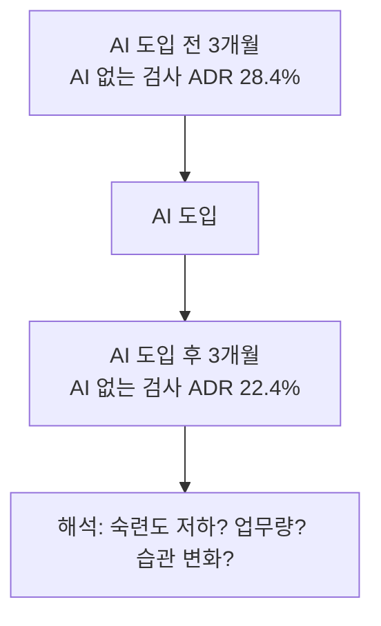

# 선종 발견율(ADR)

> Adenoma Detection Rate. 한 의사가 시행한 (선별) 대장내시경 중 선종(암이 될 수 있는 용종)을 하나 이상 찾아낸 검사의 비율. 대장내시경의 질을 재는 대표 지표이며, AI 보조 이후 AI 없는 검사에서 ADR이 떨어졌는지가 "숙련도 저하" 논쟁의 핵심 수치다.

## 쉽게 말하면
대장내시경 검사의 목적은 암이 되기 전 단계의 용종을 찾아 없애는 것이다. 어떤 의사는 100번 검사에서 40번 선종을 찾고, 어떤 의사는 20번만 찾는다. 많이 찾는 의사에게 검사받은 사람은 나중에 암에 걸릴 위험이 낮다. ADR은 이 "찾아내는 눈"의 성적표다.

## 자세히
출처: ACG(미국소화기학회) 근거 요약 "AI in colonoscopy: could it be making us worse?"(직접 읽음), 검색 결과 요약으로 확인한 NEJM 2014 Corley 연구 초록. Lancet 논문 본문은 접근이 막혀 열지 못했다.
- **정의**: 선종 또는 암을 찾은 검사의 비율. 해당 논평은 이 연구의 ADR에 톱니 모양 병변(SSL)은 포함되지 않았다고 적는다.
- **의미(Corley 2014, NEJM)**: 136명의 위장관 전문의가 시행한 대장내시경 314,872건에서 ADR은 의사별로 7.4~52.5%로 큰 차이를 보였다. ADR이 **1.0%p 오를 때마다 대장암 위험이 3.0% 감소**(위험비 0.97), 가장 높은 5분위 대 가장 낮은 5분위의 간격 암 위험비 0.52. (검색 결과로 확인한 수치)
- **기준치**: 여성 15% 이상, 남성 25% 이상이 질 지표로 권고됐으나 이 기준을 뒷받침하는 자료가 부족하다고 한다(검색 결과). 미국 ADR 목표를 35%로 인용하는 논평도 있다. 나라·기관마다 다르다.
- **AI 연구(Budzyń 외, Lancet Gastroenterol Hepatol 2025;10:896-903)**: 폴란드 4개 센터 19명의 내시경의사, AI 보조 도입 **전 3개월**과 **후 3개월**의 **AI 없는** 검사를 비교. ADR 28.4% → 22.4%, 절대 차이 -6.0%p(95% CI -10.5~-1.6, P=0.009). 보정 후 AI 노출의 오즈비 0.69. 평균 선종 수는 0.54 → 0.43으로 유의하지 않았고(P=0.071), 대장암 발견율 0.8% → 1.2%도 유의하지 않았다. AI 없는 검사 1,443건의 전체 ADR은 25.7%.
- **논평이 지적한 한계**: 관찰 연구라 교란 가능성(잔여 교란), 내시경의사 19명뿐, 철수 시간(withdrawal time) 미보고, 기준 ADR이 낮고 폴란드에 ADR 목표가 없음. 다른 전문가들은 AI 도입 후 검사 수가 거의 두 배(795 → 1,382)로 늘어 업무량·피로가 영향을 줄 수 있다, 3개월은 숙련도 변화를 보기엔 짧다, 부서 운영 변화가 있었다고 지적했다.
- **AI의 이득은 별개**: RCT 44건 메타분석에서 CADe(컴퓨터 보조 검출) 사용 시 ADR이 44.7% 대 36.7%로 높았다(ACG 논평). AGA 지침은 장기 결과 근거가 매우 불확실해 CADe 권고를 하지 않았다.
- **해석 요령(이 글의 정리)**: ADR은 "AI 없는 시간의 실력"과 "AI 있는 시간의 성과"를 구분해서 봐야 하며, 한 번의 전후 비교로 숙련도 저하를 확정할 수 없다. 이 숫자는 인과를 입증하지 않는다([관찰 연구와 인과](#observational-vs-causal)).

## 그림으로 보기

## 예시
- 한 병원이 AI 보조 도입 전후로 의사별 ADR을 분기마다 점검해 AI 켠 검사와 끈 검사를 분리해 기록한다(제안).
- 신입 내시경의사 교육: AI 없이 수행한 검사의 ADR을 따로 평가해 기본 역량을 확인(제안).

## 헷갈리는 것과 비교
| 개념 | 차이 |
|---|---|
| ADR | 선종을 찾은 검사의 비율 |
| 평균 선종 수 | 검사당 평균 선종 개수(별개 지표) |
| 간격암 | 검사 후 다음 검진 전에 생긴 대장암(ADR이 낮을수록 위험) |
| [숙련도 저하](#deskilling) | ADR 변화가 근거로 쓰인 개념 |

## 더 읽을거리
- [AI in colonoscopy: Could it be making us worse? (ACG)](https://gi.org/journals-publications/ebgi/zhou_sep2025/) — 연구 수치와 한계(직접 읽음)
- [Expert reaction to observational study ... (Science Media Centre)](https://www.sciencemediacentre.org/expert-reaction-to-observational-study-looking-at-detection-rate-of-precancerous-growths-in-colonoscopies-by-health-professionals-who-perform-them-before-and-after-the-routine-introduction-of-ai/) — 전문가 반응(직접 읽음)
- [Adenoma detection rate and risk of colorectal cancer and death (NEJM 2014, PubMed)](https://pubmed.ncbi.nlm.nih.gov/24693890/) — ADR과 암 위험(검색 결과로만 확인)
