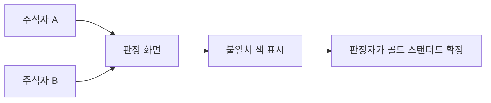
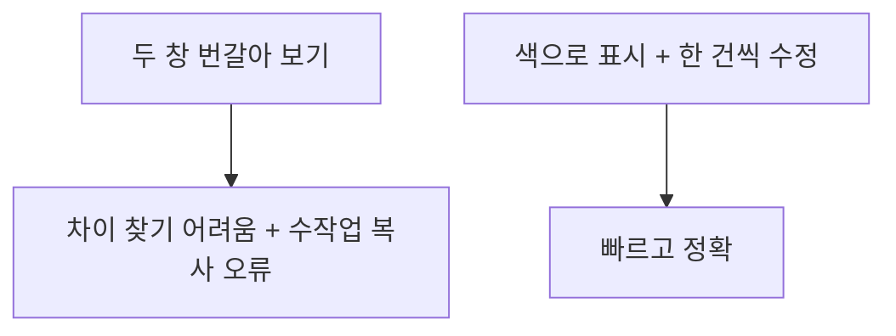

# 판정 인터페이스

> 판정(adjudication) 인터페이스는 판정자가 여러 주석자의 서로 다른 라벨을 한 화면에서 비교하고 골드 스탠더드로 병합하도록 돕는 도구다. 불일치 유형을 색으로 보여 주고 한 건씩 고치게 해 판정자의 생산성과 정확도를 크게 좌우한다.

## 쉽게 말하면
두 사람이 고친 문서를 합칠 때 변경 내용에 색이 칠해진 "변경 추적" 화면이 있으면 쉽지만, 두 창을 번갈아 보며 눈으로 비교하면 실수하기 쉽다. 판정 인터페이스는 라벨 병합의 변경 추적 화면이다.

## 자세히
- **설명(Finlayson & Erjavec, arXiv 1602.05753)**: 판정 인터페이스는 IAA 계산과 연관된 도구로, 판정자가 서로 다른 주석자의 주석을 빠르고 쉽게 병합해 골드 스탠더드를 만들게 한다. 두 주석의 차이를 시각화하기가 까다롭고, 인터페이스의 효율이 판정자 생산성에 큰 영향을 준다.
- **나쁜 예(같은 논문)**: 가장 단순한 방식은 두 주석 화면을 따로 띄우고 하나를 마스터, 다른 하나를 보조로 정하는 것이다. 판정자가 멀리 떨어진 두 창을 오가며 시각적 강조 없이 미세한 차이를 찾아야 하고, 보조에서 마스터로 정보를 수작업으로 옮기다 오류가 생길 기회가 많다.
- **좋은 예(같은 논문)**: MAI(multiple document adjudication interface, Stubbs 2011)는 주석자 간 불일치의 유형마다 다른 색을 쓰고, 판정자가 태그를 하나씩 고치거나 골드 스탠더드에 새 태그를 추가하게 한다. WebAnno도 같은 기능을 제공한다고 한다.
- **구성 요소(해석)**: ① 불일치 유형별 색(한쪽만 있음/둘 다 있으나 다름 등) ② 한 클릭으로 A·B 중 선택하거나 직접 수정 ③ 판정 결과와 사유 기록(감사 기록) ④ 일치한 항목은 접어 두어 불일치 항목에 집중 ⑤ 판정자가 어느 주석자의 것인지 가려 보게 할지(편향 방지) 옵션.
- **연결**: 어떤 샘플을 판정자에게 보낼지는 [이중 검수](#double-annotation-review)·[과반 판정 임계값](#majority-vote-threshold)이 정한다.

## 그림으로 보기

## 예시
- 개체명 라벨링에서 A는 "서울"을 지명, B는 기관으로 표시했을 때, 판정 화면은 이를 색으로 표시하고 판정자가 하나를 고르거나 직접 수정한다.
- 교육 활용: 같은 문서의 두 주석본을 종이로 비교해 본 뒤 색 강조가 있는 도구 화면과 비교한다.

## 헷갈리는 것과 비교
| 개념 | 차이 |
| --- | --- |
| 판정 인터페이스 | 불일치를 병합하는 도구 |
| 주석 인터페이스 | 라벨을 다는 화면 |
| [골드 스탠더드 만들기](#gold-standard-creation) | 판정 결과로 정답 세트를 만드는 절차 |
| [검증 화면 설계](#validation-ui-design) | 판정 화면 일반 설계 |

## 더 읽을거리
- [Overview of Annotation Creation: Processes & Tools (arXiv 1602.05753)](https://arxiv.org/abs/1602.05753) — 판정 인터페이스, MAI, WebAnno
