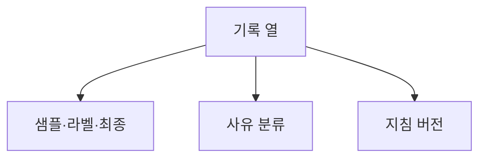

# 판정 사유 기록

> 판정 사유 기록은 판정자가 불일치 샘플을 어떻게 확정했는지와 그 이유를 짧게 남기는 기록이다. 기록이 쌓이면 자주 갈리는 유형이 보이고, 그것이 라벨 가이드 개정의 근거가 된다.

## 쉽게 말하면
재판 판결문에 "왜 그렇게 판단했는지"가 적혀 있어야 다음 비슷한 사건에서 일관되게 판결할 수 있다. 라벨 판정도 이유를 적어야 같은 유형이 다시 나왔을 때 같게 처리한다.

## 자세히
- **근거(Finlayson & Erjavec, arXiv 1602.05753)**: 주석 단계에서 수집해야 할 것으로 주석 과정 메타데이터(주석에 걸린 시간, 주석자 신원 등), 지침 버전 추적, 흔한 오류 점검과 수정, 주석자·판정자 회의를 든다. 판정 인터페이스는 판정자가 태그를 하나씩 고치거나 새 태그를 추가하게 한다. 이 위에 판정 사유를 남기면 지침 개정에 쓸 재료가 된다.
- **기록 항목(해석)**: 샘플 ID / 주석자 A·B 라벨 / 최종 라벨 / 판정자 / 날짜 / **사유 분류**(지침 없음, 문구 모호, 한쪽 실수, 샘플 모호) / 한 줄 설명 / 지침 버전. 사유 분류는 [불일치 샘플 토론](#disagreement-discussion)의 분류와 같게 맞춘다.
- **활용(해석)**: ① 사유별 건수를 월별로 집계해 늘어나는 유형을 본다 ② 같은 사유가 반복되면 지침에 규칙·예시를 추가한다 ③ 같은 판정자의 판정이 시간에 따라 흔들리는지 점검(판정 일관성) ④ 감사 시 "왜 이 라벨인가"에 답할 수 있다.
- **간단한 형식 예(가정)**:

| 샘플 | A | B | 최종 | 사유 | 설명 | 지침 v |
| --- | --- | --- | --- | --- | --- | --- |
| s-0412 | 긍정 | 중립 | 중립 | 문구 모호 | "나쁘진 않다"는 중립으로 | v1.3 |
| s-0587 | 부정 | 부정 | - | - | 일치 | v1.3 |

- **비용(해석)**: 모든 판정에 긴 글을 쓰면 부담이다. 사유 분류 선택 + 한 줄이면 충분하고, 새로운 유형일 때만 길게 쓴다.

## 그림으로 보기

## 예시
- 한 달 동안 "반어법" 사유가 15건이면 지침에 반어법 규칙·예시를 추가한다.
- 교육 활용: 판정 로그 표를 주고 사유별 건수를 집계해 지침 개정안을 쓰게 한다.

## 헷갈리는 것과 비교
| 개념 | 차이 |
| --- | --- |
| 판정 사유 기록 | 각 판정의 이유를 남김 |
| [판정 인터페이스](#adjudication-interface) | 판정 작업 화면·도구 |
| [골드 스탠더드 만들기](#gold-standard-creation) | 판정 결과로 정답 세트 구성 |
| [불일치 샘플 토론](#disagreement-discussion) | 사유를 모아 지침에 반영 |

## 더 읽을거리
- [Overview of Annotation Creation: Processes & Tools (arXiv 1602.05753)](https://arxiv.org/abs/1602.05753) — 메타데이터·지침 버전·판정자 회의
