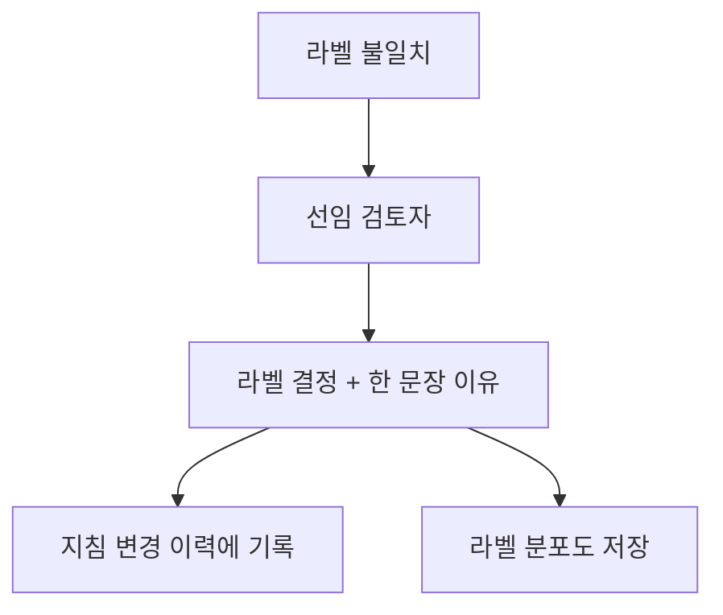

# 판정(adjudication)

> 라벨러들의 **불일치를 선임 검토자가 결정하고 이유를 기록**하는 절차다. 다수결과 다르다.

## 쉽게 말하면
심판 두 명의 판정이 갈리면 비디오 판독관이 결정하고 이유를 남기는 것이다. 단순히 표를 세는 것이 아니다.

## 자세히
(Koji와 Kili 문서를 직접 읽었다.)
- **절차(Koji)**: 불일치가 기준을 넘는 항목은 **다수결 대신 선임 검토자**에게 보낸다. 검토자는 **한 문장으로 왜 그 라벨이 맞는지**를 적고, 그것이 **지침 변경 이력**의 항목이 된다. 주관적 과제는 합산 라벨과 함께 **전체 라벨 분포**를 저장한다.
- **반복 불일치(Koji)**: 같은 경계에서 거듭 갈리면 지침을 고치고 영향받은 조각을 **재주석**한다.
- **불일치는 신호(Koji)**: CrowdTruth 연구는 불일치가 "잡음이 아니라 신호"라는 입장이다.
- **Kili**: "두 라벨러 다수결은 adjudication이 아니다". 불일치를 선임에게 보내고 결정을 기록. 오류와 모호성을 구분 — 라벨러끼리도 정답과도 다르면 교육 문제, 전문가도 갈리면 항목이 모호.

## 그림으로 보기

## 예시
- 상담 감정 분류에서 "불만 vs 요청"이 갈린 건을 선임이 결정하고 "구체적 요구가 있으면 요청" 규칙을 지침에 추가(제안).

## 헷갈리는 것과 비교
| 개념 | 차이 |
|---|---|
| adjudication | 선임이 결정·기록 |
| 다수결 | 표 수로 결정(두 명이면 의미 없음) |
| [골드 문제](#gold-tasks) | 사전 정답으로 점검 |
| [지침 설계](#labeling-guideline-design) | 반복 불일치를 줄이는 문서 |

## 더 읽을거리
- [Koji](https://www.koji.so/docs/data-annotation-quality-guide) — 직접 읽음.
- [Kili](https://kili-technology.com/blog/inter-rater-reliability) — 직접 읽음.
