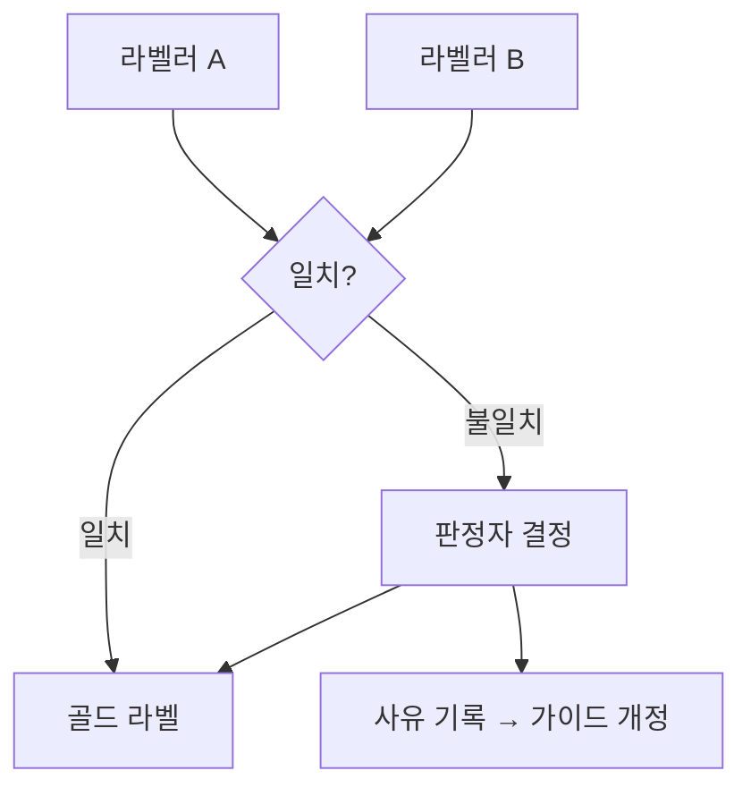
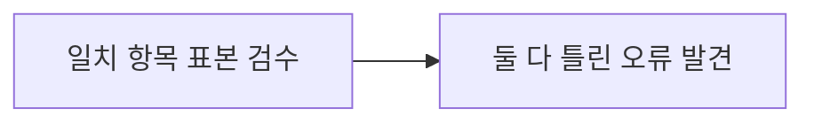

# 판정자 역할

> 두 라벨러의 라벨이 **불일치한 항목만 제3의 전문가(판정자, adjudicator)가 정리해** 최종 정답(골드 스탠더드)을 만드는 역할이다. 전부를 다시 라벨하지 않아도 되므로 비용 대비 품질이 높다.

## 쉽게 말하면
두 심사위원이 점수를 달리 준 경기만 수석 심판이 영상을 다시 보고 최종 판정을 내리는 것이다. 심사위원이 일치한 경기는 그대로 인정한다.

## 자세히
- **정의(Finlayson & Erjavec, arXiv 1602.05753 확인)**: 주석 프로젝트의 단계로 "여러 주석을 골드 스탠더드로 판정(adjudicate)"하는 일이 있고, 일정에는 주석자와 판정자 회의도 포함된다. 판정용 도구는 서로 다른 주석자의 주석을 **빠르게 병합**해 골드 스탠더드를 만들게 해 준다.
- **도구가 효율을 좌우**: 문서는 가장 단순한 방식(두 화면을 따로 열어 한쪽을 마스터로 삼아 복사)은 시선이 멀리 오가고 차이를 놓치며 수동 복사에서 오류가 생긴다고 지적한다. 예로 MAI(여러 문서 판정 인터페이스)는 불일치 유형별로 색을 달리 보여 주고 태그를 개별 수정하거나 추가할 수 있다. WebAnno도 판정 기능이 있다고 한다.
- **직접 시뮬레이션(이진 라벨 1,000개, 라벨러 A·B 각자 정확도 0.85, 판정자 정확도 0.95)**
  - 불일치 **259개**(25.9%). 라벨러 A의 정확도 0.853, 두 사람이 일치한 항목만 보면 정확도 0.977.
  - 불일치 항목만 판정자가 정하고 일치 항목은 그대로 쓸 때 골드 정확도 **0.970**. 남은 오류 30개 중 17개는 **두 라벨러가 같은 방향으로 틀려 일치한 항목**이고 13개는 판정자 실수다.
  - 제3 라벨러(정확도 0.85)를 추가한 3인 다수결 정확도는 0.947. 판정자의 정확도가 높을수록 불일치 항목 판정 방식이 유리하다.
- **함정**: ① 일치했지만 둘 다 틀린 항목은 판정 대상이 아니라 남는다(표본 검수로 보완) ② 판정자 한 명의 편향이 골드로 굳어진다 ③ 판정 이유를 기록하지 않으면 가이드 개선 기회를 잃는다.
- **운영 팁**: 판정자는 가이드 작성자나 도메인 전문가가 맡고, 판정 사유를 짧게 남기며, 판정 결과가 [가이드 개정](#guideline-draft-iteration)으로 이어지게 한다. 일치 항목은 5~10% 표본을 추가 점검(경험칙).
- 시뮬레이션은 라벨러 오류가 독립이라고 가정한 단순화이며, 실제로는 같은 방향의 체계적 오류([공통 편향](#shared-annotator-bias))가 더 많다.

## 그림으로 보기

## 예시
- 의료 문서 개체 주석: 두 간호사가 다른 항목만 의사 한 명이 판정하고 사유를 메모.
- 교육: AI 평가에서 "사람 판정"이 필요한 지점과 비용 구조를 설명하는 소재.

## 헷갈리는 것과 비교
| 개념 | 차이 |
|---|---|
| 판정자 | 불일치만 전문가가 최종 결정 |
| 다수결 | 추가 라벨러 표로 결정 |
| [이중 검수](#double-annotation-review) | 두 사람이 보고 불일치는 전문가 |
| [다중 주석자 합의](#cleanlab-multiannotator) | 통계 모델로 합의 라벨 계산 |

## 더 읽을거리
- [Overview of Annotation Creation: Processes & Tools (arXiv 1602.05753)](https://arxiv.org/abs/1602.05753) — 판정 단계와 판정 인터페이스(MAI, WebAnno).
