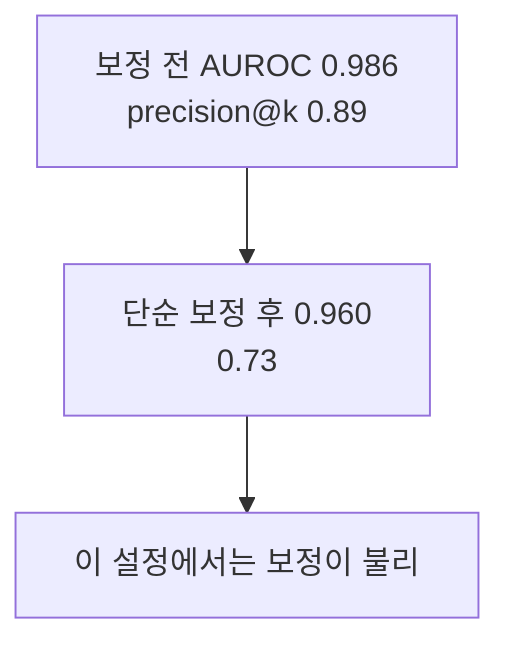

# 클래스 불균형 보정(adjust_pred_probs)

> 클래스 불균형 보정은 라벨 품질 점수를 낼 때 클래스마다 확률의 눈높이가 다르다는 점을 보정하는 단계다. 소수 클래스는 확률이 전반적으로 낮으므로, 클래스별 임계값으로 확률을 조정해 소수 클래스의 정상 샘플이 의심 대상으로 몰리는 것을 막으려는 목적이다.

## 쉽게 말하면
반 학생 95명이 과목 A, 5명이 과목 B를 선택한 반에서 조교는 "과목 B"라고 확신하는 일이 거의 없다. B 학생의 정답에 대한 조교 확신도는 늘 낮다. 그 낮은 확신도를 그대로 쓰면 B 학생의 답안지가 전부 의심 대상이 된다. 그래서 과목별 기준 눈높이로 점수를 조정한다는 발상이다.

## 자세히
- **발상(해석, cleanlab의 이름을 빌린 일반적 설명)**: [Confident Joint](#confident-joint)가 쓰는 클래스별 임계값(주어진 라벨이 k인 샘플의 k에 대한 평균 확률)을 이용해 확률을 클래스별로 조정한 뒤 점수를 만든다. 이 글에서 cleanlab 문서의 정확한 정의를 열어 확인하지 않았고, 아래 실험은 "확률을 클래스 임계값으로 나눈 뒤 다시 정규화"하는 단순한 변형이다. cleanlab의 `adjust_pred_probs`와 같지 않을 수 있다.
- **직접 해 본 실험(합성 이진 분류 4,000개, 소수 클래스 5%, 라벨의 10%를 반대로 변경, 로지스틱 회귀 5겹의 표본 외 확률)**: 클래스별 임계값은 다수 0.867, 소수 0.234였다. 라벨 변경은 다수 클래스 샘플이 소수 라벨로 바뀌는 경우가 많아, 주어진 라벨 기준 소수 라벨이 전체의 15%인데 실제 오라벨의 95%가 소수 라벨이었다. 이 상황에서 보정 전 self_confidence는 AUROC 0.986, precision@k 0.89였고, 단순 보정 후는 AUROC 0.960, precision@k 0.73으로 오히려 나빠졌다. 보정 전에는 의심 상위 후보가 전부 소수 라벨(1.00)이었는데 이것이 이 설정에서는 정확한 판단이었다. 보정이 도움이 되는 조건은 이 실험에서 확인하지 못했다.
- **해석**: 불균형 데이터에서 "소수 라벨이 많이 의심받는 것"이 편향인지 실제 오류의 분포인지 먼저 구분해야 한다. 오류가 정말 소수 라벨 쪽에 몰려 있다면 보정이 오히려 신호를 지운다. 보정은 소수 클래스 정상 샘플의 오탐이 문제인 경우를 위한 도구이며 자동으로 좋아지지 않는다.
- **권장(해석)**: 보정 전후의 상위 후보를 사람이 같은 개수만큼 검수해 정밀도를 비교하고, 데이터에 맞는 쪽을 쓴다. 불균형 데이터는 [불균형 데이터 평가 지표](#imbalanced-eval-metrics)도 함께 본다.

## 그림으로 보기

## 예시
- 사기 거래 1%인 데이터에서 라벨 오류 후보를 찾을 때, 보정 전후 상위 100개를 각각 검수해 실제 오라벨 수를 비교한다.
- 교육 활용: 오류가 소수 라벨에 몰린 경우와 균등한 경우를 만들어 보정의 효과가 달라지는지 실험한다.

## 헷갈리는 것과 비교
| 개념 | 차이 |
| --- | --- |
| 클래스 불균형 보정 | 클래스별 확률 눈높이 조정 |
| [self_confidence](#self-confidence-score) | 주어진 라벨 확률 그대로 |
| [normalized margin](#normalized-margin-score) | 경쟁 클래스와의 차 |
| [Confident Joint](#confident-joint) | 임계값을 쓰는 오류 개수 추정 |

## 더 읽을거리
- [Confident Learning (arXiv 1911.00068)](https://arxiv.org/abs/1911.00068) — 클래스별 임계값 원리
