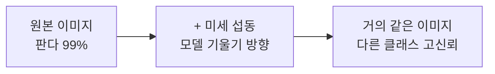
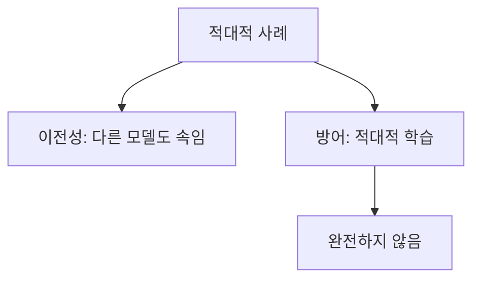

# 적대적 사례

> 적대적 사례(adversarial example)는 사람 눈엔 거의 같은데 모델이 **자신 있게 틀리도록** 일부러 계산해 만든 입력이다. 평균 정확도가 높아도 최악의 입력에는 취약하다는 것을 보여 준다.

## 쉽게 말하면
정지 표지판에 사람은 눈치채지 못할 만큼 미세한 스티커를 붙였더니 자율주행 AI가 "속도 제한"으로 읽는 상황이다. 장난이 아니라, 모델이 가장 헷갈려 하는 방향을 계산해서 살짝 민 것이다.

## 자세히
- **발견(Szegedy 외, "Intriguing properties of neural networks", arXiv 1312.6199, 초록 직접 확인)**: 심층 신경망이 배운 입력-출력 매핑은 꽤 불연속적이어서, 예측 오류를 최대화하도록 찾은 **거의 알아채기 힘든 작은 섭동**이 이미지를 오분류시킨다. 또 같은 섭동이 **다른 데이터 부분집합으로 학습한 다른 네트워크도** 같은 입력에서 틀리게 만든다는 이전성(transferability)을 보고했다.
- **설명(Goodfellow·Shlens·Szegedy, arXiv 1412.6572, 초록 직접 확인)**: 취약성의 주된 원인을 신경망의 **선형적 성질**로 설명하고, 이 관점에서 적대적 사례를 만드는 "간단하고 빠른 방법"(보통 FGSM으로 불림, 페이지 초록에는 이름이 없음)을 얻는다. 적대적 사례를 학습에 섞는 것이 MNIST의 maxout 네트워크 테스트 오류를 줄였다고 한다.
- **일반 손상과의 차이**: [ImageNet-C·ImageNet-P](#imagenet-c-p) 논문은 자신이 최악 사례 적대 섭동이 아닌 **흔한 손상**을 평가한다고 밝힌다. 적대적 사례는 모델의 약점을 직접 겨냥해 계산한다.
- **프롬프트 인젝션과의 관계(일반적 지적, 이번에 출처 미확인)**: LLM에서는 모델 입력의 텍스트 조작(탈옥·인젝션)이 비슷한 "악의적 입력" 문제로 다뤄진다.
- **방어의 한계(해석)**: 적대적 학습 등 방어가 있으나 완전한 해법은 없다고 알려져 있다. 이 글은 방어 성능 수치를 직접 확인하지 않았다.

## 그림으로 보기

## 예시
- 정지 표지판·얼굴 인식·스팸 필터에 대한 악의적 우회 테스트(레드팀).
- 교육 소재: "AI의 확신은 믿을 만한가?"를 보여 주는 사례. 코드 없이 개념 도식만으로 설명 가능.

## 헷갈리는 것과 비교
| 개념 | 차이 |
|---|---|
| 적대적 사례 | 최악을 겨냥해 계산한 입력 |
| 흔한 손상 | 노이즈·흐림·날씨 같은 자연스러운 변화 |
| [ImageNet-C·ImageNet-P](#imagenet-c-p) | 후자의 표준 벤치마크 |
| [변형 강도 단계](#perturbation-severity-levels) | 변형을 단계별로 올려 곡선 |

## 더 읽을거리
- [Intriguing properties of neural networks (arXiv 1312.6199)](https://arxiv.org/abs/1312.6199) — 최초 발견·이전성(초록 확인).
- [Explaining and Harnessing Adversarial Examples (arXiv 1412.6572)](https://arxiv.org/abs/1412.6572) — 선형성 가설(초록 확인).
