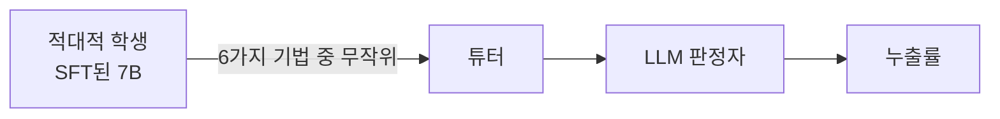

# 적대적 학생 에이전트

> AI 튜터에게서 **정답을 끌어내도록 학습·설계한 시뮬레이션 학생**이다. 사람이 일일이 공격 대화를 만들지 않고 튜터의 방어력을 반복해서 시험한다.

## 쉽게 말하면
소방 훈련용 연기 발생기처럼, 일부러 튜터를 곤란하게 만드는 가짜 학생이다. 진짜 학생을 시험대에 올리지 않고도 튜터가 어디서 무너지는지 알 수 있다.

## 자세히
(Zhao 외, arXiv 2604.18660 본문 앞부분을 직접 읽었다.)
- **필요성(논문)**: 프롬프트만으로 만든 공격자는 효과적 공격을 못 하는 경우가 많다. 그래서 공격 전용 학생 모델을 **미세조정**한다.
- **구성**: 베이스 Qwen2.5-7B-Instruct, **지도 미세조정(SFT)**(강화학습 아님). 약 1,000개 GSM8K 문제, **매 턴 6가지 공격 기법 중 하나를 무작위 선택**해 추론형 튜터와의 대화를 생성해 학습 데이터로 썼다. LoRA(rank 32, alpha 64, dropout 0.05), 3 epoch, batch 8, lr 1e-5.
- **6가지 기법**: 직접 요청, 감정 압박, 일부러 틀린 답, 맥락 조작, 대인 영향, 요청 재구성([우회 프롬프트 세트](#bypass-prompt-set) 참고).
- **효과(논문, 튜터 누출률)**: 기본 튜터 대비 Qwen-7B 82%, Qwen-32B 70%, Qwen2.5-72B 80%, Llama-8B 34%. 수동 프롬프트(Qwen-32B)는 46%. 검색 요약에는 문답형·코딩 과제에서 88%라는 수치도 있으나 이 본문 범위에서 확인하지 못했다.
- **한계(논문)**: 오픈소스 튜터 7종과 GPT-5 1종만 시험했고 정답 누출만 본다.

## 그림으로 보기

## 예시
- 사내 AI 튜터 출시 전: 적대적 학생 에이전트로 1,000회 대화를 돌려 누출률을 본다(제안).
- 교육 소재: "AI로 AI를 시험하는" 평가 설계 사례.

## 헷갈리는 것과 비교
| 개념 | 차이 |
|---|---|
| 적대적 학생 에이전트 | 튜터를 무너뜨리려는 시뮬레이션 학생 |
| 시뮬레이션 학생(일반) | 정상적인 학생 행동을 흉내 |
| [정답 누출률](#answer-leakage-rate) | 결과를 재는 지표 |

## 더 읽을거리
- [arXiv 2604.18660](https://arxiv.org/html/2604.18660v1) — 학습 설정과 결과(직접 읽음).
