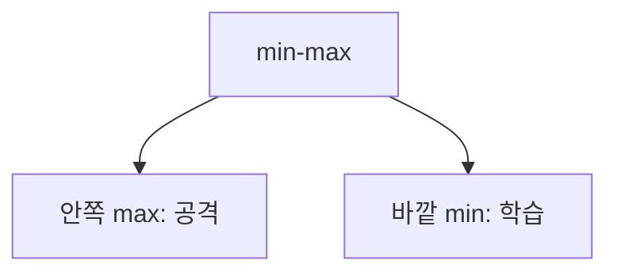

# 적대적 학습

> 학습 중에 적대적 사례를 만들어 함께 학습시켜 모델을 공격에 강하게 만드는 방법이다. Madry 외(2018)는 이를 "안쪽 최대화(공격)와 바깥쪽 최소화(학습)"의 min-max 문제로 정식화했다.

## 쉽게 말하면
권투 선수가 연습 상대를 일부러 반칙 잘하는 선수로 두는 것이다. 매 연습마다 가장 아픈 공격을 받아 보며 방어를 익힌다.

## 자세히
(Madry 외 arXiv 1706.06083과 Goodfellow 외 arXiv 1412.6572를 하위 에이전트가 읽은 노트 기준.)
- **정식화**: min_θ E[ max_{δ∈S} L(θ, x+δ, y) ]. 안쪽에서 허용 범위 S 안의 가장 해로운 변형을 찾고, 바깥에서 그 손실을 줄인다.
- **PGD 공격**: xᵗ⁺¹ = Π(xᵗ + α·sgn∇L), 무작위 시작점 사용(반복 FGSM 투영).
- **MNIST(ε=0.3)**: PGD 학습 모델이 PGD-100(재시작 20회) 89.3%, FGSM 95.6%, 블랙박스 약 95~97% 정확.
- **CIFAR-10(ε=8, wide ResNet)**: 자연 정확도 87.3%, FGSM 56.1%, PGD-7 50.0%, PGD-20 45.8%, 블랙박스 64~67%.
- **용량 효과**: 모델이 클수록 적대적 학습이 효과적. PGD 학습 단순/wide 모델의 자연 정확도 79.4%/87.3%, PGD 정확도 43.7%/45.8%.
- **초기 형태(Goodfellow 외)**: J̃ = 0.5·J(x) + 0.5·J(x+ε·sign∇J), maxout 오류 89.4% → 17.9%.
- **한계(제안)**: 학습 비용이 크게 늘고(반복 공격 포함) 깨끗한 정확도가 줄 수 있으며, 학습에 쓴 공격 유형 밖에서는 보장이 약하다. 그림 4 표의 일부 열은 추출이 모호해 미확인.

## 그림으로 보기

## 예시
- CIFAR-10 분류기에 ε=8/255 PGD 학습을 적용하고 자연·공격 정확도의 차이를 비교.
- 교육 활용: 훈련 상대가 강할수록 방어력이 느는 비유.

## 헷갈리는 것과 비교
| 개념 | 차이 |
|---|---|
| 적대적 학습 | 학습에 공격 포함 |
| 데이터 증강 | 일반 변형(공격 아님) |
| [AugMix](#augmix) | 흔한 손상 견고성 향상 |

## 더 읽을거리
- [Towards Deep Learning Models Resistant to Adversarial Attacks (arXiv 1706.06083)](https://arxiv.org/abs/1706.06083) — min-max와 PGD.
