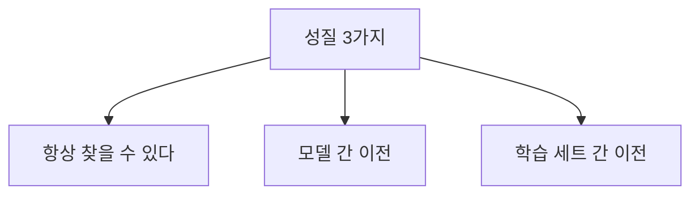

# 적대적 이전성

> 한 모델을 속이려고 만든 적대적 사례가 구조·학습 데이터가 다른 다른 모델에서도 같은 입력을 오분류시키는 성질이다. 공격자가 대상 모델을 몰라도 대리 모델로 공격할 수 있는 근거가 된다.

## 쉽게 말하면
한 학생을 속이는 트릭 문제가 같은 학원을 안 다닌 다른 학생에게도 통하는 현상이다. 문제에 숨은 공통 약점이 있기 때문이다.

## 자세히
(Szegedy 외 "Intriguing properties of neural networks" arXiv 1312.6199를 하위 에이전트가 원문으로 읽은 노트 기준. Papernot 2016 이전성 논문은 열지 못해 미확인.)
- **주장한 성질**: ① 연구한 모든 네트워크(MNIST, QuocNet, AlexNet)에서 사람 눈에 구별되지 않는 적대적 사례를 항상 찾을 수 있다 ② **모델 간 일반화**: 하이퍼파라미터(층 수·정규화·초기화)가 다른 모델에서도 오분류 ③ **학습 세트 간 일반화**: 서로소 훈련 부분집합으로 학습한 모델에서도 오분류. 초록: "같은 섭동이 다른 데이터 부분집합으로 학습한 다른 네트워크를 같은 입력에서 오분류시킬 수 있다".
- **방법**: 박스 제약 L-BFGS로 ‖r‖₂ 최소화 s.t. f(x+r)=l, x+r ∈ [0,1]ᵐ.
- **표 1(MNIST 최소 왜곡 D)**: FC10(1e-4) 시험 오류 7.4%, D 0.062 / FC100-100-10 1.64%, 0.058 / FC200-200-10 1.54%, 0.065 / AE400-10 1.9%, 0.086.
- **표 2(모델 간 오류, 대각선 100%)**: FC10(1e-4)용 사례가 FC10(1e-2)에서 11.7%, FC10(1)에서 22.7%, FC100-100-10에서 2%. FC10(1)용 사례는 71.9%/76.2%/…로 높다. 가우시안 잡음 표준편차 0.1·0.3은 각각 0~18.3%, 3~23% 오류.
- **표 4(서로소 절반 P1·P2)**: FC100-100-10용 사례(표준편차 .062)가 P1의 다른 구조 모델에서 26.2%, P2 학습 모델에서 5.9%. 증폭하면(표준편차 0.1) 98%와 43%까지 올랐고 가우시안 잡음은 2~3%.
- **의미(제안)**: 대리 모델 공격의 위험. 단, 이전율은 모델·설정마다 크게 다르다.

## 그림으로 보기

## 예시
- 오픈소스 모델로 만든 공격 이미지가 상용 API에서도 통하는지 점검(보안 평가).
- 교육 활용: 한 모델의 취약성이 다른 모델에도 있을 수 있음을 설명.

## 헷갈리는 것과 비교
| 개념 | 차이 |
|---|---|
| 이전성 | 모델 간 공격 전달 |
| 화이트박스 공격 | 대상 모델 기울기 접근 |
| [FGSM](#fgsm) | 공격 생성 방법 |

## 더 읽을거리
- [Intriguing properties of neural networks (arXiv 1312.6199)](https://arxiv.org/abs/1312.6199) — 성질·표 1~4.
