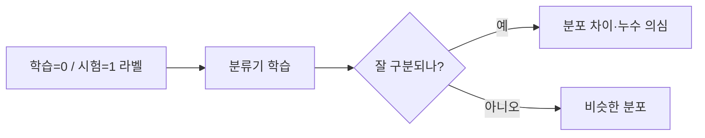

# 적대적 검증(adversarial validation)

> **학습 데이터와 시험 데이터를 구분하는 분류기**를 만들어, 잘 구분된다면 두 분포가 다르거나 누수가 있다는 신호로 보는 점검법이다.

## 쉽게 말하면
연습 문제와 실제 시험 문제를 보고 "이건 시험 문제네"라고 쉽게 맞히는 감별사가 있다면, 둘이 너무 다르다는 뜻이다. 둘이 같은 분포라면 감별사는 찍는 수준이어야 한다.

## 자세히
(TheoremPath 페이지를 직접 읽었다. 공식과 코드는 페이지에 없다.)
- **방법(페이지)**: 학습 예시와 시험 예시를 구별하는 분류기를 학습한다. **성공하면 분포가 다르며 누수 가능성**이 있다.
- **누수 탐지 체크리스트(페이지)**: ① 비자명한 과제에서 의심스럽게 높은 성능 ② 비정상적 특징 중요도(한 특징이 예측력 95%) ③ 적대적 검증 ④ 시간 일관성(예측 시점 이후 정보를 쓰는 특징이 없는지).
- **해석(해석)**: 분류기의 정확도(AUC)가 0.5 근처면 분포가 비슷하고 높을수록 다르다. 이 페이지는 임계값을 제시하지 않는다.
- **한계**: 분포가 다르다는 것이 곧 누수는 아니다(운영 분포 변화일 수도 있다).

## 그림으로 보기

## 예시
- 새 고객사 데이터로 평가할 때, 기존 학습 데이터와 구분이 잘 되는지 먼저 확인해 도메인 차이를 파악(제안).

## 헷갈리는 것과 비교
| 개념 | 차이 |
|---|---|
| 적대적 검증 | 두 데이터를 구분하는 분류기 |
| [전처리 누수](#preprocessing-leakage) | 변환 통계가 새어 듦 |
| 데이터 드리프트 | 운영 중 분포 변화 |

## 더 읽을거리
- [TheoremPath](https://theorempath.com/topics/train-test-split-and-data-leakage) — 직접 읽음.
