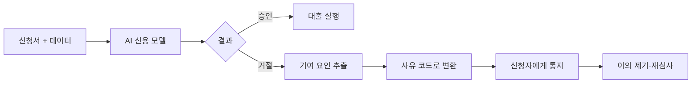

# 거절 사유 설명 의무

> 대출·신용 심사에서 거절하거나 불리한 조건을 줄 때, AI 모델을 썼더라도 "구체적인 거절 사유"를 신청자에게 알려야 하는 법적 의무.

## 쉽게 말하면
시험에서 떨어졌는데 "AI가 그렇게 판단했습니다"라고만 하면 억울하다. 법은 "어느 과목에서 몇 점이 모자랐는지"를 말해 주라고 한다. 모델이 아무리 복잡해도 설명할 수 없다는 이유로 이 의무가 면제되지 않는다.

## 자세히
- **미국 ECOA·Reg B**: 신용 거절·불리한 조치 시 '주된 사유(principal reasons)'를 구체적으로 통지해야 한다.
- **CFPB Circular 2022-03(2022-05-26)**: 복잡한 알고리즘 때문에 사유를 정확히 특정하지 못해도 통지 의무는 그대로이며, 기술이 너무 복잡하다는 변명은 인정되지 않는다고 밝혔다. 체크리스트식 일반 사유가 불충분할 수 있다는 후속 서한(2023)이 있었다고 기억하나 이번에 직접 확인하지 못했다(주장).
- **최신성 주의**: 2025년 CFPB가 여러 지침을 철회·정비했다는 보도가 있어 현재 효력은 CFPB 사이트에서 확인해야 한다(미확인). 원칙 자체는 법령(ECOA)에 있어 남는다.
- **기술적 대응**: 블랙박스 모델에는 SHAP 같은 사후 설명 기법으로 기여도 상위 요인을 뽑아 사유 코드로 매핑하거나, 처음부터 해석 가능한 모델(로지스틱 회귀·단조 제약 GBM)을 쓴다. 사후 설명이 모델의 실제 근거와 어긋나지 않는지 검증이 필요하다.
- 한국에서도 신용정보법상 자동화평가 결과에 대한 설명·이의제기 요구권이 있다(상세는 별도 확인 필요).

## 그림으로 보기

## 예시
- 거절 통지: "소득 대비 부채 비율 과다, 최근 6개월 연체 이력" — 구체적. "내부 점수 미달"은 부적절.
- 모델 선택: 설명 의무가 중요한 상품이면 정확도 약간을 포기하고 해석 가능한 모델을 택하는 결정도 한다.

## 헷갈리는 것과 비교
| 개념 | 차이 |
|---|---|
| 거절 사유 통지 | 개별 결정 하나에 대한 이유 |
| 모델 설명 가능성(XAI) | 기술 방법. 통지의 재료 |
| 공정 대출(차별 금지) | 보호 속성 때문에 결과가 달라지지 않는지 |
| [EU AI Act](#eu-ai-act) | 신용평가를 고위험으로 분류해 투명성 요구 |

## 더 읽을거리
- [Goodwin: CFPB Says Creditors Must Provide Reasons... Even When Relying On AI](https://www.goodwinlaw.com/en/insights/publications/2022/06/06_06-cfpb-says-creditors-must-provide--reasons) — Circular 2022-03 해설
- [Consumer Finance Monitor: CFPB Circular on ECOA adverse action and algorithms](https://www.consumerfinancemonitor.com/2022/05/26/cfpb-issues-new-circular-on-the-application-of-ecoa-adverse-action-notice-requirements-to-credit-decisions-using-algorithms/) — 요약
