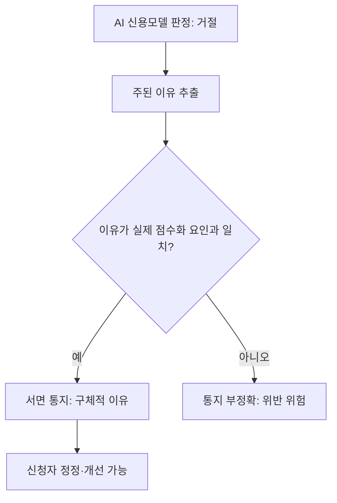

# 불리한 조치 통지

> 미국 ECOA·Regulation B에서 대출 거절 등 불리한 조치를 할 때 신청자에게 그 이유를 알리도록 요구하는 서면 통지. AI 신용모델을 써도 구체적이고 정확한 이유를 줄 수 있어야 한다는 논쟁의 중심이다. (법률 자문 아님)

## 쉽게 말하면
대출이 거절됐을 때 "시스템이 그렇게 정했어요"가 아니라 "소득 대비 부채가 높아서" 같은 진짜 이유를 서면으로 받을 권리다. 이유를 알아야 고치고, 부당한 차별도 점검할 수 있다.

## 자세히
출처: CFPB 회람 2022-03 페이지(2026-11-15 확인), 연방관보 2025-05-12 철회 목록(확인).
- **대상 조치**: 신청 거절, 기존 계정 폐쇄, 불리한 조건 변경, 한도 증액 거절.
- **CFPB 회람 2022-03(2022-06 게시)의 입장**: 복잡한 알고리즘("블랙박스" 모델)을 써도 ECOA·Reg B의 통지 요건은 똑같다. 구체적이고 정확한 주된 이유를 말할 수 없으면 그 모델을 쓰면 안 된다. "내부 정책", "점수 기준 미달"만으로는 부족. 공개 이유는 실제 고려·점수화한 요인과 일치해야 한다. 샘플 양식에서 가장 가까운 이유에 체크만 하는 방식은 실제 쓰이지 않은 이유라면 불충분. 사후 설명(post-hoc) 도구는 근사치라 그 정확도를 검증할 수 있어야 하며 덜 해석 가능한 모델에선 어려울 수 있다. 자기 기술을 이해하지 못한 것은 면책 사유가 아니다.
- **회람 2023-03(2023-09-19 게시, 샘플 양식 체크리스트 관련)**: 페이지 본문은 열리지 않아 내용을 확인하지 못했다.
- **중요한 변경**: 연방관보 2025-05-12 철회 목록에 회람 2022-03(목록 "기타 지침" 14번)과 2023-03(7번)이 모두 있다. CFPB는 이 철회가 반드시 최종은 아니라고 밝혔다. 즉 이 두 문서는 현재 CFPB 공식 입장이 아니지만, ECOA·Reg B 자체의 통지 의무(조문)는 별개로 남아 있다. 현행 조문·기관 입장은 확인이 필요하다.
- 실무: 설명 가능한 모델·이유 코드 매핑을 설계하고 이유와 실제 점수화 요인을 일치시키는 것이 안전하다.

## 그림으로 보기

## 예시
- 좋은 통지: "최근 12개월 연체 2회, 신용 한도 대비 사용률 92%". 나쁜 통지: "내부 모델 점수 미달".
- 모델 개발 시 변수 그룹별 기여도를 이유 코드로 매핑해 두고, 설명 도구의 근사 정확도를 정기 검증.

## 헷갈리는 것과 비교
| 개념 | 차이 |
|---|---|
| 불리한 조치 통지 | 거절 이유 서면 고지 |
| [신용 차별 영향 분석](#disparate-impact-credit) | 결과의 차별 효과 점검 |
| [CFPB 회람](#cfpb-circular-2023-03) | 해석 문서(철회됨) |

## 더 읽을거리
- [CFPB Circular 2022-03](https://www.consumerfinance.gov/compliance/circulars/circular-2022-03-adverse-action-notification-requirements-in-connection-with-credit-decisions-based-on-complex-algorithms/) — 복잡한 알고리즘과 통지 이유
- [Federal Register 2025-08286](https://www.govinfo.gov/content/pkg/FR-2025-05-12/html/2025-08286.htm) — 철회된 CFPB 지침 목록
