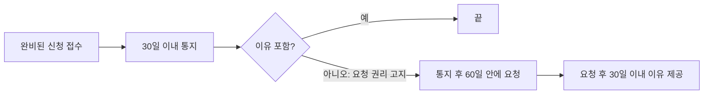
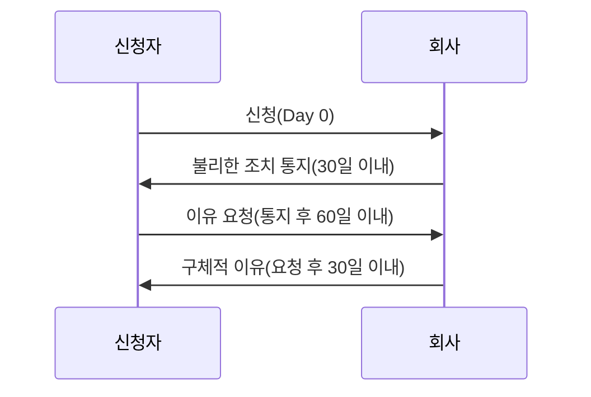

# 통지 시한 30일·60일

> 미국 Regulation B(12 CFR 1002.9)가 신용 거절 같은 "불리한 조치"를 신청자에게 알려야 하는 시한. 대표 숫자는 30일(통지)·60일(이유 요청 가능 기간)·90일(역제안)이다. 숫자가 헷갈리기 쉬워 따로 정리한다. (법률 자문 아님)

## 쉽게 말하면
택배 배송 약속처럼 "접수 후 며칠 안에 결과를 알려야 한다"는 규칙이다. 다만 숫자가 세 가지다. 회사가 알려야 하는 기한(30일), 신청자가 "왜 거절했는지 알려 달라"고 요청할 수 있는 창(60일), 역제안을 받고 대답이 없을 때의 기한(90일). 이 세 개를 섞으면 안 된다.

## 자세히
출처: CFPB Regulation B §1002.9 조문 페이지(직접 열어 읽음, 2026-11-17).
- **통지 시한 §1002.9(a)(1)** — 아래 경우 모두 30일 안에 통지한다:
  - 완비된 신청서를 받은 뒤(승인·역제안·불리한 조치 중 무엇이든)
  - 불완전한 신청서에 불리한 조치를 할 때(미비 통지를 보낸 경우 제외)
  - 기존 계좌에 불리한 조치를 할 때
- **역제안(counteroffer)**: 신청자가 명시적으로 받아들이거나 사용하지 않으면 **90일** 뒤에 통지.
- **60일의 정체**: 불완전한 신청의 기한이 아니다. 이유 진술을 요청할 수 있는 창이다. 통지서가 이유 대신 "30일 내에 이유를 요청할 수 있다"고 알리는 경우, 요청은 통지 후 60일 안에, 회사는 요청을 받고 30일 안에 이유를 준다(이유 코드 글 참고).
- **불완전 신청 §1002.9(c)**: 30일 안에 조치하거나 미비 통지를 보내야 한다.
- **통지 내용 §1002.9(a)(2)**: 서면으로 조치 내용, 회사 이름·주소, ECOA 701(a) 권리 문구, 감독 연방기관의 이름·주소, 그리고 구체적 이유 또는 이유 요청 방법.
- **예외**: 전년도 신청 150건 이하의 소규모 회사는 구두 통지 가능(§1002.9(d)). 전년 총매출 100만 달러 이하 사업체 신용은 간소 규칙(§1002.9(a)(3)).
- AI 신용 모델을 쓸 때도 시한은 같다. 자동 결정이라 즉시 나갈 수 있지만 시스템이 30일 내 통지를 보장하는지 점검해야 한다.

## 그림으로 보기

## 예시
- 1월 1일 완비된 대출 신청 → 1월 31일까지 승인·거절·역제안 중 하나를 알려야 한다.
- 거절 통지에 이유가 없고 "요청 가능"이라고만 쓴 경우, 신청자가 거절 통지 후 45일째에 요청했다면 유효(60일 이내), 회사는 요청 후 30일 안에 이유를 준다.

## 헷갈리는 것과 비교
| 숫자 | 의미 |
|---|---|
| 30일 | 회사가 통지해야 하는 기한 / 요청받은 뒤 이유 제공 기한 |
| 60일 | 신청자가 이유를 요청할 수 있는 창 |
| 90일 | 역제안에 응답 없을 때 통지 기한 |
| [이유 코드](#reason-codes) | 통지에 들어갈 구체적 이유 |
| [불리한 조치 통지](#adverse-action-notice) | 통지 의무 전체 |

## 더 읽을거리
- [Reg B §1002.9 Notifications (CFPB)](https://www.consumerfinance.gov/rules-policy/regulations/1002/9/) — 시한·내용 조문
