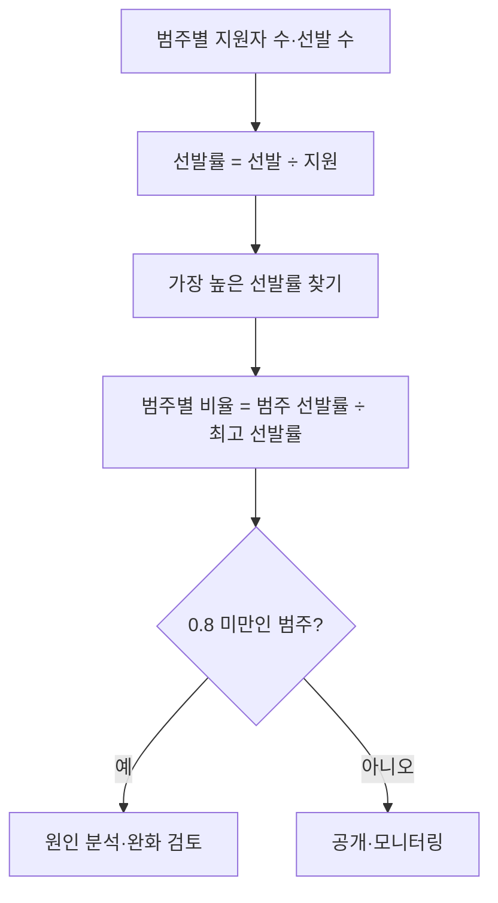

# 불리한 영향 비율 (Impact Ratio)

> 집단별 선발률(또는 점수 기준 통과율)을 **가장 높은 집단의 값으로 나눈 비율**. 1.0에 가까울수록 집단 간 격차가 작다. 미국 EEOC 4/5 규칙과 뉴욕시 Local Law 144 편향 감사의 핵심 계산이다.

## 쉽게 말하면
반 학생들의 합격률이 A반 50%, B반 40%라면 B반 비율은 40/50 = 0.8이다. 가장 높은 반을 1로 놓고 다른 반이 그 몇 %인지 보는 것이다. 이 숫자만으로 유죄를 가리지는 못하지만 어디를 더 볼지 알려 주는 신호등이다.

## 자세히
출처: 뉴욕시 DCWP Local Law 144 최종 규칙 채택 공고(2023-04-06, 원문 PDF를 직접 읽음). 4/5 규칙은 [4/5 규칙](#four-fifths-rule) 노드가 29 CFR 1607.4 조문으로 정리했다.
- **정의(규칙 원문)**: 임팩트 레이쇼 = ①해당 범주의 선발률 ÷ 가장 많이 선발된 범주의 선발률, 또는 ②해당 범주의 점수 통과율(scoring rate) ÷ 점수 통과율이 가장 높은 범주의 값.
- **선발률**: 범주 안에서 다음 단계로 진행하거나 AEDT가 분류를 부여받은 사람의 비율. 규칙의 예: 히스패닉 여성 100명이 지원해 40명이 면접 대상이 되면 40%.
- **점수 통과율**: AEDT가 낸 점수가 표본 중앙값을 넘는 비율(점수형 도구용).
- **감사 절차**: 범주별 선발률 → 임팩트 레이쇼. 성별, 인종·민족, 성별×인종 교차 범주를 각각 따로 계산한다.
- **2% 예외**: 데이터의 2% 미만인 범주는 독립 감사인이 임팩트 레이쇼 계산에서 제외할 수 있다(최종 규칙에서 추가됨). 요약에 제외 사유가 필요하다는 것은 검색 요약으로만 확인했다.
- **공식 예시표**: 남성 1,390명 중 667명 선발(48%, 1.00), 여성 1,181명 중 555명(47%, 0.979). 인종 범주에서는 흑인 0.84, 아시아계 0.95 등.
- **합격선 없음**: 규칙은 비율의 통과 기준을 두지 않고 결과 공개를 요구한다(검색 요약). 0.8은 EEOC 지침에서 온 참고선이다.

## 그림으로 보기


## 예시
```python
import pandas as pd
df = pd.DataFrame({"group": ["M", "F"], "applied": [1390, 1181], "selected": [667, 555]})
df["rate"] = df.selected / df.applied
df["impact_ratio"] = df.rate / df.rate.max()
print(df.round(3))   # F: 0.979
```
교육 활용: HR 직무 교육에서 AI 서류 심사 도구의 감사 요약표를 읽는 연습 소재로 쓴다.

## 헷갈리는 것과 비교
| 개념 | 차이 |
|---|---|
| 임팩트 레이쇼 | 집단 선발률의 비(연속 지표) |
| [4/5 규칙](#four-fifths-rule) | 그 비를 0.8과 비교하는 경험칙 |
| 통계적 유의성 검정 | 표본이 작을 때 격차가 우연인지 판정 |
| 인구통계학적 동등성(Demographic parity) | 선발률 차이 자체를 보는 공정성 정의 |

## 더 읽을거리
- [DCWP 최종 규칙 채택 공고 PDF](https://www.sidley.com/-/media/resource-pages/ai-monitor/laws-and-regulations/20230406-nyc-dcwp-notice-of-adoption-of-final-rule-for-local-law-144.pdf?la=en) — 정의·공식 예시표(본문 확인)
- [Holistic AI: 회귀형 시스템의 임팩트 레이쇼](https://www.holisticai.com/blog/nyc-bias-audit-impact-ratio-regression) — 점수형 도구 계산 논의(검색 결과만 확인)
