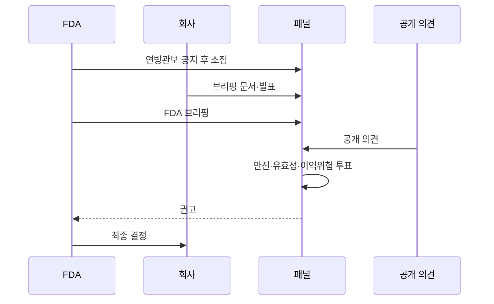
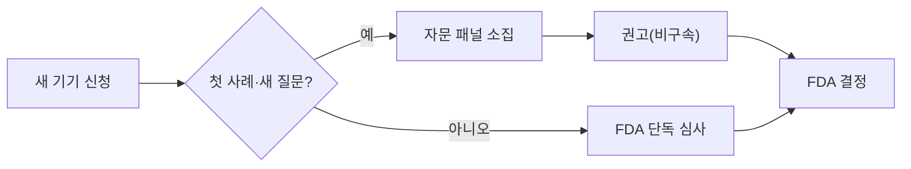

# FDA 자문 패널 회의

> FDA가 새롭거나 논쟁적인 의료기기를 허가하기 전에 외부 전문가에게 공개 회의에서 자문을 구하는 절차. "심사 패널(분류 체계)"과 이름이 비슷하지만 다르다. 투표는 권고일 뿐이고 최종 결정은 FDA가 한다.

## 쉽게 말하면
논문 심사에서 어려운 논문을 외부 심사위원단에게 돌려 공개 토론하는 것과 비슷하다. 새로운 AI 기기가 정말 안전하고 효과가 있는지 확신이 안 설 때, FDA는 임상의·통계학자·환자 대표를 불러 회사와 함께 공개로 토론하게 하고 의견을 듣는다. 의견이 갈려도 결정권은 FDA에 있다.

## 자세히
출처: FDA "Learn About FDA Advisory Committees" 페이지(직접 열어 읽음), 절차 세부는 의료기기 규제 자문 사이트 meddeviceguide의 글(2차 출처, 사례는 "예시 합성"이라고 글이 밝힘).
- **성격**: 자문(advisory)뿐이다. FDA 문구로 "FDA makes the final decisions on all matters that come before the committee." 위원회의 조언은 "FDA의 입장이 아니다".
- **구성**: 의사 겸 연구자·통계학자 같은 전문가와 소비자·산업계·환자 대표. 보통 4년 임기, 특정 회의에는 임시 위원이 합류. 의장이 회의를 진행하고, 지정 연방 공무원(DFO)이 위원회의 "관리인" 역할을 한다.
- **의료기기 쪽**: 의료기기 자문위원회(Medical Devices Advisory Committee) 아래 **18개 패널**(FDA 페이지는 전체 위원회 수를 "약 30개" 또는 "약 50개"로 서로 다르게 적어 불일치)이 분야별로 있다.
- **언제 연다**: 첫 사례의 III류 PMA나 새로운 과학·임상·기술 질문이 있는 신청, 재분류, 일부 De Novo·510(k), 시판 후 안전 문제(meddeviceguide). 안전·유효성이 잘 알려진 기기 유형이면 더 이상 의무적으로 열지 않는다.
- **공지**: 연방관보에 최소 15일 전 공지(보통 30~60일 전). 일정·토론 주제·의견 제출 방법 포함. 환자·의료인은 **공개 의견 청취(open public hearing)** 나 의견 수렴 창구(docket)로 참여한다.
- **진행(meddeviceguide 요약)**: 회사·FDA 브리핑 문서를 회의 이틀 전 공개 → 회사 발표(20~30분) → FDA 발표 → 공개 의견 → 위원 질의 → 투표. 투표 질문은 안전성 합리적 보증, 유효성 합리적 보증, 이익이 위험보다 큰지 세 가지. 위원이 각자 투표하고 간단한 근거를 말한다.
- **구속력**: 없다. 다만 같은 글은 "대부분 FDA가 패널과 같은 결론이고, 위험-이익 부정 표결 뒤 승인은 드물다"고 주장한다(출처 하나, 수치는 미검증).
- **빈도**: 같은 글에 따르면 2024년 38건에서 2025년 8월까지 9건으로 줄었다(전 센터 합계, 2차 출처). 의료기기 패널은 연 5~15회 추정.
- AI 기기는 영상의학 패널(영상 AI), 혈액·병리 패널(전체 슬라이드 영상 AI) 등이 맡는다. 디지털 헬스 자문위원회의 생성형 AI 논의는 이번에 직접 확인하지 못했다.

## 그림으로 보기

## 예시
- 최초의 소아 대상 AI 진단 소프트웨어 PMA가 접수되면 FDA가 패널을 소집해 임상시험 설계와 편향 위험을 공개 토론에 부친다(가상 예).
- 소비자 대표 자리에 지원하는 환자·보호자는 패널에서 환자 관점을 전하는 역할을 맡는다.

## 헷갈리는 것과 비교
| 개념 | 차이 |
|---|---|
| 자문 패널 회의 | 허가 전 외부 전문가 공개 토론. 권고만 |
| [FDA 심사 패널](#fda-panel) | 기기를 16개 분야로 나누는 분류 체계 |
| [PMA·510(k)·De Novo](#fda-510k-de-novo-pma) | 허가 경로. 패널은 그 중간에 낄 수 있는 절차 |
| 분쟁 해결 패널 | 승인 거부 등 이의 신청 심사 패널(별도) |

## 더 읽을거리
- [Learn About FDA Advisory Committees (FDA)](https://www.fda.gov/patients/learn-about-fda-advisory-committees) — 목적·구성·공지 규칙(직접 읽음)
- [FDA Medical Device Advisory Committees: Panel Referral & Prep (meddeviceguide)](https://meddeviceguide.com/blog/fda-medical-device-advisory-committee-guide) — 소집 기준·진행·투표 질문(2차 출처)
