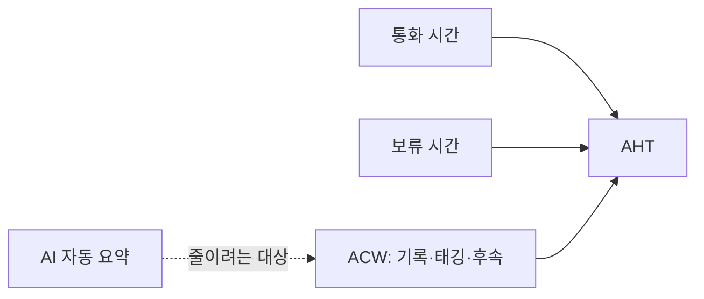

# 후처리 시간 ACW

> After-Call Work. 상담이 끝난 뒤 상담사가 기록·분류·후속 조치를 하는 시간. 평균 처리 시간(AHT)의 한 구성 요소이고, AI 통화 요약이 가장 흔히 줄이려는 대상이다.

## 쉽게 말하면
식당에서 손님이 나간 뒤 테이블을 치우고 영수증을 정리하는 시간이다. 손님 응대 시간은 아니지만 다음 손님을 받기 전에 반드시 필요한 시간이라 전체 처리량에 영향을 준다.

## 자세히
출처: 컨택센터 업체 블로그 검색 요약. 대부분 벤더 마케팅 자료이므로 수치는 벤더 보고치다.
- **정의**: 상호작용이 끝난 후의 기록·후속 작업. CRM 업데이트, 통화 노트 작성, 처리 결과(disposition) 태깅, 후속 조치 실행, 컴플라이언스 절차 포함.
- **AHT와의 관계**: AHT = 통화 시간 + 보류 시간 + ACW(Parloa 설명). 상담 인력 산정의 기본 지표.
- **AI 요약의 효과(벤더 보고, 방법론 미확인)**: 가장 많이 인용되는 약 35% 감소는 Metrigy 연구를 Zoom이 인용한 것으로 안내되나 원문을 찾지 못했다. Observe.AI 고객 Accolade는 50% 이상 감소, NICE 사례는 25% 감소를 보고. 정의·측정 방법에 따라 큰 차이가 있다.
- **측정 요령(일반)**: 도입 전후 같은 유형 통화를 비교하고, ACW 단축뿐 아니라 요약 품질(오류·누락)과 재문의율을 함께 본다. ACW가 줄어도 검수 시간이 늘면 순효과는 다를 수 있다([요약 수락률](#suggestion-acceptance-rate)).
- **오류 전파**: 자동 전사 오류가 요약에 들어가면 기록이 틀려진다([전사 오류 전파](#stt-error-propagation)).

## 그림으로 보기

## 예시
- 통화 6분 + 보류 1분 + ACW 3분 = AHT 10분. AI 요약으로 ACW를 3분에서 2분으로 줄이면 AHT 9분(10% 감소, 가상 예시).
- 품질 점검: AI 요약 중 무작위 50건을 사람이 검수해 누락·환각을 센다.

## 헷갈리는 것과 비교
| 개념 | 차이 |
|---|---|
| ACW | 통화 후 작업 시간 |
| AHT | 통화+보류+ACW 전체 |
| 통화 시간 | 고객과 대화한 시간 |
| [자동 통화 요약](#auto-call-summary) | ACW를 줄이는 AI 기능 |

## 더 읽을거리
- [Parloa: What is ACW?](https://www.parloa.com/knowledge-hub/what-is-acw/) — ACW와 AHT 정의(벤더 글, 검색 결과로만 확인)
- [Observe.AI: Accolade case study](https://www.casestudies.com/company/observeai/case-study/accolade-drives-member-engagement-with-over-50-reduction-in-after-call-work) — 벤더 사례
