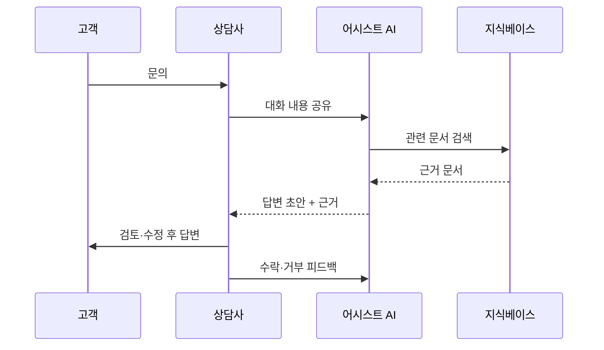

# 에이전트 어시스트

> 고객과 직접 대화하는 건 상담사(사람)로 두고, AI는 옆에서 답변 초안·관련 문서·요약을 실시간으로 제안하는 방식. 'AI가 사람을 돕는' 구조다.

## 쉽게 말하면
운전 연습 때 조수석에 앉은 선배다. 핸들은 내가 잡고, 선배는 "저 문서 보세요", "이렇게 말해 보세요"라고 귀띔한다. 최종 판단과 말은 상담사가 하므로, 틀린 제안은 걸러낼 수 있다.

## 자세히
- **구성**: ① 대화 실시간 읽기 ② 지식베이스 검색([RAG](#rag)) ③ 답변 초안 생성 ④ 상담사가 수락·수정·거부 ⑤ 통화 후 요약·분류 자동 작성.
- **대표 근거**: Brynjolfsson·Li·Raymond 「Generative AI at Work」(NBER w31161, 2023). 고객지원 상담사 5,179명 대상으로 AI 어시스턴트 도입 후 시간당 해결 건수가 평균 14% 증가했다. 초보·저숙련자는 약 34% 개선, 숙련자는 거의 변화 없음. 고객 감정 개선, 관리자 개입 요청 감소, 이직 감소도 보고됐다(논문은 개정되었으므로 최신판 확인).
- **의미**: AI가 우수 상담사의 노하우를 초보에게 퍼뜨리는 '암묵지 전파' 효과. 신입 교육 기간 단축에 쓴다.
- **고객 응대 챗봇과 차이**: 챗봇은 AI가 고객과 직접 말해 위험(환각)이 고객에게 바로 간다. 어시스트는 사람 검수 단계가 있어 도입 위험이 낮아 첫 단계로 흔히 선택된다.
- **주의**: 상담사가 제안을 무비판 수락하는 자동화 편향, 개인정보가 프롬프트에 들어가는 문제, 제안 품질을 수락률·수정률로 측정해야 한다.

## 그림으로 보기

## 예시
- 환불 규정 문의: AI가 최신 환불 정책 문단과 답변 초안을 띄우고 상담사가 고객 상황에 맞게 한 줄 고쳐 보낸다.
- 통화 종료: 3분 걸리던 상담 요약·티켓 분류를 AI가 채우고 상담사는 확인만 한다.

## 헷갈리는 것과 비교
| 개념 | 차이 |
|---|---|
| 에이전트 어시스트 | AI→상담사 제안, 사람이 고객과 대화 |
| 고객 응대 챗봇 | AI가 고객과 직접 대화 |
| [사람 이관 설계](#human-handoff) | 챗봇이 못 풀 때 사람에게 넘기는 규칙 |
| 자동 요약 | 어시스트의 부가 기능 |

## 더 읽을거리
- [Generative AI at Work (NBER w31161)](https://www.nber.org/papers/w31161) — 14% 생산성 연구 원문
- [CBS: Can AI help customer service reps help customers better?](https://www.cbsnews.com/amp/news/generative-ai-customer-support-agent-productivity) — 연구 쉬운 해설
