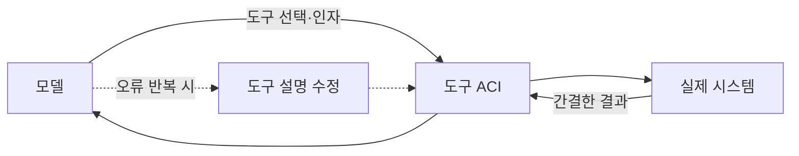

# 에이전트-컴퓨터 인터페이스(ACI)

> ACI는 사람용 UI가 아니라 **AI 에이전트가 쓰기 쉽도록** 도구의 이름·설명·입출력 형식을 설계하는 일이다. 에이전트는 도구를 확률적으로 고르고 토큰 단위로 읽기 때문에 일반 API와 다르게 설계해야 한다.

## 쉽게 말하면
새 직원에게 업무 시스템을 줄 때 화면이 헷갈리면 실수가 늘어난다. 에이전트에게 도구는 곧 그 화면이다. 이름이 모호하고 설명이 불친절하고 출력이 장황하면 에이전트도 헤맨다.

## 자세히
- 출처 맥락: Anthropic은 Building effective agents(2024-12)에서 ACI에 사람-컴퓨터 인터페이스(HCI)만큼 투자하라고 했다. 이어 "Writing tools for agents"(2025-09-11 전후 공개로 소개됨, 원문은 직접 열지 못해 2차 요약 기준)는 도구를 결정적 시스템과 비결정적 에이전트 사이의 **계약**으로 본다.
- 실무 원칙(2차 요약): 도구가 같은 오류를 반복하면 프롬프트보다 **도구 설계**를 의심한다. SWE-bench 에이전트를 만들 때 전체 프롬프트보다 도구 최적화에 시간을 더 썼다는 일화가 인용된다.
- 체크리스트: 이름은 동사+대상으로 명확히 / 설명에 쓰는 때와 인자 예시 / 실수하기 어렵게(절대경로 강제 등) / 출력은 필요한 만큼만 / 도구 수를 줄이고 겹치지 않게 / [평가](#ai-evaluation)로 도구를 개선.
- 한계: 구체 권고 문구는 2차 자료라 원문 대조가 필요.

## 그림으로 보기

## 예시
- 나쁜 도구: `search(q)` 가 JSON 수천 줄을 반환. 좋은 도구: `search_orders(customer_email, limit=5)` 가 핵심 필드만 반환.
- 파일 편집 도구에서 상대경로 때문에 오류가 잦으면 절대경로만 받게 바꾼다.

## 헷갈리는 것과 비교
| 개념 | 차이 |
|---|---|
| ACI | 에이전트가 쓰는 도구 설계 |
| API | 개발자가 결정적으로 호출 |
| [에이전트 루프](#agent-loop) | 도구를 반복 호출하는 구조 |
| [MCP](#mcp) | 도구를 연결하는 표준 규격(설계 품질은 별개) |

## 더 읽을거리
- [Writing tools for agents 요약 (beri.net)](https://www.beri.net/learning/anthropic-writing-effective-tools-for-agents) — 2차 요약
- Anthropic Engineering 원문: anthropic.com/engineering/writing-tools-for-agents (직접 열람 못 함)
