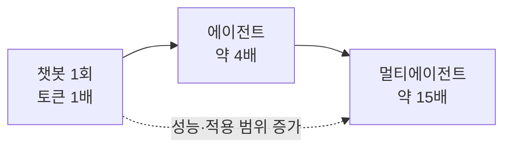
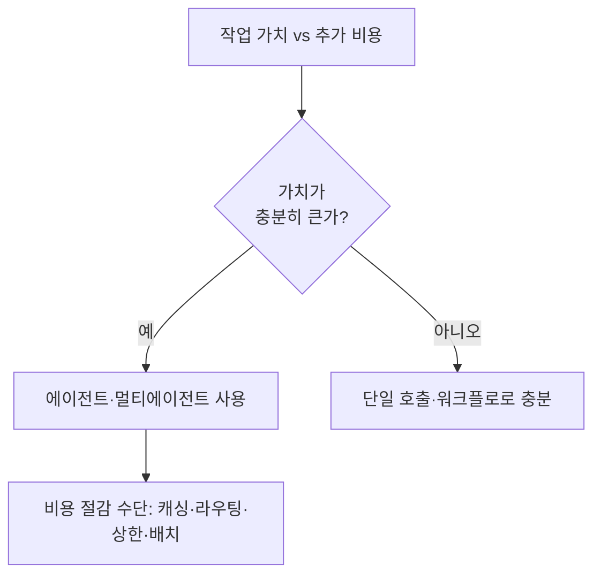

# 에이전트의 비용과 지연

> 에이전트는 여러 번 생각하고 도구를 부르며 성능을 얻는 대신, 한 번 묻고 답하는 챗봇보다 토큰(돈)과 시간을 훨씬 많이 쓴다. 이 대가를 알고 설계해야 한다.

## 쉽게 말하면
택시 호출 한 번과 출장 전문가 팀을 부르는 차이다. 전문가 팀이 훨씬 어려운 일을 해내지만 인건비와 시간이 몇 배 든다. 값비싼 일이면 쓸 가치가 있고, 가벼운 일이면 낭비다.

## 자세히
**토큰이 곧 비용이자 성능**(Anthropic 멀티에이전트 리서치 시스템 글)
- 에이전트는 채팅 대비 약 **4배**, 멀티에이전트 시스템은 약 **15배**의 토큰을 쓴다고 보고했다.
- BrowseComp 평가에서 성능 편차의 약 **80%를 토큰 사용량만으로** 설명했고, 도구 호출 수와 모델 선택까지 합하면 약 95%였다. 즉 성능이 토큰 투입에 크게 비례한다는 뜻이다.
- Claude Opus 4가 리드하고 Sonnet 4 하위 에이전트를 쓴 구성이 단일 Opus 4 에이전트보다 내부 리서치 평가에서 90.2% 앞섰다.
- 이런 구조는 **작업 가치가 추가 토큰 비용을 정당화할 때만** 경제성이 있다. 병렬화가 많거나, 정보가 한 컨텍스트에 안 들어가거나, 도구가 많고 복잡한 작업에 적합하다.
- 하위 에이전트·도구 호출을 병렬화해 복잡한 질의의 소요 시간을 최대 90% 줄였다.

**비용이 늘어나는 이유**
1. 루프 반복: 한 번의 "생각→도구 호출→관찰"마다 이전 대화 전체가 다시 입력으로 들어간다.
2. 도구 결과가 길면 컨텍스트가 커진다.
3. 여러 에이전트가 같은 배경 정보를 각자 다시 읽는다.
4. 오류 후 재시도·재계획.

**줄이는 방법**
- 가장 단순한 해법부터([단순함 원칙](#simplest-solution-first)): 단일 호출로 충분한지 먼저 평가한다.
- [프롬프트 캐싱](#prompt-caching)으로 반복되는 앞부분을 싸게 읽는다(캐시 읽기는 기본 입력가의 일부).
- 작은 모델에게 쉬운 단계를 맡기는 [모델 라우팅](#model-routing).
- 반복 횟수·토큰 상한을 둔다([반복 횟수 제한](#agent-loop-limit)).
- 즉시성이 필요 없으면 [배치 API](#batch-api).
- 도구 결과를 요약·필터링해 컨텍스트에 넣는다.
- **지연**은 병렬 호출, 스트리밍, 짧은 경로(사전 검색 등)로 줄인다.

**측정**: 작업 1건당 평균 토큰·비용·소요 시간·성공률을 같이 본다. 성공 1건당 비용이 핵심 지표다.

## 그림으로 보기

## 예시
- 시장 조사 리포트(가치가 높고 병렬 검색 가능): 멀티에이전트가 적합. 토큰 15배여도 사람 며칠 작업을 대체.
- 고객 FAQ 답변: 단일 호출 + 검색이면 충분. 멀티에이전트는 과잉 비용.
- 비용 점검: 한 작업당 토큰 로그를 뽑아 "성공 1건당 원가"를 계산하고 목표 단가를 정한다.

## 헷갈리는 것과 비교
| 개념 | 차이 |
|---|---|
| 비용 | 토큰·호출 수에 따른 금액 |
| 지연 | 최종 응답까지 걸린 시간. 병렬화로 줄일 수 있으나 비용은 늘 수 있음 |
| [워크플로 vs 에이전트](#workflow-vs-agent) | 워크플로는 예측 가능하고 싼 편, 에이전트는 유연하나 비쌈 |
| [오류 누적](#compounding-errors) | 단계가 늘수록 품질 위험도 함께 커짐 |

## 더 읽을거리
- [How we built our multi-agent research system (Anthropic)](https://www.anthropic.com/engineering/multi-agent-research-system) — 토큰 배수·성능·경제성
- [Building effective agents (Anthropic)](https://www.anthropic.com/engineering/building-effective-agents) — 지연·비용과 성능의 맞교환
