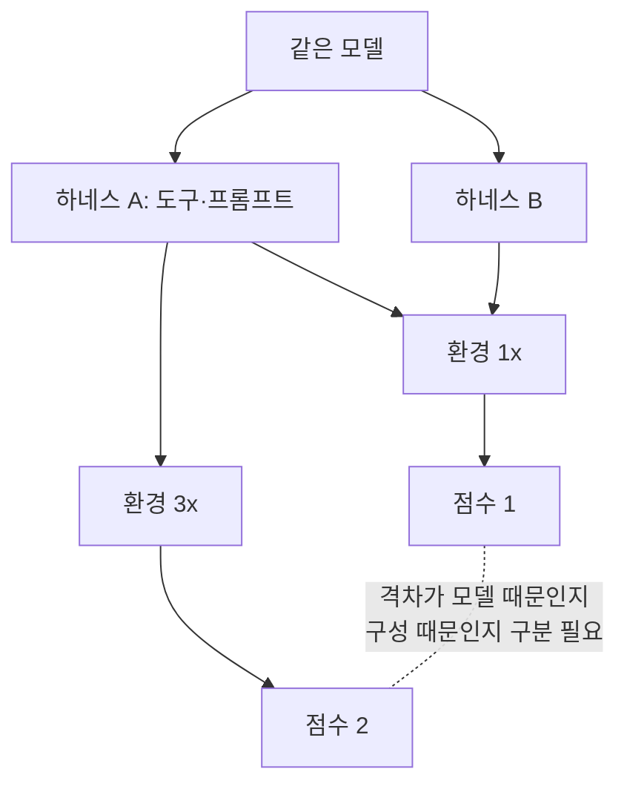
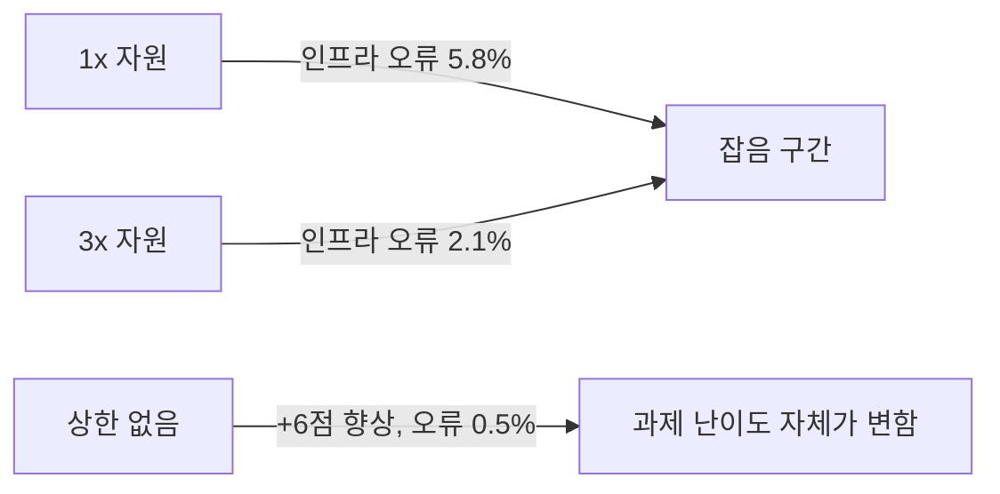

# 에이전트 하네스에 따른 점수 편차

> 같은 모델도 에이전트 구성(도구·프롬프트·턴 수·재시도)과 실행 환경(메모리·CPU·시간 제한)이 다르면 벤치마크 점수가 달라진다. 그래서 리더보드의 몇 점 차이는 모델 실력 차이가 아닐 수 있다.

## 쉽게 말하면
같은 선수가 신는 신발과 달리는 트랙이 다르면 기록이 달라진다. 모델이 선수라면 하네스(도구·프롬프트·루프)는 신발, 실행 환경(메모리·시간)은 트랙이다. 기록 비교는 같은 신발·같은 트랙일 때만 의미가 있다.

## 자세히
**Anthropic 엔지니어링 글 "Quantifying infrastructure noise in agentic coding evals"(2026-02-05)**
- **핵심 주장**: 인프라 설정만으로도 에이전트 코딩 점수가 모델 순위를 가르는 격차보다 크게 변할 수 있다.
- **Terminal-Bench 2.0 실험**: 모델·하네스·과제를 고정하고 작업별 자원 사양을 엄격히 강제하는 설정(1x)부터 상한 없음까지 6가지를 비교. 가장 많이 준 설정과 가장 적게 준 설정의 점수 차이는 **6%p**(p < 0.01).
  - **인프라 오류율**: 1x에서 5.8% → 3x에서 2.1%(p < 0.001) → 상한 없음에서 0.5%.
  - **성공률**: 1x~3x 구간의 차이는 잡음 범위(p = 0.40). 약 3x 위에서는 추가 자원이 에이전트가 원래 못 풀던 과제를 풀게 해 상한 없음에서 총 +6점.
- **SWE-bench RAM 시험**: 227문제 × 문제당 10회 샘플, 메모리를 최대 5배까지 변화. 메모리가 늘수록 점수가 올랐지만 5x가 1x보다 **1.54점**만 높았다(SWE-bench 과제는 자원을 덜 쓴다).
- **평가자에게 권고**: 과제마다 ①보장 할당량과 ②별도의 강제 종료 한도 두 값을 지정, ②바닥·천장 점수가 잡음 범위 안에 들어오게 조정(Terminal-Bench의 3x 상한이 예), ③사용한 배수를 보고.
- **다른 교란 변수**: 시간 제한, 클러스터 상태, 동시 실행 수, 외부 통신 대역폭. 시간대도 일화로 언급.
- **실무 결론**: 리더보드 격차가 **3%p 미만**이면 평가 구성이 문서화되고 일치할 때까지 회의적으로 본다. 글의 표현: "몇 점 앞선 것은 진짜 능력 차이일 수도, 더 큰 VM일 수도 있다."

**하네스(스캐폴드) 차이(2차 자료, 미검증)**: 검색에서 나온 한 arXiv 입장문은 표준화된 SEAL 스캐폴드 아래 SWE-bench Pro에서 Claude Opus 4.5가 45.9%, Claude Code 아래에서 55.4%였다고 인용한다. 이 수치는 이 세션에서 원문을 열어 확인하지 못했으므로 참고로만 둔다. 확인된 1차 자료(위 Anthropic 글)는 자원 구성의 효과를 다룬다.

**읽는 요령 체크리스트**
1. 하네스 구성(도구 목록, 프롬프트, 최대 턴 수, 재시도·병렬 샘플 수)
2. 실행 환경(자원 배수, 시간 제한)
3. 시도 횟수와 표준오차([반복 실행과 신뢰구간](#sampling-temperature-eval))
4. 자체 보고인지 독립 재현인지
5. 우리 업무 환경과의 거리

## 그림으로 보기

## 예시
- 모델 A는 "벤치마크 72%", 모델 B는 "69%". 두 결과가 서로 다른 평가 환경에서 나온 것이라면 3%p 격차는 비교 근거가 못 된다. 같은 평가 환경에서 직접 재거나 환경을 문서화한 자료만 비교한다.
- 사내 에이전트 평가 시: 평가 환경의 메모리·시간·동시 실행 수를 고정하고 기록한다.

## 헷갈리는 것과 비교
| 개념 | 차이 |
|---|---|
| 하네스 차이 | 도구·프롬프트·루프 구성이 점수에 미치는 영향 |
| 인프라 잡음 | 같은 하네스라도 자원·시간 설정에 따른 점수 변동 |
| [평가 하네스](#eval-harness) | 평가를 실행하는 틀 자체 |
| [SWE-bench Verified](#swe-bench-verified) | 이 편차를 감안해 읽어야 하는 대표 벤치마크 |
| [pass^k](#pass-hat-k-tau-bench) | 같은 설정에서의 일관성 측정 |

## 더 읽을거리
- [Quantifying infrastructure noise in agentic coding evals (Anthropic)](https://www.anthropic.com/engineering/infrastructure-noise) — 자원 구성 실험과 권고
